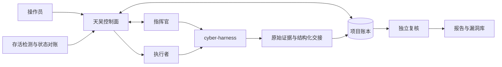
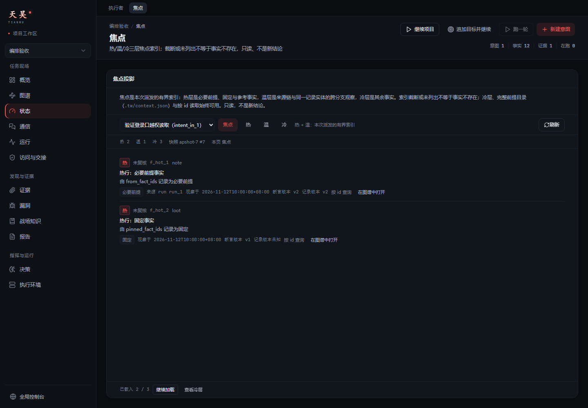
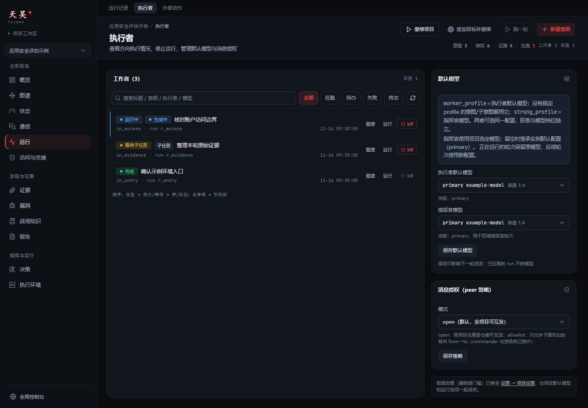

# 天吴 · Tianwu

**面向授权渗透测试的多智能体任务控制与证据管理系统。**

天吴以事实与意图图为共享状态，统一管理项目目标、任务依赖、执行记录、原始证据与复核结果。操作员定义授权和验收边界，指挥官组织任务，执行者提交结构化结果，看门狗负责存活检测与状态对账。

项目账本独立于模型会话保存，支持跨轮次检索、任务交接和整包迁移。系统面向单用户、单机、多项目部署，当前处于 0.x 预发布阶段，接口和数据格式仍可能调整。

[功能](#主要功能) · [架构](#架构与职责) · [界面](#控制台界面) · [安装](#安装与启动) · [项目迁移](#项目导入与导出) · [开发文档](#开发与文档) · [使用边界](#使用边界)

## 主要功能

| 功能 | 实现方式 |
| --- | --- |
| 事实与意图图 | 将任务前提、产出、引用和固定上下文保存为显式关系；区分事实断言、线索和原始证据 |
| 任务生命周期 | 管理方向派发、子任务、等待、交接、重试、停放和完成状态，记录每次运行的输入与结果 |
| 前提与复核 | 必要前提须通过当前断言版本的独立核验；成功方向进入固定复核阶段，复核结果绑定具体断言版本 |
| 长会话状态管理 | 复用 harness 会话与上下文压缩；笔记保存版本及写入者/轮次回执，支持续轮、交接及中断恢复 |
| 操作员监督 | 提供项目暂停与继续、持久指令、人工接管、待办收件箱、执行者状态和运行停止入口 |
| 执行观测 | 通过 AOP 采集运行事件、工具调用、命令及 HTTP 流量，保留协作消息与来源标识 |
| 模型与容量管理 | 支持多模型配置、默认绑定、并发容量、配置暂停、回退与显式连通性检测 |
| 项目迁移 | 以 `.twproj` 保存账本、工作区、证据和运行记录，校验文件摘要，导入后保持暂停 |

## 架构与职责

天吴负责项目控制、任务准入和账本持久化；独立的 cyber-harness fork 提供模型会话、原生工具、Skill 发现、会话续跑与上下文压缩。



| 职责 | 边界 |
| --- | --- |
| 操作员 | 定义项目目标、授权范围、测试时段和禁止事项，处理人工请求，决定启动与恢复 |
| 指挥官 | 根据当前账本组织方向、处理依赖与协作、判断目标进度；不能创建或改写操作员目标 |
| 执行者 | 承接具体方向，按验收条件提交事实声明、原始证据与未完成项 |
| 看门狗 | 执行确定性的存活检测和状态对账，记录中断原因；不承担策略判断，不从日志生成结论 |
| 复核与报告 | 独立检查断言及证据，生成可追溯的结果；不以消息送达或运行结束代替结论成立 |

执行者按方向和运行组织，不设置固定军衔。跨任务共享状态以账本为准；协作消息用于请求、通知与交接，消息内容不会自动成为事实。完整契约见[核心架构](docs/01-architecture.md)。

## 控制台界面

以下截图来自当前前端构建，全部使用离线合成数据，不包含真实项目、凭据或运行材料。

**事实与意图图谱。** 查看任务依赖、事实产出及当前执行状态。示例包含 100 个方向与 1,000 条事实，用于展示图谱界面，不作为测试效果或性能结论。


<table>
<tr>
<td width="50%" valign="top">
  
  <p><strong>断言与证据核对</strong><br/>查看当前断言版本、独立复核回执与关联原始材料。</p>
</td>
<td width="50%" valign="top">
  
  <p><strong>任务上下文</strong><br/>按热、温、冷层检索相关事实，保留版本与来源，支持分页续读。</p>
</td>
</tr>
<tr>
<td width="50%" valign="top">
  
  <p><strong>执行者监督</strong><br/>查看方向及最近运行，定位等待与中断，管理模型默认值和通信权限。</p>
</td>
<td width="50%" valign="top">
  
  <p><strong>模型配置</strong><br/>配置模型接口、并发容量与默认绑定，按需执行连通性检测。</p>
</td>
</tr>
</table>

项目工作区提供概览、图谱、状态、通信、运行、访问与交接、证据、漏洞、知识和报告视图。全局控制台用于管理项目、模型、共享知识、漏洞与 POC 资产。

## 安装与启动

### 环境要求

- Go 1.26 或更高版本，具体以两个仓库的 `go.mod` 为准。
- Git；修改前端时需要 Node.js 24+ 和 pnpm。
- 可用的模型 API，支持 OpenAI 兼容接口或 Anthropic Messages 接口。
- Windows 执行宿主需要 Git for Windows 提供的 Bash 与常用 POSIX 工具。

### 获取源码

```bash
git clone --recurse-submodules https://github.com/kksty/tianwu.git
git clone --branch tianwu/fixes https://github.com/kksty/cyber-harness.git
cd tianwu
```

`cyber-ui` 是控制台组件库子模块，使用 `kksty/cyber-ui` 的 `tianwu/console-tokens` 分支。已有 checkout 可执行 `git submodule update --init --recursive` 补齐子模块。harness 独立维护在 `tianwu/fixes` 分支，天吴主仓库使用 `main`。

### 构建并启动

Windows / PowerShell：

```powershell
pwsh -File scripts/build-harness.ps1 -HarnessDir ../cyber-harness
go build -o bin/tw.exe ./cmd/tw
./bin/tw.exe --aiscan ./bin/aiscan-full.exe --data ./data
```

Linux / macOS：

```bash
HARNESS_DIR=../cyber-harness sh scripts/build-harness.sh
go build -o bin/tw ./cmd/tw
./bin/tw --aiscan ./bin/aiscan-full --data ./data
```

默认访问地址为 `http://127.0.0.1:8080`。首次启动生成控制台登录令牌，保存在 `<data>/console.token`。新数据目录会创建一个空白默认项目；已有数据目录必须包含当前版本支持的 SQLite 账本，不会自动迁移旧 JSON 账本。

前端构建产物已纳入仓库，常规 Go 构建可直接使用。修改前端后，需要执行 `pnpm install` 和 `pnpm --dir web build` 更新嵌入产物。

### 配置与运行

1. 在“设置 → 模型”填写接口、API key、模型和上下文窗口，选择实例默认配置。只有一个模型时，同一配置可承担全部职责。
2. 显式执行连通性检测。检测成功只表示该次推理请求有效，不证明工具调用、长上下文或目标操作能力。
3. 创建项目，填写授权范围、测试时段、禁止事项、起点与终点目标，检查项目模型及运行配置。
4. 启动项目，通过概览收件箱、图谱、运行和证据视图检查进度，按需暂停或人工接管。
5. 复核结论与原始材料，再生成报告。项目完成或指挥官请求停止后保持暂停，恢复由操作员显式执行。

进程重启后项目默认暂停。暂停模型配置会阻止新调用，已开始的调用继续运行；继承该配置的新请求按回退契约选择可用模型，或明确报错。

### 常用启动参数

| 参数 | 默认值或用途 |
| --- | --- |
| `--addr` | `127.0.0.1:8080`，控制台监听地址 |
| `--data` | `./data`，实例数据目录 |
| `--aiscan` | harness 二进制路径，省略时从同目录及 PATH 查找 |
| `--harness-config` | 默认 `~/.cyber/cyber.yaml`，模型配置文件 |
| `--max-runs` | `3`，每项目默认执行者并发上限 |
| `--max-workers` | `0`，实例执行者总并发上限，0 表示不限 |
| `--round-timeout` | `15m`，指挥官单轮时限 |
| `--heartbeat` | `5m`，空闲心跳间隔 |
| `--no-decider` | 关闭自动指挥官，保留账本与手动派发 |

完整参数见 `tw --help`。

## 项目导入与导出

项目页支持以 `.twproj` 整包导出和导入，用于备份、换机与交接。

1. 暂停源项目，等待当前运行与指挥官轮次结束，再点击项目行的导出按钮。
2. 在接收实例的项目页点击“导入项目”，选择项目包。导入会校验文件路径、大小、SHA-256、账本 schema 及证据摘要；同 id 项目不会被覆盖。
3. 导入后项目保持暂停。检查证据、工作区、模型配置和方向绑定，确认后再继续。

项目包包含账本、持久笔记、方向工作区、原始证据、运行记录、原生产物及登录材料；不包含旧机器的运行时会话凭据、浏览器控制会话和租约，也不复制实例级模型 API 配置。接收实例须使用相同账本 schema（当前为 **13**），不存在跨 schema 自动迁移。

模型配置 id 属于实例本地引用。接收实例缺少对应配置时，需要重新设置项目默认模型及方向绑定。项目包本身不加密，应按原始项目资料保管。

<details>
<summary>查看项目管理界面</summary>


</details>

API：导出使用 `POST /api/projects/<id>/export`；导入使用 `POST /api/projects/import`，可上传包体，或通过 JSON `{"path":"..."}` 指定数据目录内的包。

## 开发与文档

```bash
pnpm install
pnpm --dir web typecheck
pnpm --dir web test
pnpm --dir web build
go build ./...
go test ./...
go vet ./...
node scripts/check-docs.mjs
```

`internal/web/static` 由 Go 嵌入，前端改动需同步更新产物。默认测试使用临时账本、本地假模型与合成数据；设置 `TW_AISCAN_BIN` 后可执行真实 harness 适配测试。这些检查验证实现与协议，不等同于实际项目效果评测。

- [核心架构](docs/01-architecture.md)：职责、数据模型、准入、协作和已知限制。
- [贡献指南](CONTRIBUTING.md)与[实现约定](agent.md)：开发检查及变更要求。
- [验收脚本](scripts/acceptance/README.md)：离线界面检查、截图复现与隔离集成验证。
- [知识卡维护](internal/kb/assets/README.md)与[条目格式](internal/kb/assets/entries/README.md)。
- 内置 Skill：[指挥官](internal/skills/assets/commander/SKILL.md)、[协作](internal/skills/assets/collaborate/SKILL.md)、[报告](internal/skills/assets/tianwu-report/SKILL.md)。

## 使用边界

控制台具有本机命令执行与文件访问权限，登录令牌应按主机凭据保护。默认仅监听本机，不应直接暴露到公网。当前实现不提供文件系统沙箱，也不逐请求强制校验目标是否属于授权范围；部署时需要独立控制运行环境、账户权限和网络访问。

模型输出、事实记录和复核通过是不同状态。结果应由操作员结合原始材料审查，系统不承诺发现率、测试完整性或无人值守的安全性。`data/`、模型配置、证据、浏览器登录材料与运行日志可能含敏感信息，不应提交到版本库或用于公开演示。

问题反馈请提供复现步骤、版本和脱敏日志。涉及天吴自身漏洞时，请按[安全策略](SECURITY.md)私下报告。

## 免责声明

- **仅限合法授权使用。** 本项目用于安全研究、学习及已获明确授权的安全测试。使用者应自行确认目标归属、授权范围和适用法律，禁止用于未授权访问、窃取数据、破坏系统或其他违法活动。下载、使用本项目不代表取得对任何第三方系统的测试授权。
- **结果须经人工核验。** 模型输出可能存在错误、遗漏或不当操作，生成的发现、证据说明和报告不保证准确、完整或可复现，不能直接作为安全、合规或业务决策的依据。
- **运行风险由使用者评估和控制。** 本项目及其调用的工具能够执行真实命令、访问网络和读写文件，可能造成数据泄露、数据损坏、服务中断及模型 API 费用。使用者应事先做好环境隔离、权限限制、数据备份与脱敏，并自行审查第三方模型和工具的数据处理条款。
- **按现状提供。** 在适用法律允许的范围内，作者与贡献者不提供适销性、特定用途适用性或不侵权等保证，亦不对使用或无法使用本项目产生的损失承担责任。具体保证与责任限制以 [LICENSE](LICENSE) 及适用法律为准。

## 致谢

感谢 [N1nEmAn](https://github.com/N1nEmAn) 的[女娲基座](https://github.com/N1nEmAn/nvwabase)与 [sapper-v2](https://github.com/N1nEmAn/sapper-v2)：其多 Agent 协作与内容资产设计为天吴提供了参考，部分事实知识卡改编自 sapper-v2。

感谢[链式反应（ChainReactors）](https://github.com/chainreactors)提供的 [cyber-harness](https://github.com/chainreactors/cyber-harness) 与 [cyber-ui](https://github.com/chainreactors/cyber-ui)：它们分别提供执行运行时和控制台组件基础。

## 许可证

天吴以 [AGPL-3.0](LICENSE) 发布。第三方内容的来源和许可见 [NOTICE](NOTICE)；独立依赖及子模块遵循各自许可证。
