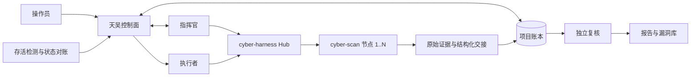
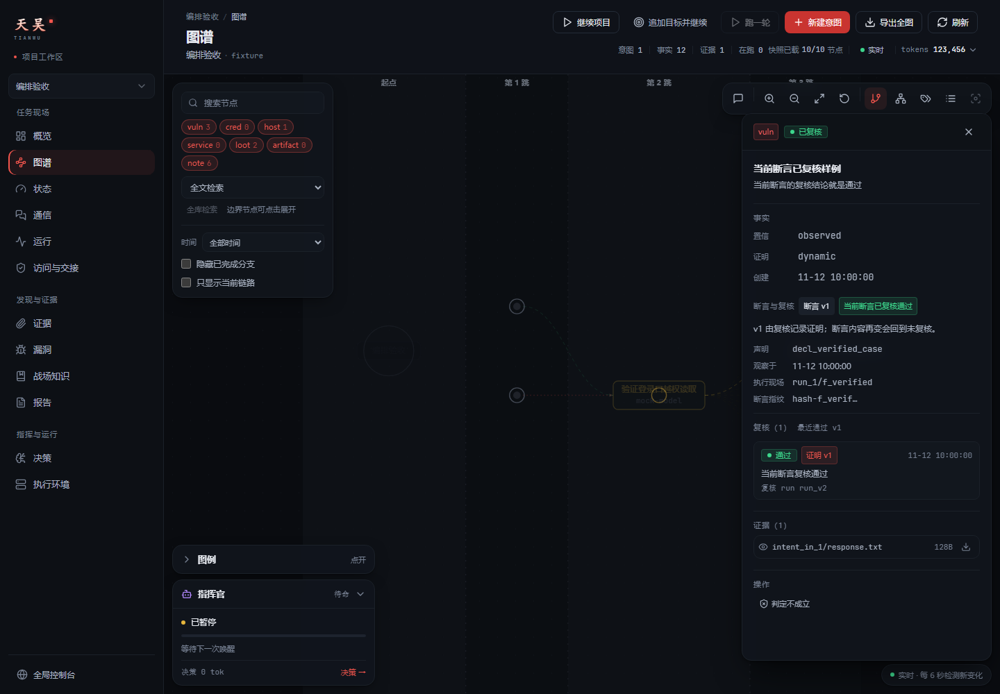
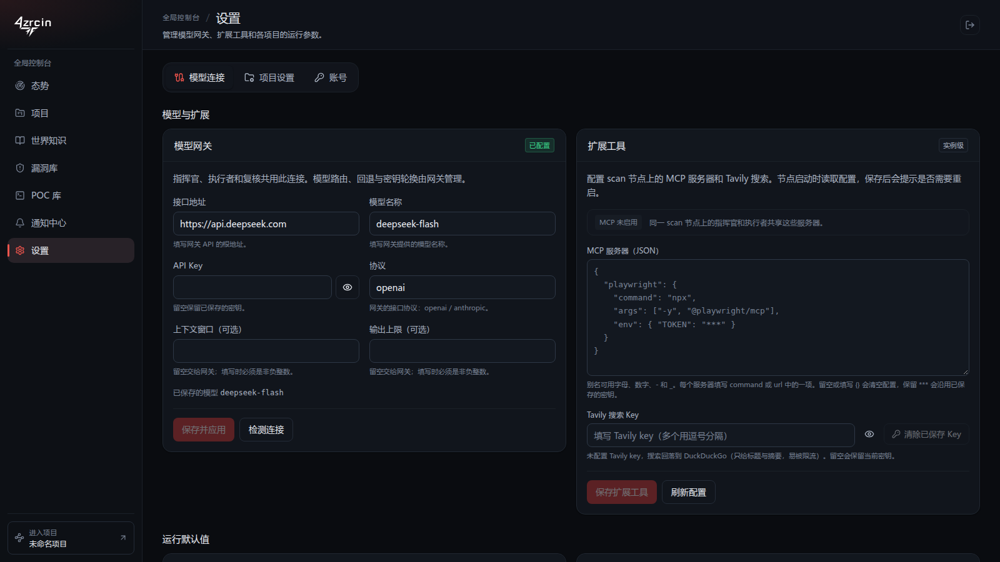
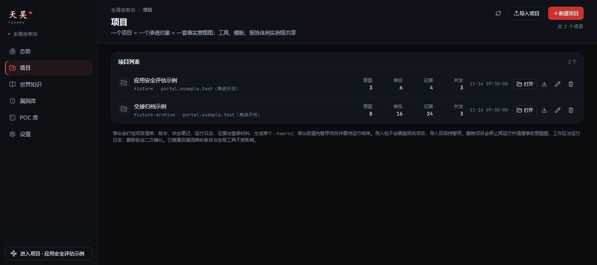

# 天吴 · Tianwu

**面向授权渗透测试的多智能体任务控制与证据管理系统。**

天吴以事实与意图图为共享状态，统一管理项目目标、任务依赖、执行记录、原始证据与复核结果。操作员定义授权和验收边界，指挥官组织任务，执行者提交结构化结果，看门狗负责存活检测与状态对账。

项目账本独立于模型会话保存，支持跨轮次检索、任务交接和整包迁移。系统面向单用户、单实例、多项目部署；一个实例监督本机 Hub + scan，并可复用同一原生 Hub 上的多个 scan 节点。当前处于 0.x 预发布阶段，接口和数据格式仍可能调整。

[功能](#主要功能) · [架构](#架构与职责) · [界面](#控制台界面) · [安装](#安装与启动) · [项目迁移](#项目导入与导出) · [开发文档](#开发与文档) · [使用边界](#使用边界)

## 主要功能

| 功能 | 实现方式 |
| --- | --- |
| 事实与意图图 | 将任务前提、产出、引用和固定上下文保存为显式关系；区分事实断言、线索和原始证据 |
| 任务生命周期 | 管理方向派发、子任务、等待、交接、重试、停放和完成状态，记录每次运行的输入与结果 |
| 前提与复核 | 必要前提须通过当前断言版本的独立核验；成功方向进入固定复核阶段，复核结果绑定具体断言版本 |
| 长会话状态管理 | 复用 harness 会话与上下文压缩；笔记保存版本及写入者/轮次回执，支持续轮、交接及中断恢复 |
| 操作员监督 | 提供项目暂停与继续、持久指令、人工接管、待办收件箱、执行者状态和运行停止入口 |
| 工具审批 | 需要人工决定的工具调用在 guardrail 命名空间挂起，由操作员在控制台批准或拒绝；审批只解除宿主对该调用的拦截，不代表执行成功；裁判可插拔（none/jev/llm/hybrid），JEV 判定沿用 harness 原生实现 |
| 执行观测 | 通过 AOP 采集运行事件、工具调用、命令及 HTTP 流量，保留协作消息与来源标识；token 按指挥官/执行者/裁判分账记录 |
| 模型与容量管理 | 统一模型网关连接、显式连通性检测、项目及实例并发上限；网关负责 Key 轮换和模型路由 |
| 项目迁移 | 以 `.twproj` 保存账本、工作区、证据和运行记录，校验文件摘要，导入后保持暂停 |

## 架构与职责

天吴负责项目控制、任务准入和账本持久化；独立的 cyber-harness fork 分为 Hub 与 scan：Hub 管理连接、模型配置和 AOP/IOA，scan 承载模型会话、原生工具、Skill 发现、会话续跑与上下文压缩。



| 职责 | 边界 |
| --- | --- |
| 操作员 | 定义项目目标、授权范围、测试时段和禁止事项，处理人工请求，决定启动与恢复 |
| 指挥官 | 根据当前账本组织方向、处理依赖与协作、判断目标进度；只能根据操作员明确消息代为变更目标，保留指令出处 |
| 执行者 | 承接具体方向，按验收条件提交事实声明、原始证据与未完成项 |
| 看门狗 | 执行确定性的存活检测和状态对账，记录中断原因；不承担策略判断，不从日志生成结论 |
| 复核与报告 | 独立检查断言及证据，生成可追溯的结果；不以消息送达或运行结束代替结论成立 |

执行者按方向和运行组织，不设置固定军衔。跨任务共享状态以账本为准；协作消息用于请求、通知与交接，消息内容不会自动成为事实。完整契约见[核心架构](docs/01-architecture.md)。

## 控制台界面

以下截图来自当前前端构建，全部使用离线合成数据，不包含真实项目、凭据或运行材料。

**事实与意图图谱。** 查看任务依赖、事实产出及当前执行状态。示例包含 100 个方向与 1,000 条事实，用于展示图谱界面，不作为测试效果或性能结论。


<table>
<tr>
<td width="50%" valign="top">
  
  <p><strong>断言与证据核对</strong><br/>查看当前断言版本、独立复核回执与关联原始材料。</p>
</td>
<td width="50%" valign="top">
  
  <p><strong>任务上下文</strong><br/>按热、温、冷层检索相关事实，保留版本与来源，支持分页续读。</p>
</td>
</tr>
<tr>
<td width="50%" valign="top">
  
  <p><strong>执行者监督</strong><br/>查看方向及最近运行，定位等待与中断，管理通信权限与协作状态。</p>
</td>
<td width="50%" valign="top">
  
  <p><strong>模型配置</strong><br/>配置统一模型接口，按需执行连通性检测；网关负责 Key 轮换和路由。</p>
</td>
</tr>
</table>

项目工作区提供概览、图谱、状态、通信、运行、访问与交接、证据、漏洞、战场知识、报告、决策和执行环境视图。全局控制台提供态势、项目、世界知识、漏洞库、POC 库与设置（模型连接、项目运行设置）。

## 安装与启动

### 环境要求

- Go 1.26 或更高版本，具体以两个仓库的 `go.mod` 为准。
- Git；Node.js 24+ 与 pnpm（前端构建、文档链接检查与本地 gate 需要）。
- 可用的模型 API，支持 OpenAI 兼容接口或 Anthropic Messages 接口。
- Windows 与 Linux 是同等支持的开发与验收平台，两者都使用 Go、Node.js 与 pnpm，不依赖某个平台专属工具链。Windows 执行宿主需要 Git for Windows 提供的 Bash 与常用 POSIX 工具。

### 获取源码

```bash
git clone --recurse-submodules https://github.com/kksty/tianwu.git
git clone --branch tianwu/fixes https://github.com/kksty/cyber-harness.git
cd tianwu
```

`cyber-ui` 是控制台组件库子模块，使用 `kksty/cyber-ui` 的 `tianwu/console-tokens` 分支。已有 checkout 可执行 `git submodule update --init --recursive` 补齐子模块。harness 独立维护在 `tianwu/fixes` 分支，天吴主仓库使用 `main`。该分支的补丁清单（编号与内容见 FORK.md；15–17 分别是 evaluator 短目标、reference scan 关闭 recap、scan 声明并装配 MCP，LLM 审批裁判由同一分支的后续补丁提供，JEV 保持原生）与升级、回滚步骤见 [cyber-harness FORK.md](https://github.com/kksty/cyber-harness/blob/tianwu/fixes/FORK.md)；天吴不复制 harness 源码或二进制，升级后要重建 Hub/scan、同步 AOP 生成文件并跑 gate。

### 构建并启动

一个实例由三个程序组成：`tw` 是控制面（账本、准入、调度与控制台），`cyber-harness` 是本机 Hub（AOP/IOA、模型配置），`cyber-scan` 是承载模型会话的 scan 节点。Hub 以 `full` tag 构建、scan 不以 `full` 构建，两者必须来自**同一次** harness 构建；`tw` 通过 `--harness` 与 `--scan` 指向它们，这是唯一入口。

Windows / PowerShell：

```powershell
pwsh -File scripts/build-harness.ps1 -HarnessDir ../cyber-harness   # -> bin/cyber-harness.exe + bin/cyber-scan.exe
go build -o bin/tw.exe ./cmd/tw
go build -o bin/tw-repair.exe ./cmd/tw-repair
./bin/tw.exe --harness ./bin/cyber-harness.exe --scan ./bin/cyber-scan.exe --data ./data
```

Linux / macOS：

```bash
HARNESS_DIR=../cyber-harness sh scripts/build-harness.sh
go build -o bin/tw ./cmd/tw
go build -o bin/tw-repair ./cmd/tw-repair
./bin/tw --harness ./bin/cyber-harness --scan ./bin/cyber-scan --data ./data
```

已经构建过时只启动（Linux / macOS 去掉 `.exe`）：

```powershell
./bin/tw.exe --harness ./bin/cyber-harness.exe --scan ./bin/cyber-scan.exe --data ./data
```

- 省略 `--harness` 时按 `tw` 同目录 → `./bin` → PATH 查找 `cyber-harness`；省略 `--scan` 时按 Hub 同目录 → PATH 查找 `cyber-scan`。可以省略，但建议显式写出：命令行本身说明了这对二进制是同一次构建的产物，升级时不会只换一半。
- 旧入口已移除：早期单二进制时代的 `--aiscan`（`--harness` 的兼容别名）不再被接受，`./bin/tw.exe --aiscan ./bin/aiscan-full.exe --data ./data` 会以 `flag provided but not defined: -aiscan` 退出。`aiscan-full.exe` 这类旧文件名也不是受支持的产物，Hub 只认 `cyber-harness`；`run.ps1 -Aiscan` 与 `AISCAN=` 同时移除。这样旧命令会立刻失败，而不是静默指向另一个名字的旧二进制。
- 源码运行：`./run.ps1 -Harness ./bin/cyber-harness.exe -Scan ./bin/cyber-scan.exe` 与 `HARNESS=./bin/cyber-harness SCAN=./bin/cyber-scan ./run.sh` 直接 `go run ./cmd/tw`，其余参数与上面一致。
- 一个控制台地址只允许一个实例：第二个 `tw` 在绑定端口时失败并提示先停旧实例，不会去动正在运行的宿主。

默认访问地址为 `http://127.0.0.1:8080`。首次启动生成控制台登录令牌，保存在 `<data>/console.token`。新数据目录会创建一个空白默认项目；已有数据目录必须包含当前版本支持的 SQLite 账本，不会自动迁移旧 JSON 账本。

前端构建产物已纳入仓库，常规 Go 构建可直接使用。修改前端后，需要执行 `pnpm install` 和 `pnpm --dir web build` 更新嵌入产物。

如需用 `scripts/install-local.ps1` 把构建产物安装到 `bin/`，先把 `tw.exe`、`cyber-harness.exe`、`cyber-scan.exe` 和 `tw-repair.exe` 放到候选目录 `.build/release`（脚本默认 `-From`），再运行 `pwsh -File scripts/install-local.ps1`。脚本只替换 `bin/` 下的程序，不启动服务，也不读写运行数据。

### 配置与运行

1. 在“设置 → 模型连接”填写外部网关的接口、单个 API key、模型和上下文窗口；全部角色共用此连接。
2. 显式执行连通性检测。检测成功只表示该次推理请求有效，不证明工具调用、长上下文或目标操作能力。
3. 创建项目，填写授权范围、测试时段、禁止事项、起点与终点目标，检查项目运行设置。
4. 启动项目，通过概览收件箱、图谱、运行和证据视图检查进度，按需暂停或人工接管。
5. 复核结论与原始材料，再生成报告。项目完成或指挥官请求停止后保持暂停，恢复由操作员显式执行。

harness evaluator（验收评估器）不是独立模型或 JEV：它用当前统一模型连接（与 commander/执行者同一 provider/model）发独立请求判定验收；JEV 只作可选的工具裁判/加速，与此处的通过/未通过判定无关。天吴的独立复核由 verifier 另开 run，同样走该连接。harness 配置里的 `eval_model` 字段当前未消费，评估固定用会话模型（已知限制）；运行页的评估说明按此显示。

进程重启后项目默认暂停。暂停后仍有未完成目标时，可让指挥官核对已有证据并收口；证据不足不会标记完成。Key 轮换、强弱模型与回退交给外部网关，天吴保留动态子任务分配、并行会话和涌现协作。一个 Hub 可连接多个 scan；天吴监督本机 Hub + scan，自动发现同 Hub 其他 scan；执行环境 → 节点管理项目启用节点和默认节点。多个节点须共享相同绝对路径的项目目录；跨机器时配置可达的 --host-addr 与 --agent-api-base。

设置页的模型连接优先在线应用：只改 shared 段（llm/agent/traffic）时，控制面把文档推给运行中的本机宿主并等待它报告新的 provider/model；宿主离线、拒绝或超时回退重启，响应以 `applied=online|restart|saved`、`requires_restart`、`restart_reason` 说明结果。产品配置（MCP/search/guardrail/JEV）只在 scan 启动时读取，改了必须重启本机宿主。

观测与流量：本地 scan 固定采集 HTTP 流量；进程环境设置 `OTEL_EXPORTER_OTLP_ENDPOINT`（或 `OTEL_EXPORTER_OTLP_TRACES_ENDPOINT` / `OTEL_EXPORTER_OTLP_METRICS_ENDPOINT` / `OTEL_EXPORTER_OTLP_LOGS_ENDPOINT`）任一时，额外采集工具、命令与进程观测交给 OTel exporter，不设置则只保留 HTTP。宿主运行配置默认把 HTTP 正文存到磁盘（`traffic.body_storage: disk`）；操作员在 `--harness-config` 指向的 `cyber.yaml` 中显式写的 traffic 值逐字段优先。抓包元数据带 `preview_only` / `truncated`：正文未落盘时只展示受限预览，旧记录不回填缺失正文。

HTTP 正文保留只有 scan 节点一级预算：harness 的 `traffic.body_storage: disk`（默认）把正文存进 scan 捕获目录，`traffic.body_retention_bytes`（默认 2 GiB）限制该目录保留量、同一 scan 上的所有项目共享，`traffic.body_max_bytes`（默认 8 MiB）限制单条正文。操作员可在设置页“流量捕获保留上限”（`traffic_body_retention_bytes`，MiB，默认 2048，范围 16..1,048,576，0/未设置表示用默认 2 GiB）修改，写入 `cyber.yaml` 的 `traffic.body_retention_bytes`；这是 scan 启动配置，保存后控制台显示需重启（宿主离线时为下次启动生效），重启本机宿主后生效，所有项目共享同一预算。正文超限后的淘汰/截断由 harness 按 `body_max_bytes` 与 retention 预算自行管理，控制台只按 harness 的 `preview_only`/`truncated` 标记展示正文是否完整。

token 分账：指挥官、执行者与裁判（JEV/LLM 审批裁判）分开记录，复核/报告 support run 单列；裁判 usage 不写入执行 run 的 token，而是以 run journal `kind=judge_usage`（`judge=jev|llm`、`input`/`output`/`total`、`emitter=guardrail|guardrail-llm`）落账，run 自身仍记 `kind=usage`。其中 JEV 用量是 harness 原生 JEV 的附加上报（只为分账，不改变其判定逻辑与两阶段流程），LLM 用量来自可插拔小模型裁判。汇总为 `executor_total=执行者+support`、`combined=指挥官+executor_total`、`all=combined+裁判`，由项目级只读 API `GET /p/<项目>/api/usage/breakdown` 提供；无数据如实说明，不伪造 0。

#### 产品扩展与 MCP

MCP/search/guardrail/JEV 是 scan 节点的扩展配置，只写在 `--harness-config`（默认 `~/.cyber/cyber.yaml`）的 `extensions` 段；写在天吴设置页的 MCP 与搜索键也会落到这里。MCP 服务器在 scan 启动时装配，没有 `mcpServers` 或为空时不装载扩展——默认不配置=不装配、不可见。配置后命令注册在 scan 节点的进程级命令注册表：同一节点上指挥官与执行者的所有会话都能看到并使用，不按角色或项目隔离，其他节点/宿主看不到；按项目/角色限制当前未实现，设置页 MCP 卡会显示是否启用、服务器数量与该边界。`tools` 省略表示挂载全部工具，`[]` 表示不挂载；env/headers 在设置页读回 `***` 掩码，保留掩码保存会沿用已存值：

```yaml
extensions:
  mcp:
    mcpServers:
      ida:
        command: idalib-mcp
        args: ["--stdio", "--max-workers", "1"]
        startupTimeoutSeconds: 30
        timeoutSeconds: 300
  search:
    tavily_keys: key-one,key-two
```

顶层写 `mcp`/`search`/`guardrail`/`jev` 会被 harness 以 unknown configuration field 拒绝；天吴保存设置时会提示改到 `extensions.<section>` 下。

#### 工具审批（Guardrail：LLM 裁判可插拔）

策略在工具调用前判定，需要人工决定时在 guardrail 命名空间挂起该调用；天吴只转发待审批项与决定，不执行工具，harness 会话读写返回 403 `operator_only`。可插拔的是 **LLM 审批裁判**；JEV 判定与两阶段流程沿用 harness 原生实现，本轮未改。配置在 `--harness-config` 的 `extensions.guardrail`（`provider` 默认 `none`）：

- `none`：默认，不启用自动判定；只配置凭据不会启用策略。
- `jev`：选择 harness 原生 JEV 实现（两阶段风险 + 后果判定，行为与旧版一致，本轮未改）。
- `llm`：可插拔的 OpenAI 兼容小模型裁判；非流式、temperature 0、max_tokens 128，默认单次超时 3s、并发 8，输出 `ALLOW`/`REVIEW`/`BLOCK`。语义是强放行偏置：默认允许、不确定或没把握也允许，只有明确破坏可用性/数据完整性/系统配置才拦截。
- `hybrid`：先由小模型判定，仅明确为 `REVIEW` 时调用既有 JEV 复核（低置信 `ALLOW` 不升级，JEV 判定逻辑不变）。

JEV 不是默认路径：部署环境无法访问 JEV 出口时应选 `llm`/`hybrid`/`none`。可以只配 `provider: llm` 与 `llm` 子段（不加载 JEV、不需要 JEV 凭据），也可以完全不配（默认 `none`）；`none` 时审批 API 返回 `unavailable`。`scope` 只按工具名缩小检查面（空=全部；未列入工具不做判定，可用未列入工具绕过，不是隔离）；`allow_prefixes` 仅在 `mode: safe` 下生效、按字面前缀匹配、不做语义分析（`ls` 会命中 `lsof`，命令拼接仍可能命中）；`shadow` 只判定并记录、永远放行（灰度统计用）；`on_error` 取 `allow`/`review`/`block`、默认 `review`（仅 llm/hybrid 生效）。未启用策略或宿主没有 guardrail 命名空间时，读取返回 `unavailable` 状态与原因，不当作空列表：

```yaml
extensions:
  guardrail:
    provider: llm              # none | jev | llm | hybrid，默认 none
    mode: auto
    review_timeout: 5m         # 人工审批最长等待
    timeout: 3s                # LLM 单次请求超时
    concurrency: 8             # 并发裁判上限
    on_error: review           # allow | review（默认）| block
    scope: [bash, subagent]    # 只判定这些工具名；省略=全部
    allow_prefixes: ["ls ", "cat "]  # 仅 mode: safe 下生效
    shadow: false              # true=只判定记录、永远放行
    llm:
      base_url: https://gateway.example/v1
      model: judge-small
      api_key: ""              # 本地网关可留空
      temperature: 0
      max_tokens: 128
```

需要 JEV/hybrid 时再补 `extensions.guardrail.jev` 与 `extensions.jev` 凭据；`provider: jev` 只是选择 harness 原生实现，不是本轮可插拔改造的对象。

`on_error: allow` 是显式的安全取舍：守门不可用或裁判失败时会自动放行，控制台设置页的守门策略卡会展示“守门未生效时自动放行”、LLM 判定语义、scope/前缀与 `shadow` 状态，不能把这种放行当成已判定通过。

操作员在收件箱或运行页的「工具审批」卡片里批准或拒绝，底层是 operator-only API：`GET /p/<项目>/api/guardrail/pending`（可带 `?session=<id>`；返回 `state=available|unavailable`、`pending` 与逐会话结果）与 `POST /p/<项目>/api/guardrail/resolve`（JSON `{"session_id":"…","operation_id":"…","approve":true|false,"reason":"…"}`；`approve` 必填，`resolved` 才表示宿主接受，`failed`/`unavailable` 带原因，未解决返回 409）。操作员的读取/解决动作写 `kind=guardrail` journal；裁判判定与人工审批另以结构化事件落账 `kind=guardrail_decision` / `kind=guardrail_review`（字段 `guardrail_action` record/review/block、`guardrail_reason`、`guardrail_tool`、`guardrail_state`、`guardrail_call_id`、`guardrail_operation_id`），运行页可审计每次判定与审批（含放行）。审批只解除宿主对该调用的拦截，工具随后是否成功、是否产出证据由执行与账本决定；审批不代表执行成功或结论成立。

### 常用启动参数

控制台与宿主：

| 参数 | 默认值或用途 |
| --- | --- |
| `--addr` | `127.0.0.1:8080`，控制台监听地址；一个地址只允许一个实例 |
| `--data` | `./data`，实例数据目录（账本、项目、证据、`console.token`） |
| `--harness` | cyber-harness Hub 路径，省略时从同目录及 PATH 查找 |
| `--scan` | cyber-scan 节点路径，省略时从 Hub 同目录及 PATH 查找 |
| `--host-addr` | `127.0.0.1:18766`，本机 Hub 监听地址；被占用时自动换空闲端口 |
| `--agent-api-base` | scan 可访问的控制面 URL，多机部署时显式设置，默认由 `--addr` 推导 |
| `--harness-config` | 默认 `~/.cyber/cyber.yaml`，harness 用户配置；设置页直接读写它 |
| `--console-token` / `--console-token-file` | 控制台登录令牌或其文件；默认读 `TW_CONSOLE_TOKEN`，都没有时首次启动在 `<data>/console.token` 生成 |
| `--require-host-ready` | 本机宿主未就绪就退出；默认降级启动控制台，模型修好后宿主自动重启 |
| `--project` | 启动时打开哪个项目，省略时用第一个 |
| `--version` | 打印版本后退出 |

派发与会话：

| 参数 | 默认值或用途 |
| --- | --- |
| `--max-runs` | `3`，每项目默认执行者并发上限；项目可在设置中覆盖 |
| `--max-workers` | `0`，实例执行者总并发上限，0 表示不限；purpose run 不计入 |
| `--allow-native-subagent` | 默认 true；原生 subagent 是父回合内的临时助手，设为 false 排除该工具 |
| `--round-timeout` | `15m`，指挥官单轮墙钟上限；超时按 canceled 截断 |
| `--heartbeat` | `5m`，空闲心跳间隔 |
| `--debounce` | `3s`，唤醒去抖窗口 |
| `--timeout` | `0`，单次 run 时限，0 表示不限 |
| `--idle-timeout` | `30m`，run 无事件超过该时长即取消，0 表示关闭 |
| `--max-evidence` | `200`，每次 run 自动登记的证据文件上限；交接口显式声明的证据不受此限 |
| `--scope` | 新建项目的授权范围，注入每份派发简报 |
| `--skills` | 额外的 harness skills，逗号分隔（名字或 SKILL.md 路径） |
| `--model` / `--model-url` / `--model-key` | 覆盖模型名/端点/Key，默认读 `CYBER_MODEL` / `CYBER_BASE_URL` / `CYBER_API_KEY` |
| `--no-decider` | 关闭自动指挥官，保留账本与手动派发 |

完整参数见 `tw --help`。

### 离线修复交接游标

交接摄取遇到存储写入失败时会保留消费游标，不会跳过未落库的声明；旧数据也可能出现“声明文件已消费、账本里没有对应断言”。这类不一致不自动重放，需要停掉控制面后显式修复：

1. 在控制台暂停项目，并停止 `tw`（修复程序直接读写 `ledger.sqlite` 和方向工作区）。
2. 运行 `tw-repair --project <项目绝对目录> --intent <精确方向 ID>`。默认只输出计划：目标游标 `before`/`through`、交接文件摘要、唯一匹配数与仍需核对的 `problems`。
3. `problems` 为空时加 `--commit` 写入游标。命令先把含修复前游标和文件摘要的审计记录写进方向工作区，再推进游标；它不改写任何事实，提交前会复核游标与交接文件未被改动。

修复只跳过已按原摘要保全、且可与已落库断言逐条对齐的声明。细节见[核心架构](docs/01-architecture.md)。

## 项目导入与导出

项目页支持以 `.twproj` 整包导出和导入，用于备份、换机与交接。

1. 暂停源项目，等待当前运行与指挥官轮次结束，再点击项目行的导出按钮。
2. 在接收实例的项目页点击“导入项目”，选择项目包。导入会校验文件路径、大小、SHA-256、账本 schema 及证据摘要；同 id 项目不会被覆盖。
3. 导入后项目保持暂停。检查证据、工作区和实例模型连接，确认后再继续。

项目包包含账本、持久笔记、方向工作区（含声明文件与消费游标）、原始证据、运行记录、原生产物及登录材料；不包含旧机器的运行时会话凭据、浏览器控制会话和租约，也不复制实例级模型 API 配置。接收实例须使用相同账本 schema（当前为 **13**），不存在跨 schema 自动迁移。

历史运行保留当时的模型元数据，新运行统一使用接收实例的模型连接。项目包本身不加密，应按原始项目资料保管。

<details>
<summary>查看项目管理界面</summary>



</details>

API：导出使用 `POST /api/projects/<id>/export`，包写入 `<data>/exports/`，返回 `{name,url,size,manifest}`（manifest 含文件数、证据数与该包中缺失证据的清单），再用 `GET /api/exports/<name>` 下载；导入使用 `POST /api/projects/import`，可上传包体，或通过 JSON `{"path":"..."}` 指定数据目录内的包。

上传包和解包中间文件暂存在 `<data>/.transfer/`。服务取得控制台监听地址后会清理上次中断的导入暂存。

## 开发与文档

版本与逐条变更见 [CHANGELOG.md](CHANGELOG.md)；从构建产物怎么起一个实例见[部署清单](docs/02-deploy.md)的「从构建产物起一个实例」。

### 本地 gate

项目当前不依赖持续集成，提交前在本地运行 gate 替代 CI。检查只有一份实现（`cmd/tw-gate`），[scripts/gate.ps1](scripts/gate.ps1) 与 [scripts/gate.sh](scripts/gate.sh) 只是定位仓库根、透传参数和退出码的薄入口，因此 Windows 与 Linux 执行同一套检查，任一平台都不减少检查项：

Windows / PowerShell：

```powershell
pwsh -File scripts/gate.ps1
```

Linux / macOS：

```bash
./scripts/gate.sh          # 或 bash scripts/gate.sh
```

macOS 与 Linux 共用同一个薄入口；`make gate` 等价。gate 串行执行并逐步打印耗时：`go build ./...`、`go vet ./...`、`go test ./... -count=1`、前端 `pnpm --dir web typecheck` / `test` / `build`、嵌入产物新鲜度、`node scripts/check-docs.mjs`、AOP 生成代码漂移检查，再从 harness 源码构建 `cyber-harness` + `cyber-scan`、构建 `bin/tw` 与 `bin/tw-repair`，最后生成构建清单。任一步失败时 gate 以非零退出码结束。

常用参数（两平台相同）：

| 参数 | 用途 |
| --- | --- |
| `-skip-web` | 显式跳过前端检查（typecheck/test/build 与新鲜度）；默认不跳过 |
| `-skip-harness` | 显式跳过 harness 二进制构建；默认不跳过，源码缺失时失败并给出 clone 指引（源存在时 AOP 漂移检查仍会运行） |
| `-harness-dir <目录>` | harness 源码目录；默认依次取 `HARNESS_DIR`、`.build/harness-src`、同父目录的 `cyber-harness` |
| `-test-flags "-timeout 20m"` | 透传给 `go test` |
| `-manifest-out <路径>` | 清单输出路径，默认 `.build/build-manifest.json` |
| `-manifest-only` | 只生成清单，不执行检查与构建 |
| `-no-model-probe` / `-model-probe=false` | 关闭模型探测；默认开启（一次 `max_tokens=1` 的极小请求） |

只生成清单：`pwsh -File scripts/gate.ps1 -manifest-only` 或 `./scripts/gate.sh -manifest-only`（也可 `make manifest`）。

### AOP 生成代码与 harness 升级

`internal/aop` 下的 `*.pb.go` 是 cyber-harness 生成文件的 vendored 副本，只允许改写 import/package，不手改。gate 在 harness 构建前逐对比对 vendored 与 harness 源（归一化 protoc 版本头、注释、换行、package 行与 import 路径后取 SHA-256）：不一致时失败并打印首个差异与修复命令；harness 源缺失时该步记录 skip、不使 gate 失败。构建清单的 `aop_proto` 记录状态、fingerprint、逐文件摘要与 harness commit。

升级 harness 后同步生成文件（只复制上游生成文件，不改语义；复制后立即复检）：

Windows / PowerShell：

```powershell
pwsh -File scripts/sync-aop-protos.ps1              # 复制并复检
pwsh -File scripts/sync-aop-protos.ps1 -aop-dry-run # 只列出将写入的差异
```

Linux / macOS：

```bash
bash scripts/sync-aop-protos.sh
bash scripts/sync-aop-protos.sh -aop-dry-run
```

只检查不写盘：`go run ./cmd/tw-gate -check-aop-protos`。harness 源解析顺序与 gate 相同（`-harness-dir`、`HARNESS_DIR`、`.build/harness-src`、同父目录 `cyber-harness`）。同步后仍需跑完整 gate 并提交更新后的生成文件；fork 补丁与 rebase、重建、回滚步骤见 [CONTRIBUTING.md](CONTRIBUTING.md#开发环境与检查)与 harness 仓库 `FORK.md`。

### 构建清单

gate 结束时写 `.build/build-manifest.json`（`.build/` 不入库；清单含本机绝对路径与本地模型配置信息，不要提交）。它回答“这次检查测的是哪份源码、哪个二进制”：

- 源码身份：仓库根、git commit/branch/commit subject、dirty、工作树补丁 SHA-256（`git diff HEAD` 字节 + 未跟踪文件清单与内容摘要）、`cyber-ui` 子模块 commit。
- harness 身份：源码目录、branch/commit/dirty，以及 `cyber-harness` / `cyber-scan` 的路径、大小、SHA-256 与 `--version` 输出。
- AOP 生成代码：`aop_proto.status`（ok/mismatch/skipped）、聚合 fingerprint、逐文件 SHA-256、harness commit 与 mismatch；`checks` 记录每步耗时及被跳过步骤的原因。
- 控制面二进制：`bin/tw`、`bin/tw-repair` 的路径、大小、SHA-256 与 `--version`。
- 协议/数据版本：`ioa.ProtocolVersion`、`store.CurrentSchemaVersion()`、bundle 与 graph 版本常量，直接 import 常量以免漂移。
- 平台与工具链：GOOS/GOARCH、`go version`、node/pnpm 版本。缺失的工具记 null 并在 `platform.errors` 说明原因，不使 gate 失败。
- 模型连接：`--harness-config` / `TW_HARNESS_CONFIG` / `~/.cyber/cyber.yaml` 中 active profile 的 provider、配置的 model id、base_url 的 scheme+host。默认探测记录响应里的真实 model id；网关在响应头报告上游模型时另记 `upstream_model` / `upstream_provider`。API key 只记录是否存在，绝不写入清单；无配置或探测失败只记录原因，不使 gate 失败。

Windows 与 Linux 的清单字段一致、路径统一用 `/`，可以互相对照。在两平台分别跑 gate 时把 Linux 清单写到另一个文件（例如 `-manifest-out .build/build-manifest.linux.json`），不要覆盖 Windows 清单。

### 纵向指标

`cmd/tw-metrics` 以只读方式计算 13 项指标（只记录，不设阈值、不设目标）：

```bash
go run ./cmd/tw-metrics --project <项目目录> [--json]
```

其中七项纵向指标是交接回执有效率、操作员指令消费延迟、停测后事实数、未消费已验证事实数、方向停顿率、环境误判比例、复核排队/执行耗时；另外六项能力使用指标（键 `eval_pass_rate`、`eval_rounds_max`、`eval_rounds_avg`、`guardrail_actions`、`traffic_body_coverage`、`media_preserved`）衡量评测判定、守门动作、HTTP 正文保真与媒体留存是否被真正使用、结构化结果是否成立。每项输出 `value`、`unit`、`numerator/denominator`、`definition` 与不可得时的 `unavailable` 原因；指标只由结构化字段派生（run 目的/状态/时间、notebook 写者与回执、消息投递与引用、verifier 队列/执行字段、`operator-scope.jsonl` 的 stop 条目、run journal 的评测/守门/媒体事件、抓包的 `preview_only`/`truncated` 标记），不按标题或关键词分类。读取使用 SQLite `mode=ro&immutable=1`（存在非空 WAL 时先复制到临时目录），不会写项目目录或生成 `-wal/-shm`。历史项目早于该旁路文件时“停测后事实数”记 0 并注明；没有结构化环境信号时“环境误判比例”输出 `unavailable(no_structured_signal)`，不用 0 冒充。提示词/日志金样在 `internal/api/testdata/prompt-golden/`，两平台跑同一字节；有意修改提示词后用 `go test ./internal/api -run TestPromptGoldenContract -update-prompt-golden` 重新生成并审阅 diff。

### 双平台前提与依赖

Windows 与 Linux 同等支持：两平台都需要 Go 1.26+、Node.js 24+、pnpm 与 Git，并且都能完整跑通同一套 gate。先初始化 `cyber-ui` 子模块并安装前端依赖（每个平台各自执行一次 `pnpm install`，原生依赖按平台安装）：

```bash
git submodule update --init --recursive
pnpm install
git clone --branch tianwu/fixes https://github.com/kksty/cyber-harness.git .build/harness-src
```

harness 源码独立维护，gate 通过 `-harness-dir` / `HARNESS_DIR` / `.build/harness-src` / 同父目录的 `cyber-harness` 找到它。Linux 上用发行版包或官方 tarball 安装 Node.js 24+ 后安装 pnpm，例如 Debian/Ubuntu：

```bash
sudo apt-get update && sudo apt-get install -y nodejs npm git golang-go
sudo npm i -g pnpm
```

发行版自带的 Node 太旧时（`node --version` 低于 24），按 Node.js 官方文档把 Node 24 解压到用户目录并把其 `bin` 加入 `PATH`，再执行 `npm i -g pnpm`。部分发行版的 Node 24 包在编译时没有启用 TypeScript 支持（`node -p "process.config.variables.node_use_amaro"` 输出非 `true`），此时 `pnpm --dir web test` 会报 `ERR_UNKNOWN_FILE_EXTENSION`/`ERR_NO_TYPESCRIPT`，请改用 Node.js 官方二进制包（其内置 Amaro/type stripping）。较新的 npm 默认跳过依赖包的安装脚本，可能导致 pnpm 启动器不完整（`pnpm --version` 报错或输出异常）；遇到时用 `sudo npm i -g --allow-scripts=pnpm pnpm` 重装，或执行 `corepack enable pnpm`。Windows 用官方安装包或 `winget install OpenJS.NodeJS.LTS`，然后 `npm i -g pnpm`。安装完成后两平台都可用同一条命令验证：`go version`、`node --version`、`pnpm --version`、`git --version`。

`TW_HARNESS_BIN` 与 `TW_SCAN_BIN` 指向已构建的 Hub 与 scan 二进制时，`go test ./...` 会额外执行真实 harness 适配测试；不设置时这些测试跳过。它们不替代 gate 的 harness 重建与清单记录。

在 WSL 中直接使用 Windows 上的 checkout（`/mnt/c`）时，先让 WSL 的 git 与 Windows 检出一致：`git config --global core.autocrlf true`（Git for Windows 默认如此），否则 WSL 的 git 会把整棵树报告为已修改；原生 Linux checkout 不需要。gate 自身的 git 查询已忽略文件模式差异（`core.fileMode=false`）。

`internal/web/static` 由 Go 嵌入，前端改动后必须重新构建并一并提交；gate 的嵌入产物新鲜度检查会检出“改了 `web/` 但没提交重建产物”的情况（工作树原本就脏不算失败，只有本次重建新产生的差异才失败）。默认测试使用临时账本、本地假模型与合成数据；这些检查验证实现与协议，不等同于实际项目效果评测。

- [核心架构](docs/01-architecture.md)：职责、数据模型、准入、协作、harness 能力使用面与已知限制。
- [部署清单](docs/02-deploy.md)：三个二进制各自的归属、重建顺序与上线核对项。
- [贡献指南](CONTRIBUTING.md)与[实现约定](agent.md)：开发检查及变更要求。
- [验收脚本](scripts/acceptance/README.md)：离线界面检查、截图复现与隔离集成验证。
- [知识卡维护](internal/kb/assets/README.md)与[条目格式](internal/kb/assets/entries/README.md)。
- 内置 Skill：[指挥官](internal/skills/assets/commander/SKILL.md)、[协作](internal/skills/assets/collaborate/SKILL.md)、[报告](internal/skills/assets/tianwu-report/SKILL.md)。

## 使用边界

控制台具有本机命令执行与文件访问权限，登录令牌应按主机凭据保护。默认仅监听本机，不应直接暴露到公网。当前实现不提供文件系统沙箱，也不逐请求强制校验目标是否属于授权范围；部署时需要独立控制运行环境、账户权限和网络访问。

模型输出、事实记录和复核通过是不同状态。结果应由操作员结合原始材料审查，系统不承诺发现率、测试完整性或无人值守的安全性。`data/`、模型配置、证据、浏览器登录材料与运行日志可能含敏感信息，不应提交到版本库或用于公开演示。

问题反馈请提供复现步骤、版本和脱敏日志。涉及天吴自身漏洞时，请按[安全策略](SECURITY.md)私下报告。

## 免责声明

- **仅限合法授权使用。** 本项目用于安全研究、学习及已获明确授权的安全测试。使用者应自行确认目标归属、授权范围和适用法律，禁止用于未授权访问、窃取数据、破坏系统或其他违法活动。下载、使用本项目不代表取得对任何第三方系统的测试授权。
- **结果须经人工核验。** 模型输出可能存在错误、遗漏或不当操作，生成的发现、证据说明和报告不保证准确、完整或可复现，不能直接作为安全、合规或业务决策的依据。
- **运行风险由使用者评估和控制。** 本项目及其调用的工具能够执行真实命令、访问网络和读写文件，可能造成数据泄露、数据损坏、服务中断及模型 API 费用。使用者应事先做好环境隔离、权限限制、数据备份与脱敏，并自行审查第三方模型和工具的数据处理条款。
- **按现状提供。** 在适用法律允许的范围内，作者与贡献者不提供适销性、特定用途适用性或不侵权等保证，亦不对使用或无法使用本项目产生的损失承担责任。具体保证与责任限制以 [LICENSE](LICENSE) 及适用法律为准。

## 许可证

天吴以 [AGPL-3.0](LICENSE) 发布。第三方内容的来源和许可见 [NOTICE](NOTICE)；独立依赖及子模块遵循各自许可证。
