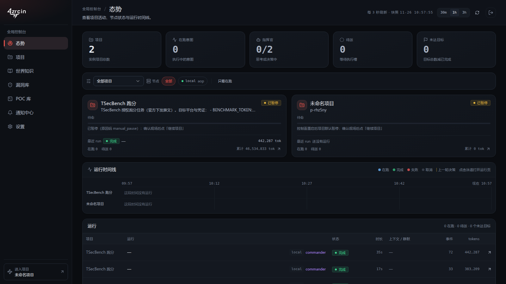
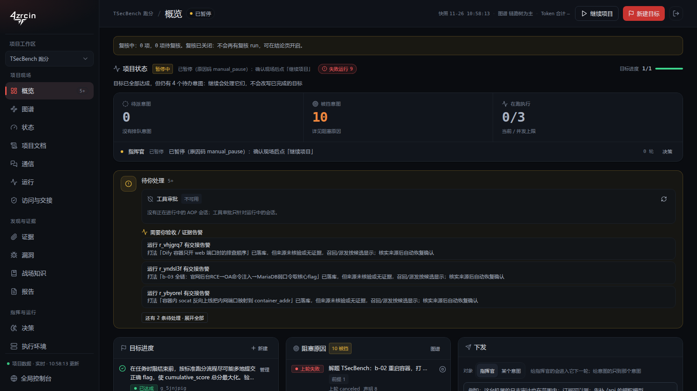
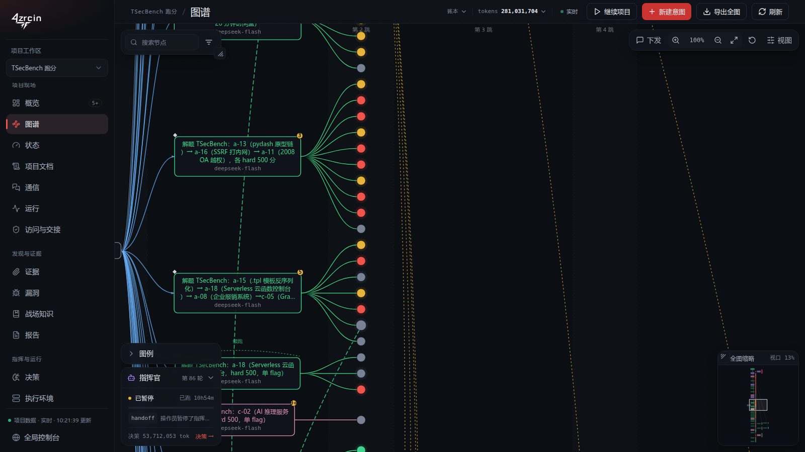
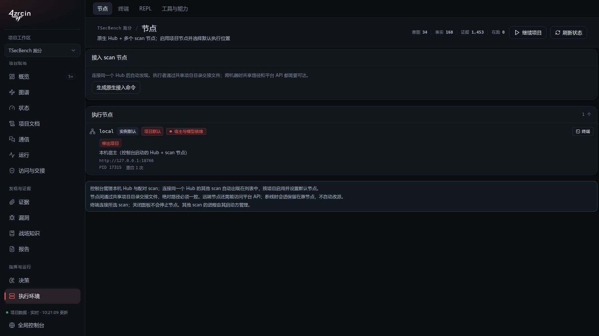
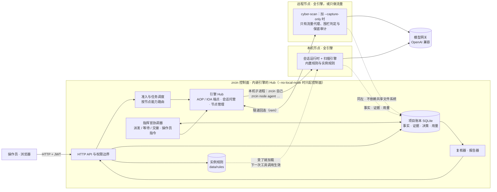
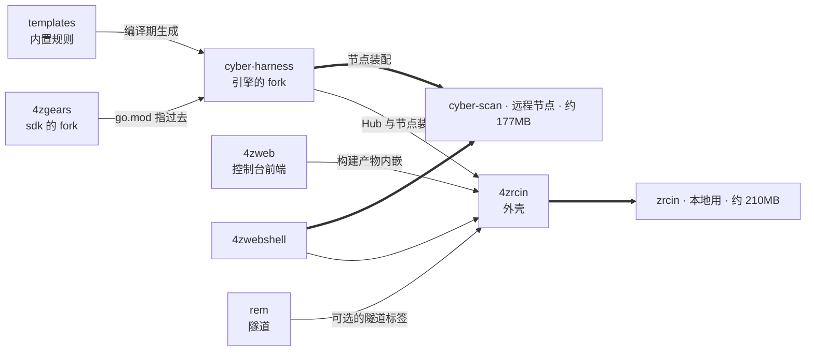

# 4zrcin

单用户、单实例、多项目的授权安全测试平台。操作员写清范围与验收标准；指挥官把意图派给执行者，执行者在扫描节点上跑模型会话、调用工具；事实、证据与用量落进持久账本，由复核器独立核验。人随时可以暂停、发指令、接管，或批准一次工具调用。

fork 自 [Saker](https://github.com/kksty/saker)（原名 Tianwu，AGPL-3.0）。图谱、意图生命周期、账本与复核沿用它；fork 之后做的是平台化：单文件部署、引擎积木化、节点接入、规则热加载。怎么拆、怎么并，见 [docs/19](docs/19-decoupling-plan.md)。

> **0.x 版本。** 接口、账本格式与运行行为在 1.0 之前仍会变。升级前备份 `data/`；不要用于无人值守的生产环境。

## 控制台

| | |
| --- | --- |
|  |  |
|  |  |
|  | |

## 它能做什么

- **一次测试有账可查**：每次执行留下输入、状态、用量与停止原因；事实断言、线索与原始证据分开存放，报告里的每条结论都能追到证据。
- **人在环里**：暂停与继续、操作员指令、人工接管、待办收件箱；需要人决定的工具调用挂起，等操作员批准。
- **围栏**：范围在节点侧判定，高危命令的保底审计无条件落账；capture 节点不装配扫描引擎，也不接隐式派发。
- **单文件部署**：一个 `zrcin` 内嵌控制台、引擎的 Hub 与节点装配，启动时用自己的可执行文件再起一个节点进程；`--no-local-node` 只起控制面。
- **分布式节点**：远程节点经隧道回连，控制台给出接入命令或直接 SSH 部署；同一个 `cyber-scan` 加 `--capture-only` 就是只做流量代理的节点。
- **规则热加载**：控制台录入指纹与 POC，本机节点在下一次工具调用时就用上，不重启、不重编。见 [docs/20](docs/20-rule-hot-reload.md)。

## 仓库地图

4zrcin 由七个仓组成。两个产物：`zrcin` 给本地用，`cyber-scan` 给远程节点。

| 仓库 | 角色 | 上游 | 主线 | 怎么用上 |
| --- | --- | --- | --- | --- |
| [4zrcin](https://github.com/c1ayooo/4zrcin) | 外壳：控制面、调度、账本、复核，以及把各块拼起来的装配 | fork 自 [kksty/saker](https://github.com/kksty/saker) | `feat/server-minimal`，`main` 与它同步 | `zrcin` 的主体 |
| [cyber-harness](https://github.com/c1ayooo/cyber-harness) | 引擎：Hub、会话运行时、扫描器装配，加 4z 的扩展（围栏、会话载荷、规则热加载） | fork 自 [chainreactors/cyber-harness](https://github.com/chainreactors/cyber-harness) | `tianwu/fixes`，`master` 与它同步 | Hub 与节点装配编进 `zrcin`；节点装配另出 `cyber-scan` |
| [4zgears](https://github.com/c1ayooo/4zgears) | 扫描引擎的齿轮：在上游之上加了运行中增删规则的接口 | fork 自 [chainreactors/sdk](https://github.com/chainreactors/sdk) | `master` | 引擎与外壳的 `go.mod` 指向它的某个提交 |
| [templates](https://github.com/c1ayooo/templates) | 内置规则：指纹与 POC | fork 自 [chainreactors/templates](https://github.com/chainreactors/templates) | `4z/rules` | 编译期由引擎生成，编进 `scan` |
| [4zwebshell](https://github.com/c1ayooo/4zwebshell) | WebShell 引擎：连接材料保管、运行时与节点侧操作 | 独立仓 | `main` | 库与扩展，编进 `zrcin` 与 `cyber-scan` |
| [rem](https://github.com/c1ayooo/rem) | 隧道与中继 | fork 自 [chainreactors/rem](https://github.com/chainreactors/rem) | `feat/remote-nodes`，`master` 与它同步 | 远程节点回连；`-tags remtunnel` 与 `rem-relay` |
| [4zweb](https://github.com/c1ayooo/4zweb) | 控制台前端 | 独立仓 | `main` | 构建产物内嵌进 `zrcin` |

fork 仓都是「上游加纯新增」：自己的东西放在 fork 自有的文件里，对上游文件的改动逐条登记在各自仓的说明里。同步上游的流程见 [docs/19 §12](docs/19-decoupling-plan.md)。

## 架构

### 运行时



一次运行的样子：指挥官轮读项目文档与图谱，把一条意图派给执行者；执行者在扫描节点上跑模型会话、调用工具，把事实与证据写回账本；复核独立核验断言；操作员在控制台看图谱、暂停、发指令或批准工具调用。三处职责的边界与已知限制见[核心架构](docs/01-architecture.md)，节点形态与接入见 [docs/14](docs/14-nodes.md)。

### 一个产物由哪些仓拼成



`zrcin-node`（远程节点的启动器）与 `rem-relay`（中继）是分布式模式的配套件，由外壳仓构建。

## 快速开始

五个仓并排检出：`4zrcin`、`cyber-harness`、`4zwebshell`、`rem`；要重新构建控制台时再加 `4zweb`。外壳的 `go.mod` 用相对路径指向它们，完整构建与门禁缺一不可（只构建 `zrcin` 本身用不到 `rem`）。

```bash
make zrcin            # 构建控制面（自动探测同级的引擎检出，带上内嵌标签）
./bin/zrcin --data ./data
```

1. **配模型**：设 `CYBER_BASE_URL`、`CYBER_API_KEY`、`CYBER_MODEL`，或启动后在「设置 → 模型」里填。
2. **打开控制台**：`http://127.0.0.1:8080`，首次跳到 `/setup` 建操作员账号。
3. **建项目**：写起点（范围与已知信息）、终点（验收标准）、约束（必须守住的东西）。这三份原文就是授权边界。
4. **让它跑**：指挥官按文档与图谱派意图；在「图谱」看待办、事实与证据，「项目状态」看谁在跑、为什么停。
5. **复盘**：每个运行都有输入、状态、用量与停止原因；整项目可导出为 `.twproj`。

远程节点用引擎仓的 `make scan` 编出 `cyber-scan`。端口、数据目录、换版判据见[部署清单](docs/02-deploy.md)；完整参数见 `zrcin --help`。

## 常用命令

| 用途 | 命令 |
| --- | --- |
| 本地门禁（构建、静态检查、测试、前端检查、文档链接、构建清单） | `./scripts/gate.sh`，Windows 为 `pwsh -File scripts/gate.ps1` |
| 控制面 | `make zrcin` |
| 前端产物（先在 4zweb 构建，再内嵌） | `make web` |
| 隧道启动器与中继 | `make node`、`make rem-relay` |
| 离线修复工具 | `make repair`，用法见下 |
| 单文件部署与规则热加载的验收 | `scripts/acceptance/single-file.sh`、`scripts/acceptance/local-turn.sh` |

环境：Go 1.26 或更高、Node.js 24 或更高、Git。Windows 上还需要 Git for Windows 提供的 Bash 与 POSIX 工具。

## 文档

| 文档 | 内容 |
| --- | --- |
| [01 核心架构](docs/01-architecture.md) | 职责边界与已知限制 |
| [02 部署](docs/02-deploy.md) | 端口、数据目录、停启顺序、换版与回滚 |
| [04 规则与资源](docs/04-templates-and-resources.md) | 内置规则怎么生成、怎么编进节点 |
| [14 节点](docs/14-nodes.md) | 本机节点、远程节点、capture 模式、隧道接入 |
| [18 WebShell](docs/18-webshell-management.md) | WebShell 引擎的管理面 |
| [19 解耦与积木化](docs/19-decoupling-plan.md) | 七个仓怎么分工、fork 的红线、上游同步流程 |
| [20 规则热加载](docs/20-rule-hot-reload.md) | 实例规则与节点就地生效 |

## 构建清单

gate 的最后一步写 `.build/build-manifest.json`：源码与引擎各自的提交、平台与工具链、模型连接，以及每个二进制的 SHA-256 与 `--version` 输出。它从不写 API key；换版时拿它核对装上去的就是构建出来的那份。

## 离线修复交接游标

历史有效置信度与交接游标的修复要求项目暂停且 `zrcin` 已停止，先预览、核对后再提交：

```bash
./bin/zrcin-repair --project <项目绝对目录> --confidence            # 预览
./bin/zrcin-repair --project <项目绝对目录> --confidence --commit   # 先备份账本再写回
```

## 致谢

本项目站在多个开源项目的肩膀上，感谢这些项目的作者与贡献者：

- **[Saker](https://github.com/kksty/saker)**（原名 Tianwu）—— 4zrcin 的直接上游（AGPL-3.0）。本项目的图谱模型、意图生命周期、账本与复核机制均源自它的设计；fork 之后的平台化改造叠加在其架构之上。
- **[chainreactors](https://github.com/chainreactors)** —— scan 侧的根基。cyber-harness 及其 gogo、neutron、zombie、fingers、proton、words 等工具链与模板栈由 chainreactors 开发维护，本项目的扫描与流量能力建立在它们之上；部分组件经 fork 定制后回用于本仓库，均遵循原许可并在 [NOTICE](NOTICE) 中注明。
- **[projectdiscovery](https://github.com/projectdiscovery)** —— katana 等依赖的作者与社区，为 scan 节点提供了成熟的爬虫与探测基座。

各上游项目的分发许可与版权声明见 [LICENSE](LICENSE) 与 [NOTICE](NOTICE)；若有遗漏，请提 issue 告知，我们会补正。

## 免责声明

- **只用于已获授权的目标。** 4zrcin是安全测试工具，未经目标所有者书面授权对其系统做测试可能构成违法；授权范围由使用者自行取得并负责，本项目不提供任何目标清单或授权。
- **按「现状」提供，不附带担保。** 依 AGPL-3.0 分发，不承诺适销性、特定用途适用性或不侵权；因使用本软件造成的任何直接或间接损失，作者与贡献者不承担责任。
- **测试会改变目标状态。** 扫描、上传、登录尝试都可能留下痕迹或影响业务；请在隔离或可回滚的环境先行验证，风险与后果由使用者承担。
- **数据与合规由使用者负责。** 账本、证据与抓取的流量可能含个人信息或敏感数据，保存、传输与销毁须符合所在地法律与授权约定。
- 本项目与任何被测试的第三方无关；文中出现的产品名仅用于说明。

## 贡献与许可

提交前跑本地门禁；约定见 [CONTRIBUTING.md](CONTRIBUTING.md) 与 [agent.md](agent.md)。测试与演示只使用临时目录、本地假模型或明确授权的隔离环境，不把协议测试表述为真实效果。

4zrcin以 [AGPL-3.0](LICENSE) 发布；第三方内容的来源和许可见 [NOTICE](NOTICE)。
