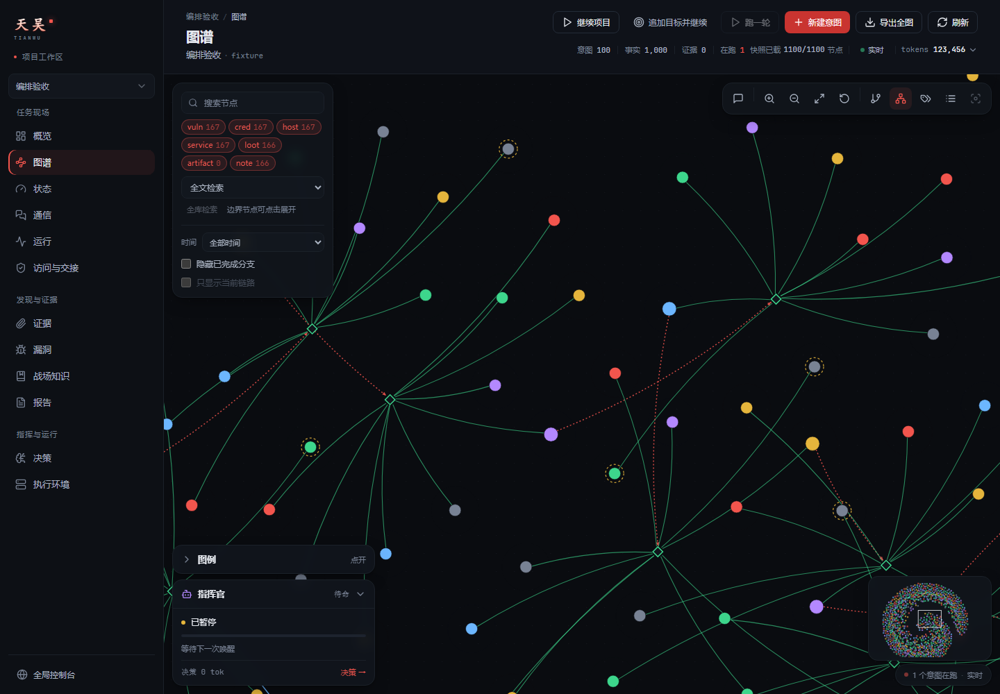
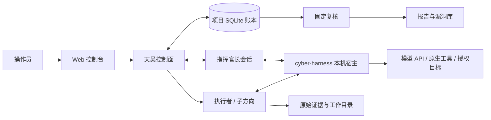

# 天吴 · Tianwu

**面向授权渗透测试的长链路多 Agent 控制面。**

天吴把一次渗透测试从“一段会越来越长的对话”变成一个有目标、有攻击面图、有证据链、可复核、可交接的项目：操作员定义授权范围和终点目标，指挥官在长会话里决定先打哪里、怎么拆、何时停，多个执行者并行验证，控制面把每一条结论连同原始证据写进账本。会话可以压缩、进程可以重启、模型可以更换，判断不丢。

[界面](#界面) · [核心能力](#核心能力) · [长链路如何推进](#长链路如何推进) · [核心架构](docs/01-architecture.md) · [快速开始](#快速开始) · [贡献指南](CONTRIBUTING.md) · [安全策略](SECURITY.md) · [免责声明](#免责声明) · [许可证](LICENSE)

> 当前为 0.x 预发布，面向单机、单用户使用。接口与数据格式仍可能调整。仅可用于已获明确授权的环境；请先阅读安全策略，并为每个项目写清测试范围和禁止事项。

## 界面

同一份账本被投影成图谱、焦点、方向、运行和证据视图。以下是离线 fixture 生成的截图，使用合成目标和数据，**不含真实项目目标、凭据或运行记录**。

<p align="center">
  
</p>

<p align="center"><em>攻击面图谱。合成 fixture：100 条方向、1,000 条事实；节点按事实类型着色，边区分产出、必要前提、引用与固定关系。未满足的硬前提是虚线红，实线红只表示正在执行。</em></p>

<table>
<tr>
<td width="50%" valign="top">
  
  <p><sub><b>图谱与节点检查</b><br/>点开节点查看断言版本、复核状态、证据与关系；未满足的前提不会被伪装成产出，未产出的方向是幽灵环而不是可点节点。</sub></p>
</td>
<td width="50%" valign="top">
  
  <p><sub><b>焦点投影</b><br/>把本轮相关事实分成热/温/冷三层，带断言版本、记录版本与来源 run，按 id 续读；“没列出来”不等于“事实不存在”。</sub></p>
</td>
</tr>
<tr>
<td width="50%" valign="top">
  
  <p><sub><b>持久指令</b><br/>操作员的授权边界、禁止事项和长期约束进入每一轮；指挥官与执行者只能读取，不能创建、改写或撤销。</sub></p>
</td>
<td width="50%" valign="top">
  
  <p><sub><b>模型与执行环境</b><br/>多配置、层级选择、并发容量、暂停与恢复、显式连通性检测。只有一个模型时设为实例默认即可，无需为了“分工”硬拆小模型。</sub></p>
</td>
</tr>
</table>

### 页面地图

| 分组 | 页面 | 用途 |
| --- | --- | --- |
| 任务现场 | 概览、图谱、状态、通信、运行、访问与交接 | 看项目态势、攻击面、方向生命周期、消息和正在跑的执行者；接手需要人工处理的登录、授权与外部动作 |
| 发现与证据 | 证据、漏洞、战场知识、报告 | 从结论回到原始材料；复核过的漏洞进入漏洞库；报告按账本当前版本生成 |
| 指挥与运行 | 决策、执行环境 | 看指挥官为什么醒、为什么停；管理宿主、终端、模型分层与容量 |
| 全局控制台 | 态势、项目、世界知识、漏洞库、POC 库、设置 | 跨项目的操作员视图；项目导出/导入、实例级资源与模型配置 |

概览页同时是操作员的收件箱：需要人工授权、扫码登录、确认外部动作或补测的事项会出现在这里。项目页支持整包导出与导入（`.twproj`），用于换机、备份和交接。

## 核心能力

| 能力 | 说明 |
| --- | --- |
| 长链路任务编排 | 指挥官在长会话里把“打进去”拆成可验收的方向和子方向：前提、依赖、等待、重试、停放、收口都落在账本里；不内置固定攻击流程，策略由模型对当前证据判断 |
| 攻击面图谱 | 意图、事实、目标、证据投影成一张图；边只表达产出、必要前提、引用与固定关系，不把“有边”当成“已证明” |
| 前提准入 | 只有 `verified_only`：必要前提必须当前断言已独立核验，否则方向 `held`，不能用“另开一个无前提方向”绕过复核 |
| 证据链与固定复核 | 结论必须关联可复核的原始材料；成功方向先进入复核，`vuln`/`cred` 结论通过独立复核才算完成，未通过进入可重试的 `review_failed` |
| 长会话 + 外部记忆 | 指挥官会话跨唤醒保留；`state.md` 是外部持久笔记，接近上下文上限时强制交接，harness 压缩后仍以账本和笔记为准 |
| 多执行者协作 | 同项目执行者并发工作，可派生子任务、交换结构化消息、等待结果、请求人工访问；等待与唤醒由控制面准入，不在账本外自动续跑 |
| 操作员监督 | 暂停/继续、持久指令、人工授权与接管、取消运行、终端与过程查看、指挥官请求停止 |
| 执行观测 | 复用 harness 的 AOP 事件流：工具调用、命令、状态、HTTP 流量进入运行视图；协作消息保留 IOA 观测记录；每个会话有自己的战场身份 |
| 模型与容量 | 多模型配置、层级选择、fallback、并发容量、暂停与恢复、显式连通性检测；单模型同样可承担全部职责 |
| 资产与迁移 | 内置协作/报告 Skill、事实知识卡、实例级 Skill 与 POC 资源；项目整包 `.twproj` 迁移，逐文件 SHA-256 校验，导入后默认暂停 |

### 长链路，而不是更长的提示词

一次真实渗透很少是一条直线：先拿到入口，再从入口找凭据，用凭据换更高权限，最后才谈得上影响。天吴让这条链路始终可核对：

- **方向是账本对象，不是聊天记录。** 每个方向带目标、前提、验收口径、尝试次数和模型绑定；子方向、等待、重试和停放都是显式状态。
- **事实分版本。** 修改断言会生成新的断言版本，旧复核不会被自动带过去；图谱和报告引用的是当前版本。
- **线索不是结论。** 无法保留原始证据的内容只能登记为线索；来源日志、扫描输出和网页内容不会自动晋升为发现。
- **复核是固定阶段。** 方向成功结束后进入 `reviewing`，独立复核者按验收标准重跑；没有原始证据或复核未通过，方向停在 `review_failed`，由指挥官重试。
- **判断可以交接。** 85% 上下文交接、harness 压缩、进程重启后，下一位指挥官从笔记和账本恢复，而不是从被截断的对话里猜。

### 冷启动时先看什么

控制面给每个会话注入自己的只读 CLI。指挥官被唤醒时不需要用 curl + Python 重新“摸索现场”：

```text
tw wake        # board + 焦点 + 收件箱 + 前提准入，一次读完
tw board       # 目标、方向、计数、待办、运行中、近期事实
tw focus       # 本方向的 hot/warm/cold 事实索引，按 id 续读
tw facts --ids f_x
tw changes     # 上次确认之后的账本变化
tw inbox       # 本会话自己的消息邮箱
tw readiness --intent in_x
tw reviews --fact f_x
```

输出有明确的 `truncated/dropped/has_more/next_cursor` 契约：被截断时不会谎报“没有更多”，模型可以用更小的 `--limit` 重试而不是跳过行。写得进去的仍然是 API/curl；读接口是只读的。

### 观测与协议

天吴不复制 harness 的工具、会话和压缩实现，只复用它的协议与事件：

- 执行事件走 harness 的 **AOP** 事件流；HTTP 抓包以 `aop.traffic.Flow` 进入账本，控制台「HTTP 流量」才有数据。
- 协作消息保留 **IOA** 观测记录，消息 id 与 IOA 传输 id 分开显示，回复时不会拿错。
- 每个会话在启动时获得自己的战场身份和一次性凭据，通过 shell init 注入；操作员令牌不进入宿主环境。
- 模型 system prompt 只放会话级稳定内容（当前时间在 user turn），避免每次唤醒重建 system 导致 provider 前缀缓存整体失效。

## 长链路如何推进



1. 操作员创建项目：授权范围、测试时段、禁止动作、起点与终点目标。
2. 指挥官读取 board、目标和约束，创建第一批方向并派发；执行者只拿到自己的方向、前提、上下文和交接契约。
3. 执行者声明事实与证据，控制面校验前提、版本和证据；新的可执行方向由调度器续接。
4. 方向成功进入固定复核；`vuln`/`cred` 通过独立复核后才完成。
5. 目标全部达成且没有在办工作时收口；未达成目标不画进链路，只在终点卡显示。

遇到授权阻塞、目标不可达或继续只会空转，指挥官可以请求全局停止；恢复仍只有操作员的显式「继续项目」。

## 快速开始

### 环境要求

- Go 1.26 或更高版本，以两个仓库的 `go.mod` 为准。
- Git，以及一个可用的模型 API。支持 OpenAI 兼容接口和 Anthropic Messages 接口，具体能力取决于供应商与模型。
- Windows 上需要 Git for Windows，并让 harness 能找到其附带的 Bash 与常用 POSIX 工具。
- 修改前端时需要 Node.js 20+ 和 pnpm；只构建 Go 控制面可使用已入库的前端产物。

### 1. 获取源码

```bash
git clone --recurse-submodules https://github.com/kksty/tianwu.git
git clone --branch tianwu/fixes https://github.com/kksty/cyber-harness.git
cd tianwu
```

`cyber-ui` 是控制台组件库子模块。已有 checkout 可运行 `git submodule update --init --recursive` 补齐。子模块指向 fork `kksty/cyber-ui` 的 `tianwu/console-tokens` 分支；上游仍是 `chainreactors/cyber-ui`，已配置为子模块的 `upstream` remote。harness 独立维护，使用 fork 的 `tianwu/fixes` 分支；主项目仅维护 `main`。

### 2. 构建并启动

Windows / PowerShell：

```powershell
pwsh -File scripts/build-harness.ps1 -HarnessDir ../cyber-harness
go build -o bin/tw.exe ./cmd/tw
./bin/tw.exe --aiscan ./bin/aiscan-full.exe --data ./data
```

Linux / macOS：

```bash
HARNESS_DIR=../cyber-harness sh scripts/build-harness.sh
go build -o bin/tw ./cmd/tw
./bin/tw --aiscan ./bin/aiscan-full --data ./data
```

默认控制台地址为 `http://127.0.0.1:8080`。首次启动会生成登录令牌，保存在 `<data>/console.token`；使用该令牌登录。全新的数据目录会创建一个空白默认项目，不包含目标、发现或运行记录。

数据目录应为空目录或当前版本支持的 SQLite 项目目录。旧 JSON 账本、缺少 `ledger.sqlite` 的项目目录不会自动迁移；升级前请备份并确认兼容性，不要混用旧目录。

### 3. 配置模型与项目

1. 在「设置 → 模型」填写接口地址、API key、模型名称与上下文窗口，选择默认模型。只有一个模型时，设为实例默认并让项目跟随即可。
2. 点击「连通性检测」。检测会发送一次轻量推理请求，成功后展示接口实际返回的模型名称；模型目录查询只辅助选型，不能证明推理或工具调用可用。
3. 在项目设置中填写授权范围、测试时间、禁止动作和数据保护要求，再填写项目目标。
4. 检查模型、工具与权限后启动项目，关注待办、执行过程和证据；需要时暂停或人工接管。

模型配置可以暂停使用。暂停状态会保存到配置文件，该配置不再接受新调用；默认调用会自动选择其他可用模型，没有替代模型时明确提示。已开始的调用继续运行，配置、默认选择与现有宿主保留；恢复后新请求重新使用原默认模型。

### 项目导出与迁移

项目可以整体导出为单个 `.twproj` 包，在另一台机器的最新天吴中导入，用于换机、备份或交接：

1. 在项目页先**暂停项目**，等待在跑的方向和指挥官的当前轮结束。
2. 点项目行的下载按钮（或 `POST /api/projects/<id>/export`），控制台会生成并下载 `.twproj`。导出包含项目清单、SQLite 账本、`state.md`、运行日志、方向工作区、证据、原生结果和登录材料。
3. 在目标实例的项目页点「导入项目」，选择该包（或 `POST /api/projects/import`，请求体为包，也接受 JSON `{"path":"..."}` 指向已放进数据目录的包）。导入校验收到的每个文件、账本 schema 和全部证据摘要，通过后才发布；同名项目不会被覆盖。
4. 导入后的项目保持暂停，检查后再点「继续项目」。旧机器的会话标记和按会话令牌不会迁移：新机器第一轮会开新会话，并从 `state.md` 与账本恢复判断。

包内不包含运行时会话凭据、`commander/` 临时工作区、`.verify` 复核草稿、浏览器控制会话和租约。目标机必须与源机使用**相同的账本 schema**（当前为 13）；账本不做自动迁移，版本不匹配会明确拒绝导入。项目里的模型档位、节点绑定和意图的模型配置是实例指针：目标机没有同名配置时，需要在项目设置/意图里重选，否则后续派发会明确报配置不存在。项目包含真实证据与登录材料，包本身不加密；传输和存放应按敏感数据保护（加密盘、加密归档或受控通道）。

### 常用启动参数

| 参数 | 默认值 / 用途 |
| --- | --- |
| `--addr` | `127.0.0.1:8080`，控制台监听地址 |
| `--data` | `./data`，实例数据目录 |
| `--aiscan` | harness 二进制路径；省略时从同目录及 PATH 查找 |
| `--harness-config` | 默认 `~/.cyber/cyber.yaml`；控制台模型设置直接读写该配置 |
| `--max-runs` | `3`，每项目默认执行者并发上限 |
| `--max-workers` | `0`，实例执行者总并发上限，0 表示不限 |
| `--round-timeout` | `15m`，指挥官单轮时限 |
| `--heartbeat` | `5m`，空闲心跳间隔 |
| `--no-decider` | 关闭自动指挥官，保留账本和手动派发 |

完整参数可运行 `tw --help` 查看。项目在进程重启后保持暂停，由操作员确认后恢复。启动和重启长期服务由操作员执行。

## 开发与验证

```bash
pnpm install
pnpm --dir web typecheck
pnpm --dir web test
pnpm --dir web build
go build ./...
go test ./...
go vet ./...
node scripts/check-docs.mjs
```

`internal/web/static` 由 Go 嵌入二进制，修改前端后需重新构建并提交产物。大部分测试使用临时账本和本地假模型，不调用外部模型。真实 harness 集成测试需要显式设置 `TW_AISCAN_BIN`，未设置时跳过；这些测试验证适配契约，不能代表真实目标上的测试效果。

维护资料：

- [核心架构](docs/01-architecture.md)：角色、数据、调度和验证边界。
- [界面截图](docs/screenshots/)：由 `scripts/acceptance` 的离线 fixture 生成，使用合成数据和目标，不含真实项目内容。
- [贡献指南](CONTRIBUTING.md)与[实现约定](agent.md)：开发环境、测试和变更原则。
- [验收脚本说明](scripts/acceptance/README.md)：离线界面检查与隔离集成验证。
- [知识卡维护](internal/kb/assets/README.md)与[条目格式](internal/kb/assets/entries/README.md)。
- 内置 Skill：[指挥官](internal/skills/assets/commander/SKILL.md)、[协作](internal/skills/assets/collaborate/SKILL.md)、[报告](internal/skills/assets/tianwu-report/SKILL.md)。这些文件也是运行时资产。

## 使用边界

控制台具备本机命令执行与文件访问能力，登录令牌应按主机凭据保护。默认仅监听本机，不应直接暴露到公网。本项目不提供文件系统沙箱，也不会逐请求强制校验目标是否在授权资产范围内；请使用隔离环境、专用运行账户和最小权限。

`data/`、模型配置、证据、浏览器登录材料和运行日志可能包含敏感信息，不应提交到版本库或用于公开演示。模型生成的内容需要检查；一条已记录的发现不等于已复核结论。项目不承诺自动发现率、测试完整性或无人值守的安全性。

问题反馈请附复现步骤、版本及脱敏日志。涉及天吴自身漏洞时，请按[安全策略](SECURITY.md)私下报告。

## 免责声明

- **仅限合法授权使用。** 本项目用于安全研究、学习及已获明确授权的安全测试。使用者应自行确认目标归属、授权范围和适用法律，禁止用于未授权访问、窃取数据、破坏系统或其他违法活动。下载、使用本项目不代表取得对任何第三方系统的测试授权。
- **结果须经人工核验。** 模型输出可能存在错误、遗漏或不当操作，生成的发现、证据说明和报告不保证准确、完整或可复现，不能直接作为安全、合规或业务决策的依据。
- **运行风险由使用者评估和控制。** 本项目及其调用的工具能够执行真实命令、访问网络和读写文件，可能造成数据泄露、数据损坏、服务中断及模型 API 费用。使用者应事先做好环境隔离、权限限制、数据备份与脱敏，并自行审查第三方模型和工具的数据处理条款。
- **按现状提供。** 在适用法律允许的范围内，作者与贡献者不提供适销性、特定用途适用性或不侵权等保证，亦不对使用或无法使用本项目产生的损失承担责任。具体保证与责任限制以 [LICENSE](LICENSE) 及适用法律为准。

## 致谢

感谢 [N1nEmAn](https://github.com/N1nEmAn) 的[女娲基座](https://github.com/N1nEmAn/nvwabase)与 [sapper-v2](https://github.com/N1nEmAn/sapper-v2)：其多 Agent 协作与内容资产设计为天吴提供了参考，部分事实知识卡改编自 sapper-v2。

感谢[链式反应（ChainReactors）](https://github.com/chainreactors)提供的 [cyber-harness](https://github.com/chainreactors/cyber-harness) 与 [cyber-ui](https://github.com/chainreactors/cyber-ui)：它们分别提供执行运行时和控制台组件基础。

## 许可证

天吴以 [AGPL-3.0](LICENSE) 发布。第三方内容的来源和许可见 [NOTICE](NOTICE)；独立依赖及子模块遵循各自许可证。
