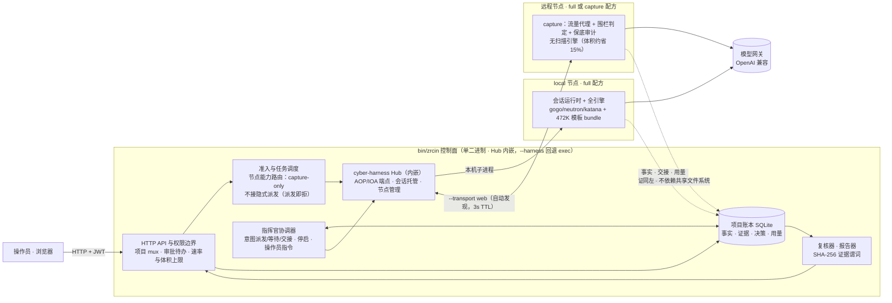

# 4zrcin · 4zrcin

单用户、单实例、多项目的授权安全测试平台：Go 服务端 + Web 控制台，复用 cyber-harness 的 Hub 与 scan 承载模型会话、工具调用与观测。

> **当前是 0.x 版本。** 接口、账本格式与运行行为在 1.0 之前仍会变，升级前先备份 `data/`；不要把 0.x 当作稳定版产品或直接用于无人值守的生产环境。

## 它是什么

- **图谱**：意图前提、产出、引用和固定上下文是显式关系；事实断言、线索与原始证据分开存放。
- **意图生命周期**：意图派发、子意图、等待、交接、重试、停放与完成；每次有账本记录的执行都留下输入、状态、用量与停止原因。
- **协作与涌现**：执行者按需互发消息、派子意图或平级意图，不必层层请示；关键结论与可复用打法汇回共享账本，打法经复核落库后跨意图复用，退役与降级由证据决定。
- **前提与复核**：必要前提须在当前断言版本上通过独立核验；成功意图进入复核阶段；复核默认开启，可在设置里改实例默认、在单个项目里覆盖（不覆盖就跟随实例），也可以新建项目时一次设定。
- **长会话状态**：笔记保存判断与回执，一个压力周期以有效交接收口后轮换会话；记忆载体是笔记与账本，不是会话本身。
- **操作员监督**：暂停/继续、操作员指令（通信页侧栏，持续注入每轮）、人工接管、待办收件箱、运行停止；暂停原因分类落盘，操作员的盖章与撤销另写 `operator-actions.jsonl`。
- **工具审批**：需要人工决定的工具调用在 guardrail 命名空间挂起，由操作员批准或拒绝；裁判可插拔（`none`/`jev`/`llm`/`hybrid`）。
- **执行观测与分账**：AOP 采集运行事件、工具调用、命令与 HTTP 流量；token 按指挥官/执行者/裁判分账，只记录不设阈值。
- **模型与容量**：单一模型连接，shared 段在线热更新；项目与实例并发上限、单轮墙钟上限、空闲检测。
- **项目迁移**：`.twproj` 带账本快照与证据摘要，导入后以暂停状态落地。
- **单二进制部署**：`bin/zrcin` 进程内嵌 Hub，本机 scan 子进程随起随停；`--harness` 保留 exec 逃生舱。
- **分布式 scan 与构建配方**：远程节点 `--transport web` 自动发现；`cyber-scan`（full，全引擎）与 `cyber-scan-capture`（capture，裁掉扫描引擎与模板 bundle、保留流量代理与审计）两种配方，控制台给出可复制构建指令。范围围栏（CIDR+通配）在节点侧判定，高危命令保底审计无条件落账，扫描/代理证据以 Artifact sidecar 经事件流回传中心——远程节点不再依赖共享文件系统。
- **节点能力路由**：节点 hello 自报配方能力，态势页徽章可见；隐式派发不会落到 capture-only 节点（派发即拒绝并说明原因），显式指派尊重操作员。
- **跨公网回连的节点**：`zrcin --public-url https://<域名>` 打开接入面，节点页可生成一行安装命令或用 SSH 直接部署；节点主机上的启动器自己经 `wss` 隧道回连，回合文件随回合下发、交接与证据经事件流回传，不需要共享目录。控制台显示隧道流量与派发就绪，销毁会吊销凭据并让节点自行卸载（[docs/14](docs/14-nodes.md) §7–§9）。

## 控制台

| | |
| --- | --- |
|  |  |
|  |  |
|  | |

## 架构



远程 capture 节点裁掉扫描引擎与模板 bundle，保留流量代理、范围围栏判定与保底审计（`builtin.` 前缀无条件落账）；调度把隐式派发挡在 capture-only 节点之外，显式指派尊重操作员。节点 hello 自报配方能力，经宿主上报为态势页徽章。节点形态、接入、部署与构建配方见 [docs/14-nodes.md](docs/14-nodes.md)。

一次运行的样子：指挥官轮读项目文档与图谱，把一条意图派给执行者；执行者在 scan 节点上跑模型会话、调用工具，把事实与证据写回账本；复核 run 独立核验断言；操作员在控制台看图谱、暂停、发指令或批准工具调用。三处职责的边界与已知限制见 [核心架构](docs/01-architecture.md)。

## 目录结构

```
cmd/        zrcin（服务端）、zrcin-gate（本地门禁）、zrcin-repair（离线修复）、zrcin-manifest、zrcin-metrics
internal/   api（HTTP/路由）、decider（指挥官循环）、store（账本）、host（Hub/scan 监督）、
            project（项目清单）、verifier（复核）、report（报告）、board（态势投影）、aop（客户端骨架与领域包）
console     控制台前端源码与组件库在独立的 [4zweb](https://github.com/c1ayooo/4zweb) 仓（同父目录检出，或设 `ZRCIN_WEB_DIR`）；本仓只提交构建产物 internal/web/bundle
scripts/    gate、build-harness、collect-run、watchdog、check-docs 等入口
docs/       01-architecture.md、02-deploy.md、03/04 设计文档、14-nodes.md（节点形态与配方）
data/       运行时实例目录（账本、项目、证据、console.token），不随仓库分发
```

## 环境要求

- Go 1.26 或更高（`go.mod` 当前声明 `go 1.26.0`）。
- Node.js 24 或更高（`scripts/check-docs.mjs` 用；改前端时装 pnpm，依赖在 4zweb 仓里安装）。
- Git。
- Windows 上还需要 Git for Windows 提供的 Bash 与常用 POSIX 工具：宿主的 shell 工具依赖它们。

本机验证过的组合：Go 1.27.0、Node.js 24.20.0（`go version` / `node -v`，2026-11-23）。

## 从源码构建与启动

控制面会嵌入仓库里的前端产物。改了界面源码时，在 [4zweb](https://github.com/c1ayooo/4zweb) 检出里 `pnpm install --frozen-lockfile` 和 `pnpm build`，再回到本仓 `go generate ./internal/web` 一并提交产物，然后构建 `zrcin`。

```powershell
pwsh -File scripts/build-harness.ps1 -HarnessDir ../cyber-harness   # -> bin/cyber-harness.exe + cyber-scan.exe + cyber-scan-capture.exe
go build -o bin/zrcin.exe ./cmd/zrcin
./bin/zrcin.exe --scan ./bin/cyber-scan.exe --data ./data            # 单二进制：Hub 内嵌，本机 scan 子进程
```

Linux / macOS 用 `scripts/build-harness.sh` 或 `make harness`（另有 `make scan-capture` 单独编 capture 配方），`bin/zrcin` 不带后缀。端口、数据目录、模型连接、最小验证与换版判据见[部署清单](docs/02-deploy.md)；完整启动参数见 `zrcin --help`。

## 如何使用

1. **配置模型连接。** 启动前设置 `CYBER_BASE_URL`、`CYBER_API_KEY` 和 `CYBER_MODEL`，或在「设置 → 模型连接」中填写。保存结果会说明是否已在线应用，或是否需要重启宿主。
2. **打开控制台。** 默认 `http://127.0.0.1:8080`；令牌在 `data/console.token`（首次启动生成，只给本机操作员）。
3. **建项目。** 新建项目时写三份文档：起点（范围与已有信息）、终点（验收标准）、内置约束（必须守住的东西）。这三份原文就是授权边界，代码不再另加规则；边界可以随项目推进在控制台里更新。
4. **让它跑。** 启动项目后，指挥官按文档与图谱派意图，执行者接意图执行；在「图谱」看待办、事实与证据，「项目状态」看谁在跑、为什么停。
5. **随时接管。** 暂停/继续、给指挥官发指令、在待办里处理审批；工具调用需要人工决定时会挂起等操作员。
6. **复盘与带走。** 每个 run 有输入、状态、用量与停止原因；报告预检从结论直达原始证据；整项目可导出为 `.twproj`。

第一次上手建议用离线假模型或隔离环境跑一遍，只看流程是否通，不要直接指向真实资产。

## 常用命令

| 用途 | 命令 |
| --- | --- |
| 本地门禁（构建、静态检查、测试、前端检查、文档链接、构建清单） | `pwsh -File scripts/gate.ps1`，Linux 为 `./scripts/gate.sh` |
| Go 测试（串行） | `go test ./... -p 1 -count=1` |
| 前端检查 | 4zweb 检出存在时由 gate 代跑（源码已拆到 4zweb 仓） |
| 收一个 run 供复盘 | `pwsh -File scripts/collect-run.ps1 -Project <项目ID> -Out <out.zip>` |
| 长跑外部看护（默认只观察） | `pwsh -File scripts/watchdog.ps1 -Project <项目ID>` |
| 版本 | `./bin/zrcin.exe --version` |

## 构建清单

gate 最后一步写 `.build/build-manifest.json`（`cmd/zrcin-gate/main.go`）：源码身份（仓库根、commit、branch、dirty、工作树补丁 SHA-256）、harness 身份与提交、协议版本、平台与工具链、模型连接与真实上游 model id、以及各二进制的 sha256 与 `--version` 输出。清单从不写 API key。

## 离线修复交接游标

历史有效置信度、交接游标的修复都要求项目暂停且 `zrcin` 已停止，先预览、核对后再提交：

```powershell
./bin/zrcin-repair.exe --project <项目绝对目录> --confidence            # 预览
./bin/zrcin-repair.exe --project <项目绝对目录> --confidence --commit   # 先备份账本再写回
./bin/zrcin-repair.exe --project <项目绝对目录> --intent <精确意图ID>    # 预览该意图的交接游标
```

`--commit` 只写回能保留断言哈希的派生标签或与现存声明一致的游标，并保留修复前的游标、文件摘要与审计记录。

## 致谢

本项目站在多个开源项目的肩膀上，感谢这些项目的作者与贡献者：

- **[Tianwu](https://github.com/kksty/tianwu)** —— 4zrcin 的直接上游（AGPL-3.0）。本项目的图谱模型、意图生命周期、账本与复核机制均源自 Tianwu 的设计；fork 之后的平台化改造（单二进制部署、构建配方、节点路由等）叠加在其架构之上。
- **[chainreactors](https://github.com/chainreactors)** —— scan 侧的根基。cyber-harness 及其 gogo、neutron、zombie、fingers、proton、words 等工具链与模板栈由 chainreactors 开发维护，本项目的扫描与流量能力建立在它们之上；部分组件经 fork 定制后回用于本仓库，均遵循原许可并在 [NOTICE](NOTICE) 中注明。
- **[projectdiscovery](https://github.com/projectdiscovery)** —— katana 等依赖的作者与社区，为 scan 节点提供了成熟的爬虫与探测基座。

各上游项目的分发许可与版权声明见 [LICENSE](LICENSE) 与 [NOTICE](NOTICE)；若有遗漏，请提 issue 告知，我们会补正。

## 免责声明

- **只用于已获授权的目标。** 4zrcin是安全测试工具，未经目标所有者书面授权对其系统做测试可能构成违法；授权范围由使用者自行取得并负责，本项目不提供任何目标清单或授权。
- **按「现状」提供，不附带担保。** 依 AGPL-3.0 分发，不承诺适销性、特定用途适用性或不侵权；因使用本软件造成的任何直接或间接损失，作者与贡献者不承担责任。
- **测试会改变目标状态。** 扫描、上传、登录尝试都可能留下痕迹或影响业务；请在隔离或可回滚的环境先行验证，风险与后果由使用者承担。
- **数据与合规由使用者负责。** 账本、证据与抓取的流量可能含个人信息或敏感数据，保存、传输与销毁须符合所在地法律与授权约定。
- 本项目与任何被测试的第三方无关；文中出现的产品名仅用于说明。

## 贡献与许可

提交前跑本地门禁；约定见 [CONTRIBUTING.md](CONTRIBUTING.md) 与 [agent.md](agent.md)。测试与演示只使用临时目录、本地假模型或明确授权的隔离环境，不把协议测试表述为真实效果。

4zrcin以 [AGPL-3.0](LICENSE) 发布；第三方内容的来源和许可见 [NOTICE](NOTICE)。
