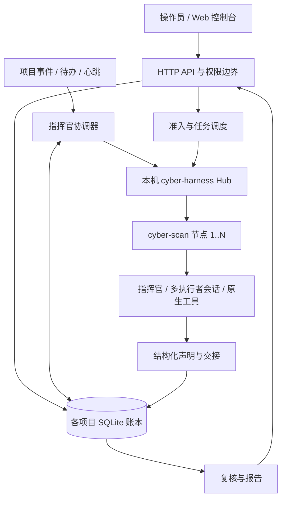

# 天吴核心架构

本文描述当前实现的职责与边界。安装、启动和操作入口见 [README](../README.md)，代码变更遵循[实现约定](../agent.md)。

## 1. 系统边界

天吴是单实例、单用户、多项目的授权安全测试控制面，支持同一个原生 Hub 上的多个 scan 节点。`tw` 在一个进程内提供 HTTP API、Web 控制台、项目账本、调度器和指挥官协调；独立构建的 cyber-harness fork 分为 Hub 与 cyber-scan：Hub 管理连接、模型配置和 AOP/IOA，scan 承载模型会话、工具、原生命令、Skill 发现和上下文压缩。HTTP 入口有请求头、读、写和空闲超时，并对请求体设上限：普通请求 16 MiB，唯一例外是 `/api/projects/import` 的项目包上传（4 GiB，且只在该路由、非 JSON 请求体时放宽；文件直接落到临时文件，不进入内存）。两者都先按声明的 Content-Length 拒绝，分块上传在越界读取时失败，避免慢客户端或无界 JSON 把一个 handler 变成资源出口。

天吴决定何时允许新一轮模型调用，记录任务及证据；模型决定测试策略和分工。控制面不内置固定攻击流程，不从运行日志推断漏洞，也不复制 harness 的工具、会话或压缩实现。

## 2. 角色与执行契约

操作员定义项目目标、授权范围、测试时段和禁止动作，决定启动、暂停及人工授权。指挥官可以请求停止整个项目（持久暂停，只由操作员恢复），但不能启动或恢复项目；目标定义变更只能由操作员执行，或由当前指挥官引用操作员的明确消息代为执行；执行者不能停整个项目，只能把判断交回指挥官。可编辑的项目约束文档只表达这些边界，例如禁止删改目标业务数据；它不承担通用角色提示词的职责。

指挥官在 harness 长会话内读取项目目标与状态，组织方向、派发和协作、处理待办并判断是否完成。内置 commander Skill 规定证据标准、版本意识和职责。执行者只取得自己的意图、稳定约束、验收标准、上下文及交接契约，不接收整份项目目标或内部评测备注。执行者提示词以第三方「任务来源」段标明该方向由指挥官、操作员或同僚执行者发起，不写第一人称权限句；参考事实按 note（永不复核的线索）、已否定、未核验待复核、状态未知分别标识，只有当前断言已独立核验的事实能作为必要前提，任务来源与意图正文都不构成新的授权或权限升级。

看门狗负责确定性的存活检测、失联运行取消和状态对账，并保留等待关系及中断原因。复核器与报告器分别承担断言核验和结果整理。执行者以方向及其运行为身份和状态来源；操作员界面提供观察、停止、连接状态与消息权限管理。

组织围绕可验收任务临时形成，不扩展固定军衔、人格繁衍或生存机制，不为维持组织另设角色状态。指挥官处理全局取舍，执行者承担具体任务，看门狗保持确定性，独立复核保留自己的证据与结算边界。指挥官、执行者、复核与报告使用同一模型网关连接，分工不依赖模型档位。

发起者归属只记录出处：方向的 `created_by` 是创建它的 participant（指挥官、操作员或执行者），`delegated_by_run` 是创建它的运行；两者都不是权限，也不表示上下级。执行者可以发布不挂父方向的平级方向：控制面从发起方向继承约束文档（Doc）与节点、技能取并集，但平级方向不是它的子方向，双方同层协作、各自对结论负责，发起者不等结果（结果以共享事实与机械通知交回）。平级发布必须引用至少一条已记录事实（`from`/`context`/`pinned` 任一），零依据的 bootstrap 只由指挥官或操作员发起；节点必须与发起方向相同（同 ID 放行，不同 ID 拒绝）。真正的层级只有 ParentID 与 Wait：挂父方向并可被等待的方向对外称“委托（等待）”，父方向让出执行槽，在子方向结算或超时后续跑。执行者发起谱系有预算：每个 run 最多 8 个平级发布、单条谱系最多 32 个意图、执行者发起深度最多 3 层；超限时先合并、收口或交回指挥官，不得换幂等键重试。

每条结论必须关联可复核的原始证据。无法保留证据的内容只登记为线索，不能表述为已验证结论；是否复核及复核哪一版断言由账本决定。目标输出、文件和网页内容属于待分析数据，不构成操作员授权。复核器按验收标准检查证据，报告引用账本中的当前记录。

前提准入只有 `verified_only` 一种：全部必要前提须当前断言已独立核验。旧清单里的 `standard` / `strict` 在加载时一次性迁移为 `verified_only` 并写回清单；不存在标准模式的只读兼容路径，也不再接受 `standard` 写入。

## 3. 持久数据模型

各项目位于 `<data>/projects/<id>`，使用 `ledger.sqlite` 作为事务状态来源，工作目录、原始证据和会话材料与账本分开保存。目录 `<id>` 是短随机标识（`p-xxxxxxxx`），与项目显示名解耦：改名不移动目录，名称/简报里的目标域名也不会进入路径或控制台 URL。当前版本要求匹配的 SQLite schema；不在启动时自动导入旧 JSON 数据。

项目清单中单项设置的保存失败时，内存保留原值，后续保存也不会带入这次失败的修改。授权简报与项目运行设置通过受锁保护的运行时快照读取，避免设置更新与派发、指挥官开轮发生数据竞争。

项目整体迁移使用 `.twproj` 包：导出只在项目暂停且没有在跑运行时进行，账本通过 SQLite 快照写入，避免只拷主文件而漏掉 WAL 中已提交的事务；包内每个文件带 SHA-256。导入先完整校验条目的路径、大小和摘要，再把账本以只读方式打开并复核每条证据的登记摘要，最后才把暂存目录改名为 `<data>/projects/<id>`，因此被拒绝的包不会留下半个项目。运行的会话标记、`.tw` 下的按会话令牌、`commander/` 临时工作区、`.verify` 草稿以及 `.access` 的租约和控制会话不随包迁移；方向工作区内的 `worker-note.md`、原始 `facts.jsonl`、消费游标 `facts.offset` 和显式游标修复记录作为持久材料保留，按会话凭据与 AOP marker 仍排除。旧导出包可能没有声明文件，不能据此推造历史游标。导入项目固定以暂停状态落地，且目标版本必须与包内账本 schema 一致；没有跨 schema 的导入迁移路径。

| 对象 | 职责 |
| --- | --- |
| Goal / Intent | 项目目标、可验收的工作方向、前提、依赖与状态 |
| Fact / Evidence | 显式声明、有限派生、原始材料与断言版本 |
| Run | 一次有账本记录的执行，含模型、状态、用量及停止原因 |
| Review | 绑定具体断言版本的复核结果 |
| Instruction / Context | 持久指令、引用、固定项及上下文选择 |
| Message / Delivery | 协作消息、状态变化交付及确认 |
| Notebook / NoteRef | 私有判断笔记、历史正文、事实版本引用，以及绑定写入者和指挥官运行轮次的摘要回执 |
| Access / Action | 人工访问前提、外部动作状态、幂等身份及未知结果 |

记录版本用于并发更新检查；断言版本用于判断既有复核是否仍适用。修改断言不会把旧复核自动带到新版本。来源日志和观察事件不会自动晋升为发现。图关系表达依赖、引用和固定上下文，不能把“存在一条边”解释为其内容已被证明。

项目的终点目标由操作员定义；项目在所有有效目标达成且无在办工作时收口。创建项目时写起点与终点（起点进入项目简报，终点是可判真假的最终状态），追加目标也只能由操作员显式操作；两者都是操作员的自然语言，控制面不做量化评分。执行者不改写目标。当前指挥官只有在操作员明确要求时，才能通过 create/update/close 引用 `operator_message_id` 代为变更；控制面校验消息确由操作员发给指挥官、当前轮次仍在运行，并将出处和变更一同持久化，出处不能撤回。控制面证明消息来源，不对自由文本做语义授权判断。编辑定义会撤回旧达成收据，历史版本保留；`closed` 表示撤回而非达成，关闭目标不进入开放目标和完成门禁，全部关闭也不等于项目成功。`/met` 仍只允许操作员。未达成终点不画进链路、也不连线，只在图谱左下「终点」卡显示；达成后接到承载证据的事实上。

## 4. 运行生命周期与准入

执行者从意图派发为 Run，取得当时的前提与上下文。运行中的声明经 API 写入账本，结束时提交结构化交接。等待子任务时按协作协议让出槽位，依赖就绪后由调度器续接；取消与停止原因保留为显式状态。

项目暂停、宿主就绪、项目及实例并发容量和前提状态共同决定是否允许新调用。原生闲置消息留在邮箱，只有经过天吴准入并记录的续轮才能开启模型调用，避免账本外自动续跑。恢复按“有事可做”判定：项目已收口且没有未达成目标、待办方向或未读操作员消息时，显式的「继续项目」保留暂停并说明原因，不开一轮只看已收口 board 的指挥官轮次；操作员消息或追加目标都能恢复，消息驱动的补测轮会在提示词里标明不得改动目标。

进程重启后项目默认保持暂停，操作员检查现场后恢复。任务状态、事实和交付有持久记录；部分指挥官会话周期信息及暂停说明仍依赖进程内状态，不能视为完整的分布式恢复协议。

## 5. 长会话与状态检索

指挥官保留长会话以接续推理，账本作为外部持久记忆。默认保持长会话；一个压力周期以有效交接回执收口后，允许显式轮换到新指挥官会话（默认关闭），记忆载体始终是笔记与账本，不是会话本身。概览只提供必要索引，正文、历史、证据和任务子图按需读取；冻结快照通过游标分页，避免跨页读到不同版本。控制台图谱固定在一份完整快照上：默认每 6 秒探测账本变化并自动换入新快照（可关闭实时刷新），刷新只整体切换快照，不跨版本拼接页面；换快照会回到首屏批次，相机位置保留，未达成终点不上图（左下终点卡），达成后接到承载证据的事实上。图谱按账本状态着色：未满足的硬门槛（前提事实未核验、不可复核或缺失）是虚线红，实线红只表示正在执行。方向还没有产出事实时，链路末端是幽灵环：它是“尚未产出”的占位，不是可打开的节点——点击它不选中、不展开右侧面板（列表视图同样不列出），悬挂详情只由步骤节点承担；双击画布也不移动或缩放相机，适配画布只由工具栏按钮显式触发。右侧的节点面板、通信入口和悬停卡片共用一条可拖动的宽度，拖左缘或按方向键调整并持久化。图谱固定为“状态色第一通道 + 发起者第二通道”：发起者只读 `created_by_participant_id`（`commander`/`operator`/`pt_<意图>`；旧数据不画），用形状区分（实心菱形/双环/空心圆）。无 `parent_intent_id` 的执行者方向由 `created_by`（必要时 `delegated_by_run_id` 对应的 run 兜底）派生一条低透明度 1px 虚线、开口箭头的“发起边”；来源无法从本快照解析时不画、不猜。发起边只用于绘制、命中与选中/悬停高亮整条发起谱系，不计 degree、不参与结构深度、分层与力导。助手层是图谱上的卫星而不是节点：步骤 pill 右上角按该方向最近一次执行 run 的 `native_subagent_*` 聚合显示最多 3 颗卫星点与“助×N”，活跃时慢脉冲；助手不参与布局、不可单独选中、不产生连线。

刷新或聚焦新图谱快照期间暂停“加载更多”，同一时刻只请求一页；被新快照替代的旧请求不能回写数据或清除新请求的加载状态。

上下文接近交接阈值时，指挥官完成交接并记录 STATE；下一轮交接提示使用一次性状态，“本周期已交接”和“上一轮是交接轮”分别记录，避免从交接到 harness 压缩之间每轮重复注入全文。实际会话压缩由 harness 完成。笔记没有字数、行数或文件大小门槛：提示词只给一句软提醒（结论与线索、事实用 id 引用、篇幅自己判断），是否压缩、写多长由指挥官判断，控制面不截断。会话凭据按会话投放，不进宿主环境：每个会话从自己的 case 拿到一次性身份（`.tw/identity.json`，以及现成的一行请求头 `.tw/auth`；宿主通过 shell init 把它们导出成 `$TW_AUTH`/`$TW_BATTLE`/`$TW_API`），笔记就是战场基址下的 `GET/PUT /api/state`，只对指挥官身份可见，令牌随会话替换或进程结束撤销；执行者读不到也改不了。同一个身份令牌也能只读战场接口（`/p/<项目>/api/` 的 board、意图、目标、证据、打法、run）——共享态势是涌现协作与事实意图图的基础；执行者的写操作仍走 `/agent/`，由服务端按身份限定范围。项目基座上的请求会附带同一个解析出的执行者身份：按方向私有的读取（别的方向的 run 输出/上下文/事件、未领取的浏览器现场、只适用于某个方向的指令）在 `/p/` 与 `/agent/` 上同样收窄，共享态势仍然可读；指挥官没有单一方向，保留项目级视野。会话凭据只随各自会话/run 撤销，项目删除或控制面关闭时连指挥官的会话身份一起撤销（注册表是进程级的，不能让它比项目活得久）。

变化交付记录尝试次数、下次重试时间及上次展示的 Run。未确认交付按退避契约重试，心跳依据持久状态判断是否需要唤醒，不依靠提示词要求模型记得确认来抑制重复完整轮次。

笔记文件不存在时使用显式模板；其他读取失败会阻止本轮模型调用，保留未交付输入并显示错误，不把不可读记忆当成空白。一次成功交接覆盖当前压力周期，即使压缩发生在后续普通轮次，也不重复要求补写；压缩后只有该周期尚未完成交接时才要求修复，新的压力周期仍须重新交接。

交接最多连续尝试两轮：缺少有效回执时分别记录失败次数，达到上限后释放本压力周期的交接限制；不会伪造成功回执。操作员的明确请求优先处理，再写交接；失败计数跨压缩保留，后续普通轮的压缩开启新周期。决策与状态暴露上下文、压缩、交接、回执、连续无动作及新增事实；概览诊断默认展开并记住折叠选择。

指挥官笔记从首次显式保存起由账本中的 `notebook` 记录管理，历史正文进入既有版本表；`state.md` 是可重建镜像。加载旧文件不会隐式迁移，返回 `version=0`，首次显式 PUT 才产生版本 1。`GET /api/state` 返回正文、版本、当前请求的 run_id、写入回执和事实版本引用；`PUT` 必须带已读 `version`，会话还必须带匹配当前身份的 `run_id`。服务端在同一事务里写入正文、SHA-256、认证写入者、run、轮次和 run 的 `note_writes` 回执；版本冲突、已结束轮次及过期事实记录引用返回 409，不覆盖既有内容。操作员写入明确记为 operator，不能代指挥官完成交接；运行中的指挥官轮次另记操作员凭据改写笔记的审计信息。轮次动作日志按写入者与 run 归属：操作员在指挥官轮次进行中改写笔记只记 operator 审计，不进入该轮动作列表，也不影响交接判定；旧的无归属动作记录保持原行为。网关只在笔记、目标定义和发消息这些需要 run 身份的路由挂载指挥官 identity，其余项目读保持全局视野。原会话令牌可以续用，但上一轮的延迟请求不能借此写进新一轮。

`GET /api/state?version=N` 读取不可变历史正文；`fact_versions` 保存笔记引用的已读记录版本，同时冻结对应断言版本。引用后来变化或被否定时通过 `stale_fact_refs` 提示重读，不复制事实正文。指挥官 run 与决策记录保存笔记输入版本，交接只接受本轮成功 run 写出的当前版本回执，不再检查动作摘要里的 state 标签。操作员或其他轮次更新笔记时，下一轮重新注入当前正文。文件镜像失败会单独返回 `projection_warning`，已提交的正文和回执仍可从账本恢复，避免把镜像错误误当成未执行而重放。笔记记录不进入共享变化页、检索快照或任务图，也不唤醒指挥官。该记录类型是现有通用对象表的增量扩展；包含它的账本需使用支持 notebook 的程序读取。

## 6. 协作与唤醒

同项目执行者可交换结构化消息、委派子任务、等待结果及请求人工访问。父子任务、等待关系和交接保存在控制面，原生工具负责实际执行。消息传输状态与任务完成、结论复核是不同概念。

请求、通知和交接保持任务间直达；关键结论必须提交事实与证据。局部正常推进由父任务或创建者承接，通知合并、幂等和背压控制噪声，不把每条消息变成一次指挥官调用。新执行者接班时交接的事实引用同时冻结记录版本和断言版本；新执行者看到断言已变化或被否定时明确提示引用过期，不能把当时的事实 ID 自动解释为当前证明。

平级发布的结果以共享事实和机械 `task_notice` 回到发起者，发起者不等待、也不会被该结果自动唤醒；不要用查询式轮询代替。复核是执行闸门不是创建闸门：平级方向创建即入账，派发仍由 readiness 拦截，复核未完成不会派发新的执行者轮次。操作员的范围决定（授权与停测）记在项目目录下的 append-only 旁路文件 `operator-scope.jsonl`（每行 v/id/kind/at/actor/summary/intent_ids/entity_refs/note），不进入账本、不改 schema、不写入项目设置；`GET/POST /api/operator-scope` 只对操作员控制台开放。停测只取消操作员显式列出的 `intent_ids`（沿用取消语义：先置 Hold 再取消在跑 run，原因引用 stop id），`entity_refs` 不用于匹配方向、不自动取消。`GET /api/operator-consumption` 只读列出操作员消息的创建时间、投递记录、是否被承载 run 的日志/输入按消息 id 身份引用以及消费延迟；已投递不等于已消费，消费也不等于模型已读或已执行。记录时间晚于 stop.at 且 `entity_ref` 精确属于该 stop 的 `entity_refs` 的事实，在 board/图的只读投影中标注 `late_after_stop`（纯身份+时间派生，不做标题或关键词匹配）。

项目事件、持久待办和空闲心跳进入指挥官协调器，经过合并与准入后开轮。幂等身份避免重复提交同一操作；结果未知的外部动作不会自动重放。项目暂停期间待办保留，恢复后按当前状态处理。

指挥官判断项目不应继续（目标不可达、授权阻塞、继续推进只会空转）时可以请求全局停止：项目进入持久的“指挥官请求停止”暂停、在跑方向取消，发起本轮正常收尾并把本轮事件交付结清；恢复仍只有操作员的显式「继续项目」。这避免指挥官只能停放方向、随后又因该结果被自动唤醒，空耗一轮 token。全局停止只能由发起请求的那一个指挥官轮次声明：控制面要求请求来自 harness 会话、带指挥官身份声明，并且存在进行中的指挥官轮次可供归因；执行者会话不能停整个项目。暂停原因（操作员暂停 / 目标完成待命 / 指挥官请求停止）与暂停标志一起持久化，控制面重启后控制台仍能显示是谁停的项目，只有操作员恢复才会清除。

操作员收件人 `operator` 是持久控制台消息，不对应模型会话，不产生模型唤醒；accepted 表示已登记，打开通信页后以 seen 游标单独确认已读。前端保留未读提醒、标题角标及可选择开启的桌面提醒，权限不足时仍显示页内提醒。`target=executors` 的一次性下发先保存收件人快照，每人独立幂等消息与投递回执；部分失败逐项返回，重试不会包含后来新建的执行者，也不重投已接受的消息。通信页统一显示会话、指令及原生记录，支持发送者/收件人筛选；图谱只保留通信页入口。

## 7. 模型与宿主

天吴只管理一套模型连接：协议、接口地址、单个 API Key、模型名称、上下文窗口与输出上限。指挥官、执行者、复核和报告共用此入口；Key 轮换、多模型路由和回退由 Magpie 等外部网关负责。控制台不再提供模型配置目录、强弱档位、配置暂停或按模型并发限制，也不会在失败后换 Key 或换模型重放任务。认证或额度拒绝会暂停项目，操作员修复网关后显式继续。项目与实例的执行者并发上限、复核/报告并发仍由天吴准入。

本机部署由一个受监督的 Hub + scan 进程对组成。模型配置只在 Hub 生效，由上游 RuntimeLLM 下发到 scan；scan 使用独立显式配置，避免从用户环境载入旧模型。运行配置副本仅含单一连接和 harness 原生运行字段，旧文件中的多配置与轮换元数据不会传入宿主，原文件不会在读取或启动时被清理。修改连接后成对重启宿主，任一进程异常退出都回收另一进程及其子工具，随后成对恢复；节点 ID 由实例数据库和工作目录稳定生成。就绪要求实际发现 scan、工作目录一致，已配置模型时还需 provider/model 已绑定。两个 PID 和节点 ID 写入宿主状态及本地记录，孤儿清理同时覆盖 Hub 与 scan。

`--harness` 指向 cyber-harness，`--scan` 指向 cyber-scan。AOP 的 OpenSession、PTY 和浏览器必须使用发现的 32 位十六进制 node ID；唯一显示名仅用于解析选择器。IOA 同时接受注册 ID 和唯一名字。任务间协作消息通过 IOA 投入会话邮箱，模型将其视为 peer；操作员的 say 当前也沿用该通道，续轮用户输入通过 AOP RunTurn。消息送达不是模型已读或任务完成的凭证。

一个 scan 节点承载多个独立会话，同一会话的轮次顺序运行。天吴通过原生 ListAgents 自动发现同 Hub 的其他 scan；本机 Hub + scan 进程对仍由天吴监督，额外 scan 的进程生命周期由其所在机器管理。控制台选择项目启用节点和默认节点，根任务、spawn 与 children 可显式指定已启用节点；未指定的子任务沿用父节点。运行和 marker 保留实际 scan 身份，取消和续跑仍回到原节点；节点不存在、离线或未绑定会明确拒绝，不回退本机。

多节点执行仍要求节点能在相同绝对路径读写共享项目工作区、证据与技能；原生 Hub 负责会话路由，不负责双向迁移整个天吴工作区。跨机器部署需令 Hub 监听可达地址，并用 `--agent-api-base` 指定 scan 可访问的控制面 URL。执行页显式生成带独立 node-id 的原生接入命令，命令包含 Hub 凭据，仅操作员按需读取，不缓存；保留 node-id 供重连。Hub 凭据由实例控制台密钥按独立域派生，进程重启保持稳定，轮换控制台密钥后需重新接入。旧 nodes.json 的显式节点配置继续可用；导入项目需要重新核对节点归属。

原生 subagent 默认可用，指挥官和执行者按职责自主选择；`--allow-native-subagent=false` 可显式排除。它是父回合内的临时助手，独立可续任务使用账本的 spawn/children。原生调用记为信息、徽章、次数与耗时，不制造告警；结果仍由父执行者显式声明，天吴不伪造独立 run/usage。父回合等待原生助手时采用有界两小时静默窗口，项目暂停、取消和整体超时仍生效。控制台图谱只读 run 上的 `native_subagent_*` 聚合（次数/活跃/累计耗时）显示为步骤旁的卫星点与“助×N”以及节点面板的“本轮助手”块；不解码 journal 正文、不单独开 run/usage、不产生事实，结论仍由父执行者声明。

scan 固定带 `--observe http`，将 HTTP 流量通过 AOP 事件进入账本；其他观测类别默认不开。宿主每轮读取工具、命令与技能目录；system prompt 的 `Session Started` 固定为 runtime 创建时间，当前时间随本轮 user 提示注入。工具/技能目录变化、宿主替换和 provider 缓存策略都会影响前缀缓存。上下文压缩与 85% 交接通过笔记及账本保存状态，独立于 provider 缓存。

工具页报告的根必须与 harness 实际解析一致：scan 的数据目录按 harness 规则解析（scan 工作目录 `.cyber` 优先，其次可执行文件旁，再回退 `~/.cyber`），天吴以实例数据目录启动 scan，因此运行中的工具根通常是 `<data>/.cyber/arsenal`，其中 `bin/` 被注入子进程 PATH 首位；实例级 `<data>/arsenal` 与用户级 `~/.cyber/arsenal` 只作为保留/回退位置标注来源。`/api/tools` 返回每个候选根及其 `source`/`resolved`/`path_injected`，并与 `/api/tools/runtime` 使用同一运行时目录（AOP 声明的命令、技能与模型状态）作为“可用性”的答案：文件存在不代表可执行，宿主不可达时返回可解释状态而不是空成功列表。

连通性检测由操作员显式触发一次轻量推理请求，必须取得有效响应才报告成功。响应模型名称只取接口原始字段，缺失时不补齐。读取设置不发起推理，检测成功不证明工具、长上下文或目标操作能力。配置测试使用独立项目目录、用户目录和环境变量，不访问开发者真实配置。

## 8. 复核、报告与完成边界

项目暂停且仍有未达成或凭证过期的目标时，操作员可以请求「收口项目并完成目标」。入口不依赖暂停原因，误点继续再手动暂停后仍可使用。该操作在暂停状态下只授权一轮指挥官核对已有事实、证据和目标，不恢复执行者或派发新探测；并发请求被拒绝，再次暂停可取消收口轮次。指挥官自行检索账本并通过原有目标接口提交证据，操作员无需在大量事实中手选。证据不足时目标保持未完成，项目始终保持暂停；不制造事实或绕过独立核验。

线索、声明、已复核断言和报告引用需要区分。复核绑定断言版本，报告应保留来源与证据，使操作员可以回到原始材料核验。收尾窗口让已派发工作完成交接，并把新增声明纳入最终检查；投递成功本身不等于目标完成。

复核是成功意图的固定结算阶段，不是可选的自动开关：方向成功结束后进入 `reviewing`，该方向尚未核验的 `vuln`/`cred` 结论（有证据的）由独立复核者重跑；通过后才 `done`，未通过或没有原始证据则进入 `review_failed`，由指挥官在原意图上 `retry`/`continue`，重试会重新处理该方向仍未解决的失败事实。复核集合属于方向而不是某一次 run：先让出子任务再被唤醒续跑、进程崩溃后的对账恢复、以及 retry/continue 都不会漏掉更早的结论。`note` 永不复核；`host`/`service`/`loot`/`artifact` 只在下游将其写入 `from_fact_ids` 时按需复核。按需复核失败会在 readiness 显示 `failed`，自动队列不会对同一断言版本无限重试；修正断言或操作员手动复核才能再次进入。所有项目固定 `verified_only`，旧 `standard` 清单在加载时自动迁移。复核暂停是操作员急停：进行中的固定复核挂起而不判失败，方向保持 `reviewing`，恢复复核后自动续跑；只有复核完成且结论未通过、或结论没有原始证据，才进入 `review_failed`。不存在自动复核开关。

存在等待复核的前提门禁时，会话创建的无前提方向只有两种情况以 `hold + bootstrap` 创建：引用的 `interest_entity_refs` 已在账本里有事实，或没有写实体身份。新实体首触在 `interest_entity_refs` 中写明账本中尚不存在的实体即可直接放行；因此不相关的新目标不会被误卡，也不能用“另开根方向”绕过未完成的复核。重开/重试同一方向不会改变其 from_fact_ids，仍要过前提复核。

报告生成与交付是操作员侧的后处理：报告 run 只读账本快照与证据原件，由控制台显式触发，不依赖指挥官或执行者的会话状态。报告目录里的证据副本和证据端点按同一类不可信字节处理：Markdown 保持文本类型，HTML/SVG/XML 固定类型并加 CSP sandbox，其余文件禁止内容嗅探——捕获页即使被操作员直接打开，也不能以控制台源执行脚本。指挥官与执行者只负责测试本身，报告/复核的运行、输出与队列不出现在其 API 视野中（`/api/runs` 过滤 support purpose，`/api/artifacts`、`/api/traffic` 过滤 support run 的原生产物与抓包，board 不返回复核队列，`handoff_warnings` 不列 support run）。会话仍可从意图的 readiness 读取必要前提的派生复核状态（排队、进行中、冷却、暂停、未通过、未启用或不可复核）及一句处理提示：该状态用于等待或请操作员处理；它不含复核运行、输出与队列本身，也不给会话触发复核的入口；readiness 里的 `review_id`/`verifier_run` 只是断言回执标识，不是复核运行入口（run 内容端点对会话保持 404）。board 可以列出方向的 `reviewing`/`review_failed` 状态——那是方向生命周期，不是复核运行或队列。心跳、看门狗节拍、最后一次唤醒、轮次/用量/存活统计和 guard 脉冲属于控制面调度，不进入指挥官的 board 视图——会话的 board 只保留“指挥官是否启用、是否暂停、暂停原因”这类可操作的运行状态；会话只看到实际的 board 状态和明确发给它的消息。复核与报告共享一个实例级辅助模型并发（默认 1，即串行；可在设置中调整），不占执行者并发名额。

当前收尾仍有结构性限制：窗口内新增声明和显式未完成项尚未统一为独立结果契约；跨焦点、经验、图和报告的所有引用也尚未收敛成同一种版本结构。实体身份检索与跨分支旧事实引用仍需谨慎核验。

复核 run 分别保存 `queued_at`、`execution_started_at`、`queue_ms` 与 `execution_ms`。排队时间从复核 run 登记到取得辅助模型槽位并开始执行，包含执行前准备；执行时间只覆盖实际模型执行，运行详情同时显示总耗时、复核排队和执行耗时。取消于队列中的运行保留排队时长，执行时长为空，不伪记为已执行。模型执行超时从取得槽位后计算，排队期间仍可由操作员取消；等待槽位不会单独耗尽模型执行时限。独立复核继续绑定具体断言，不通过缩减复核来优化执行耗时。

运行日志记录脱敏后的完整天吴输入任务书及实际 AOP 回合输入；它们不是完整模型 system/history 的替代，旧日志不会补造提示词。运行页同时读取最近 400 条事件和日志中已采集的输入，长运行不会挤掉输入。运行页按回合/工具 call_id 配对，展示已提供的消息与思考摘要、参数解码和原始返回，支持异常、输入、交接过滤及全部展开/收起；项目和 run 各自保存视口与展开状态。排行榜从结构化事件计数，另外从 bash 的参数解析实际命令位置并匹配本机工具目录；shell 管道结果只归属 bash，不冒充每个程序的成败。harness 的 write 已原生支持 edits，无需另造 edit 工具。

账本新 ID 为前缀加 10 位随机 base32，并对当前账本碰撞重抽；旧 ID 按原字符串继续读取，不迁移。声明身份沿用 source_ref/declaration_id 时更新同一事实并由 store 维护断言版本，旧复核随断言变化自然失效。未复核参考在任务书标为待复核假设，不因出现在 context_fact_ids 或叙述里就成立；概览分别统计可复核积压和笔记。

交接摄取先精确解析 fact ID，再在同方向中唯一解析 declaration_id/source_ref 和有限前缀别名；无法唯一解析的 playbook 告警跳过，原件不可读只保留无原件线索。真正存储写入失败仍保留消费游标。历史游标只通过停止 tw、且项目处于暂停状态时，显式运行 `tw-repair --project <项目绝对目录> --intent <精确ID>` 预览；核对全部现存声明与已落库断言一致后，才用 `--commit` 保存，并保留修复前游标、文件摘要和审计记录，不改写事实。构建与使用步骤见[离线修复交接游标](../README.md#离线修复交接游标)。

项目暂停取消正在执行的回合并保留原生会话和工作区，不承诺冻结进程；恢复因 pause/restart 中断的方向时优先续接原会话。会话已丢失或迁移包不含 marker 时明确记录重建原因，以账本和 worker-note 恢复；显式 retry 仍可要求新执行者接班。

## 9. 验证层级与已知限制

Go 测试覆盖账本、调度、准入、状态检索与交付协议；前端测试覆盖状态转换、版本冲突和组件交互。假模型、合成图与离线界面样本只验证协议和产品行为。显式启用的真实 harness 集成测试验证适配与 Skill 展开，真实测试效果需要在授权且隔离的目标上独立验收。

控制台令牌具备本机执行权限，模型工具不受本项目提供的文件系统沙箱保护；授权资产范围不是逐请求的强制过滤器。模型输出与第三方内容都需审查。

变更历史加载与账本快照的计算和内存开销随数据量增长；分页只限制返回结果的大小。事实图的前提核验只检查引用条件，工具调用的授权范围与执行隔离不由图关系保证。

规模评测待办：下一次长任务结束后，选固定的隔离任务比较重复工作、无效唤醒、过期引用、恢复失败、执行耗时、复核排队耗时与 token 用量，再决定并发和检索复杂度。在取得这组测量前，不继续增加组织层级或检索机制；本次协议回归不作为规模或真实测试效果的证据。

当前实现面向单用户、单实例、多项目及同一 Hub 的多 scan，不提供多租户、多 Hub 编排或工作区同步，不承诺完整无人值守、自动发现率或业务安全保证。

Windows 与 Linux 为同等支持的开发与验收平台，不设平台优先级：两端都能完整构建、运行控制面与宿主，并执行同一套本地 gate（`cmd/tw-gate` 单一实现，`scripts/gate.sh` / `scripts/gate.ps1` 两个薄入口，参数与退出码一致，任一平台不减少检查项）。项目当前不依赖持续集成，提交前以本地 gate 代替 CI；gate 串行执行构建、静态检查、测试、前端 typecheck/test/build、嵌入产物新鲜度、文档链接检查，重建 harness 与控制面二进制，并生成构建清单（源码身份、工作树补丁摘要、二进制摘要、协议版本、平台与工具链、模型连接与真实上游 model id；不写 API key）。平台差异只以构建标签、运行时检测与纯函数参数化表达并有两侧测试：可执行文件后缀与查找、路径大小写/分隔符、孤儿宿主与进程组回收方式、宿主子进程 PATH 注入。隔离边界：进程隔离与网络隔离在 Windows 与 Linux 上均未实现，任一平台都不宣称强制隔离；`GET /api/platform-boundary` 以 `unsupported_boundary`/`enforced=false` 机器可读地列出这些已知限制，该状态不构成授权依据。

纵向指标工具 `cmd/tw-metrics --project <项目目录>` 以只读方式（SQLite `immutable=1`，存在非空 WAL 时复制临时目录；绝不写项目目录）计算七项指标：交接回执有效率、操作员指令消费延迟、停测后事实数、未消费已验证事实数、方向停顿率、环境误判比例、复核排队/执行耗时；不可得项输出 `unavailable` 原因而不是用 0 冒充。指标只由结构化字段派生（run 目的/状态/时间、notebook 写者与回执、消息投递与引用、verifier 的队列/执行字段、operator-scope 的 stop 条目），不按标题/关键词分类；token 只记录，不设阈值、不进提示词、不作为验收目标。提示词/日志金样固定版本化段落、预算常量、禁用文本与日志锚点，统一 LF 且不含绝对路径/动态时间/随机 id，Windows 与 Linux 跑同一字节；金样更新需 `-update-prompt-golden` 后人工审阅 diff。
