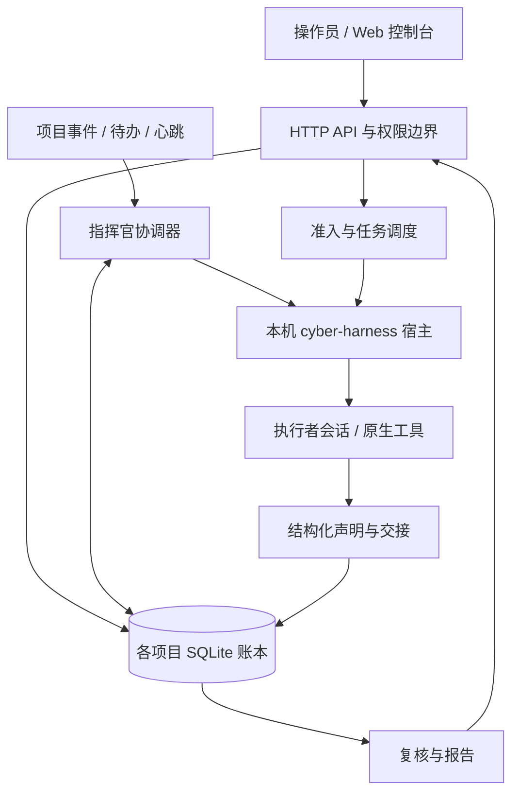

# 天吴核心架构

本文描述当前实现的职责与边界。安装、启动和操作入口见 [README](../README.md)，代码变更遵循[实现约定](../agent.md)。

## 1. 系统边界

天吴是单机、单用户、多项目的授权安全测试控制面。`tw` 在一个进程内提供 HTTP API、Web 控制台、项目账本、调度器和指挥官协调；独立构建的 cyber-harness fork 提供本机执行宿主、模型会话、工具、原生命令、Skill 发现和上下文压缩。HTTP 入口有请求头、读、写和空闲超时，并对请求体设上限：普通请求 16 MiB，唯一例外是 `/api/projects/import` 的项目包上传（4 GiB，且只在该路由、非 JSON 请求体时放宽；文件直接落到临时文件，不进入内存）。两者都先按声明的 Content-Length 拒绝，分块上传在越界读取时失败，避免慢客户端或无界 JSON 把一个 handler 变成资源出口。

天吴决定何时允许新一轮模型调用，记录任务及证据；模型决定测试策略和分工。控制面不内置固定攻击流程，不从运行日志推断漏洞，也不复制 harness 的工具、会话或压缩实现。

## 2. 角色与执行契约

操作员定义项目目标、授权范围、测试时段和禁止动作，决定启动、暂停及人工授权。指挥官可以请求停止整个项目（持久暂停，只由操作员恢复），但不能启动、恢复或追加目标；执行者不能停整个项目，只能把判断交回指挥官。可编辑的项目约束文档只表达这些边界，例如禁止删改目标业务数据；它不承担通用角色提示词的职责。

指挥官在 harness 长会话内读取项目目标与状态，组织方向、派发和协作、处理待办并判断是否完成。内置 commander Skill 规定证据标准、版本意识和职责。执行者只取得自己的意图、稳定约束、验收标准、上下文及交接契约，不接收整份项目目标或内部评测备注。

看门狗负责确定性的存活检测、失联运行取消和状态对账，并保留等待关系及中断原因。复核器与报告器分别承担断言核验和结果整理。执行者以方向及其运行为身份和状态来源；操作员界面提供观察、停止、模型与消息权限管理。

组织围绕可验收任务临时形成，不扩展固定军衔、人格繁衍或生存机制，不为维持组织另设角色状态。指挥官处理全局取舍，执行者承担具体任务，看门狗保持确定性，独立复核保留自己的证据与结算边界。模型档位是资源选择，不建立上下级关系。

每条结论必须关联可复核的原始证据。无法保留证据的内容只登记为线索，不能表述为已验证结论；是否复核及复核哪一版断言由账本决定。目标输出、文件和网页内容属于待分析数据，不构成操作员授权。复核器按验收标准检查证据，报告引用账本中的当前记录。

前提准入只有 `verified_only` 一种：全部必要前提须当前断言已独立核验。旧清单里的 `standard` / `strict` 在加载时一次性迁移为 `verified_only` 并写回清单；不存在标准模式的只读兼容路径，也不再接受 `standard` 写入。

## 3. 持久数据模型

各项目位于 `<data>/projects/<id>`，使用 `ledger.sqlite` 作为事务状态来源，工作目录、原始证据和会话材料与账本分开保存。目录 `<id>` 是短随机标识（`p-xxxxxxxx`），与项目显示名解耦：改名不移动目录，名称/简报里的目标域名也不会进入路径或控制台 URL。当前版本要求匹配的 SQLite schema；不在启动时自动导入旧 JSON 数据。

项目整体迁移使用 `.twproj` 包：导出只在项目暂停且没有在跑运行时进行，账本通过 SQLite 快照写入，避免只拷主文件而漏掉 WAL 中已提交的事务；包内每个文件带 SHA-256。导入先完整校验条目的路径、大小和摘要，再把账本以只读方式打开并复核每条证据的登记摘要，最后才把暂存目录改名为 `<data>/projects/<id>`，因此被拒绝的包不会留下半个项目。运行的会话标记、`.tw` 下的按会话令牌、`commander/` 临时工作区、`.verify` 草稿以及 `.access` 的租约和控制会话不随包迁移；方向工作区内的 `worker-note.md` 作为跨轮记忆保留。导入项目固定以暂停状态落地，且目标版本必须与包内账本 schema 一致；没有跨 schema 的导入迁移路径。

| 对象 | 职责 |
| --- | --- |
| Goal / Intent | 项目目标、可验收的工作方向、前提、依赖与状态 |
| Fact / Evidence | 显式声明、有限派生、原始材料与断言版本 |
| Run | 一次有账本记录的执行，含模型、状态、用量及停止原因 |
| Review | 绑定具体断言版本的复核结果 |
| Instruction / Context | 持久指令、引用、固定项及上下文选择 |
| Message / Delivery | 协作消息、状态变化交付及确认 |
| Notebook / NoteRef | 私有判断笔记、历史正文、事实版本引用，以及绑定写入者和指挥官运行轮次的摘要回执 |
| Access / Action | 人工访问前提、外部动作状态、幂等身份及未知结果 |

记录版本用于并发更新检查；断言版本用于判断既有复核是否仍适用。修改断言不会把旧复核自动带到新版本。来源日志和观察事件不会自动晋升为发现。图关系表达依赖、引用和固定上下文，不能把“存在一条边”解释为其内容已被证明。

每个项目由一个或多个由操作员在创建或追加时定义的终点目标组成；项目在所有目标达成且无在办工作时收口。创建项目时写起点与终点（起点进入项目简报，终点是可判真假的最终状态），追加目标也只能由操作员显式操作；两者都是操作员的自然语言，控制面不做量化评分。指挥官与执行者不创建、不改写目标：它们只做测试、按目标判断是否达成并推进。未达成终点不画进链路、也不连线，只在图谱左下「终点」卡显示；达成后接到承载证据的事实上。

## 4. 运行生命周期与准入

执行者从意图派发为 Run，取得当时的前提与上下文。运行中的声明经 API 写入账本，结束时提交结构化交接。等待子任务时按协作协议让出槽位，依赖就绪后由调度器续接；取消与停止原因保留为显式状态。

项目暂停、模型暂停、宿主就绪、并发容量和前提状态共同决定是否允许新调用。运行中的任务不会因为某个配置被暂停就被强行终止。原生闲置消息留在邮箱，只有经过天吴准入并记录的续轮才能开启模型调用，避免账本外自动续跑。恢复按“有事可做”判定：项目已收口且没有未达成目标、待办方向或未读操作员消息时，显式的「继续项目」保留暂停并说明原因，不开一轮只看已收口 board 的指挥官轮次；操作员消息或追加目标都能恢复，消息驱动的补测轮会在提示词里标明不得改动目标。

进程重启后项目默认保持暂停，操作员检查现场后恢复。任务状态、事实和交付有持久记录；部分指挥官会话周期信息及暂停说明仍依赖进程内状态，不能视为完整的分布式恢复协议。

## 5. 长会话与状态检索

指挥官保留长会话以接续推理，账本作为外部持久记忆。概览只提供必要索引，正文、历史、证据和任务子图按需读取；冻结快照通过游标分页，避免跨页读到不同版本。控制台图谱固定在一份完整快照上：默认每 6 秒探测账本变化并自动换入新快照（可关闭实时刷新），刷新只整体切换快照，不跨版本拼接页面；换快照会回到首屏批次，相机位置保留，未达成终点不上图（左下终点卡），达成后接到承载证据的事实上。图谱按账本状态着色：未满足的硬门槛（前提事实未核验、不可复核或缺失）是虚线红，实线红只表示正在执行。方向还没有产出事实时，链路末端是幽灵环：它是“尚未产出”的占位，不是可打开的节点——点击它不选中、不展开右侧面板（列表视图同样不列出），悬挂详情只由步骤节点承担；双击画布也不移动或缩放相机，适配画布只由工具栏按钮显式触发。右侧的节点面板、下发面板和悬停卡片共用一条可拖动的宽度，拖左缘或按方向键调整并持久化。

上下文接近交接阈值时，指挥官完成交接并记录 STATE；下一轮交接提示使用一次性状态，“本周期已交接”和“上一轮是交接轮”分别记录，避免从交接到 harness 压缩之间每轮重复注入全文。实际会话压缩由 harness 完成。笔记没有字数、行数或文件大小门槛：提示词只给一句软提醒（结论与线索、事实用 id 引用、篇幅自己判断），是否压缩、写多长由指挥官判断，控制面不截断。会话凭据按会话投放，不进宿主环境：每个会话从自己的 case 拿到一次性身份（`.tw/identity.json`，以及现成的一行请求头 `.tw/auth`；宿主通过 shell init 把它们导出成 `$TW_AUTH`/`$TW_BATTLE`/`$TW_API`），笔记就是战场基址下的 `GET/PUT /api/state`，只对指挥官身份可见，令牌随会话替换或进程结束撤销；执行者读不到也改不了。同一个身份令牌也能只读战场接口（`/p/<项目>/api/` 的 board、意图、目标、证据、打法、run）——共享态势是涌现协作与事实意图图的基础；执行者的写操作仍走 `/agent/`，由服务端按身份限定范围。项目基座上的请求会附带同一个解析出的执行者身份：按方向私有的读取（别的方向的 run 输出/上下文/事件、未领取的浏览器现场、只适用于某个方向的指令）在 `/p/` 与 `/agent/` 上同样收窄，共享态势仍然可读；指挥官没有单一方向，保留项目级视野。会话凭据只随各自会话/run 撤销，项目删除或控制面关闭时连指挥官的会话身份一起撤销（注册表是进程级的，不能让它比项目活得久）。

变化交付记录尝试次数、下次重试时间及上次展示的 Run。未确认交付按退避契约重试，心跳依据持久状态判断是否需要唤醒，不依靠提示词要求模型记得确认来抑制重复完整轮次。

笔记文件不存在时使用显式模板；其他读取失败会阻止本轮模型调用，保留未交付输入并显示错误，不把不可读记忆当成空白。一次成功交接覆盖当前压力周期，即使压缩发生在后续普通轮次，也不重复要求补写；压缩后只有该周期尚未完成交接时才要求修复，新的压力周期仍须重新交接。

指挥官笔记从首次显式保存起由账本中的 `notebook` 记录管理，历史正文进入既有版本表；`state.md` 是可重建镜像。加载旧文件不会隐式迁移，返回 `version=0`，首次显式 PUT 才产生版本 1。`GET /api/state` 返回正文、版本、当前请求的 run_id、写入回执和事实版本引用；`PUT` 必须带已读 `version`，会话还必须带匹配当前身份的 `run_id`。服务端在同一事务里写入正文、SHA-256、认证写入者、run、轮次和 run 的 `note_writes` 回执；版本冲突、已结束轮次及过期事实记录引用返回 409，不覆盖既有内容。操作员写入明确记为 operator，不能代指挥官完成交接。原会话令牌可以续用，但上一轮的延迟请求不能借此写进新一轮。

`GET /api/state?version=N` 读取不可变历史正文；`fact_versions` 保存笔记引用的已读记录版本，同时冻结对应断言版本。引用后来变化或被否定时通过 `stale_fact_refs` 提示重读，不复制事实正文。指挥官 run 与决策记录保存笔记输入版本，交接只接受本轮成功 run 写出的当前版本回执，不再检查动作摘要里的 state 标签。操作员或其他轮次更新笔记时，下一轮重新注入当前正文。文件镜像失败会单独返回 `projection_warning`，已提交的正文和回执仍可从账本恢复，避免把镜像错误误当成未执行而重放。笔记记录不进入共享变化页、检索快照或任务图，也不唤醒指挥官。该记录类型是现有通用对象表的增量扩展；包含它的账本需使用支持 notebook 的程序读取。

## 6. 协作与唤醒

同项目执行者可交换结构化消息、委派子任务、等待结果及请求人工访问。父子任务、等待关系和交接保存在控制面，原生工具负责实际执行。消息传输状态与任务完成、结论复核是不同概念。

请求、通知和交接保持任务间直达；关键结论必须提交事实与证据。局部正常推进由父任务或创建者承接，通知合并、幂等和背压控制噪声，不把每条消息变成一次指挥官调用。换模型交接的事实引用同时冻结记录版本和断言版本；新会话看到断言已变化或被否定时明确提示引用过期，不能把当时的事实 ID 自动解释为当前证明。

项目事件、持久待办和空闲心跳进入指挥官协调器，经过合并与准入后开轮。幂等身份避免重复提交同一操作；结果未知的外部动作不会自动重放。项目暂停期间待办保留，恢复后按当前状态处理。

指挥官判断项目不应继续（目标不可达、授权阻塞、继续推进只会空转）时可以请求全局停止：项目进入持久的“指挥官请求停止”暂停、在跑方向取消，发起本轮正常收尾并把本轮事件交付结清；恢复仍只有操作员的显式「继续项目」。这避免指挥官只能停放方向、随后又因该结果被自动唤醒，空耗一轮 token。全局停止只能由发起请求的那一个指挥官轮次声明：控制面要求请求来自 harness 会话、带指挥官身份声明，并且存在进行中的指挥官轮次可供归因；执行者会话不能停整个项目。暂停原因（操作员暂停 / 目标完成待命 / 指挥官请求停止）与暂停标志一起持久化，控制面重启后控制台仍能显示是谁停的项目，只有操作员恢复才会清除。

## 7. 模型与宿主

模型配置保存在 harness 用户配置中，控制台提供配置、默认选择、层级、容量和 API key 轮换管理。不同配置可复用或启动对应的本机宿主。默认宿主与审计调用通过显式 `--config` 读取过滤后的运行配置副本，命名配置宿主读取单配置副本；启动和保存设置后的重启均使用这条边界。原文件及其暂停与调度元数据保留，harness 的严格解析器只接收运行字段。本机宿主固定带 `--observe http`：harness 的 observe 扩展只能由命令行选择，配置副本里没有对应键；不选 http 时抓包仍留在 harness 自己的 hub 里，永远不会作为 `aop.traffic.Flow` 事件进入账本，控制台「HTTP 流量」就会一直为空。其余观测类别（工具、命令、进程、文件）在天吴没有消费者，默认不开，避免把每个动作变成一行无下游的日志。

宿主每轮重建 system prompt，并读取工具、命令与技能目录；时间字段 `Session Started` 固定使用宿主 runtime 创建时间。当前时间随本轮 user 提示注入。工具或技能目录变化、宿主替换及 provider 的缓存策略都会影响前缀缓存命中。上下文压缩与 85% 交接通过笔记和账本保存状态，独立于 provider 缓存。

harness 的配置优先级测试通过显式 `Context` 提供独立的项目目录、用户目录和环境变量，不访问开发者真实配置。天吴向宿主传递过滤后的运行配置副本；独立 harness 直接读取共享配置时，使用自身的配置兼容契约。

`paused` 是持久布尔字段。暂停保留配置、默认绑定和现有宿主，后端拒绝显式指定该配置的新调用。执行者、指挥官及复核、报告继承的默认模型被暂停时，优先选择配置的 fallback，再尝试实例默认及配置目录中的其他可用模型；跳过暂停、配置不完整或已确认不可用的配置，无可用替代时明确报错。替代模型通过独立宿主执行，运行记录反映实际绑定；恢复后新请求重新使用原默认，不终止或重放已有请求。

模型目录查询与连通性检测分开：前者辅助选择名称；后者由操作员显式触发一次轻量推理请求，必须取得有效响应才报告成功。展示的响应模型名称只取接口原始字段，缺失时不以配置名称补齐。成功不证明工具调用、长上下文或目标操作能力。读取设置不会自动发起真实推理。

## 8. 复核、报告与完成边界

线索、声明、已复核断言和报告引用需要区分。复核绑定断言版本，报告应保留来源与证据，使操作员可以回到原始材料核验。收尾窗口让已派发工作完成交接，并把新增声明纳入最终检查；投递成功本身不等于目标完成。

复核是成功意图的固定结算阶段，不是可选的自动开关：方向成功结束后进入 `reviewing`，该方向尚未核验的 `vuln`/`cred` 结论（有证据的）由独立复核者重跑；通过后才 `done`，未通过或没有原始证据则进入 `review_failed`，由指挥官在原意图上 `retry`/`continue`，重试会重新处理该方向仍未解决的失败事实。复核集合属于方向而不是某一次 run：先让出子任务再被唤醒续跑、进程崩溃后的对账恢复、以及 retry/continue 都不会漏掉更早的结论。`note` 永不复核；`host`/`service`/`loot`/`artifact` 只在下游将其写入 `from_fact_ids` 时按需复核。按需复核失败会在 readiness 显示 `failed`，自动队列不会对同一断言版本无限重试；修正断言或操作员手动复核才能再次进入。所有项目固定 `verified_only`，旧 `standard` 清单在加载时自动迁移。复核暂停是操作员急停：进行中的固定复核挂起而不判失败，方向保持 `reviewing`，恢复复核后自动续跑；只有复核完成且结论未通过、或结论没有原始证据，才进入 `review_failed`。不存在自动复核开关。

存在等待复核的前提门禁时，会话创建的无前提方向只有两种情况以 `hold + bootstrap` 创建：引用的 `interest_entity_refs` 已在账本里有事实，或没有写实体身份。新实体首触在 `interest_entity_refs` 中写明账本中尚不存在的实体即可直接放行；因此不相关的新目标不会被误卡，也不能用“另开根方向”绕过未完成的复核。重开/重试同一方向不会改变其 from_fact_ids，仍要过前提复核。

报告生成与交付是操作员侧的后处理：报告 run 只读账本快照与证据原件，由控制台显式触发，不依赖指挥官或执行者的会话状态。报告目录里的证据副本和证据端点按同一类不可信字节处理：Markdown 保持文本类型，HTML/SVG/XML 固定类型并加 CSP sandbox，其余文件禁止内容嗅探——捕获页即使被操作员直接打开，也不能以控制台源执行脚本。指挥官与执行者只负责测试本身，报告/复核的运行、输出与队列不出现在其 API 视野中（`/api/runs` 过滤 support purpose，`/api/artifacts`、`/api/traffic` 过滤 support run 的原生产物与抓包，board 不返回复核队列，`handoff_warnings` 不列 support run）。会话仍可从意图的 readiness 读取必要前提的派生复核状态（排队、进行中、冷却、暂停、未通过、未启用或不可复核）及一句处理提示：该状态用于等待或请操作员处理；它不含复核运行、输出与队列本身，也不给会话触发复核的入口；readiness 里的 `review_id`/`verifier_run` 只是断言回执标识，不是复核运行入口（run 内容端点对会话保持 404）。board 可以列出方向的 `reviewing`/`review_failed` 状态——那是方向生命周期，不是复核运行或队列。心跳、看门狗节拍、最后一次唤醒、轮次/用量/存活统计和 guard 脉冲属于控制面调度，不进入指挥官的 board 视图——会话的 board 只保留“指挥官是否启用、是否暂停、暂停原因”这类可操作的运行状态；会话只看到实际的 board 状态和明确发给它的消息。复核与报告共享一个实例级辅助模型并发（默认 1，即串行；可在设置中调整），不占执行者并发名额。

当前收尾仍有结构性限制：窗口内新增声明和显式未完成项尚未统一为独立结果契约；跨焦点、经验、图和报告的所有引用也尚未收敛成同一种版本结构。实体身份检索与跨分支旧事实引用仍需谨慎核验。

复核 run 分别保存 `queued_at`、`execution_started_at`、`queue_ms` 与 `execution_ms`。排队时间从复核 run 登记到取得辅助模型槽位并开始执行，包含执行前准备；执行时间只覆盖实际模型执行，运行详情同时显示总耗时、复核排队和执行耗时。取消于队列中的运行保留排队时长，执行时长为空，不伪记为已执行。模型执行超时从取得槽位后计算，排队期间仍可由操作员取消；等待槽位不会单独耗尽模型执行时限。独立复核继续绑定具体断言，不通过缩减复核来优化执行耗时。

## 9. 验证层级与已知限制

Go 测试覆盖账本、调度、准入、状态检索与交付协议；前端测试覆盖状态转换、版本冲突和组件交互。假模型、合成图与离线界面样本只验证协议和产品行为。显式启用的真实 harness 集成测试验证适配与 Skill 展开，真实测试效果需要在授权且隔离的目标上独立验收。

控制台令牌具备本机执行权限，模型工具不受本项目提供的文件系统沙箱保护；授权资产范围不是逐请求的强制过滤器。模型输出与第三方内容都需审查。

变更历史加载与账本快照的计算和内存开销随数据量增长；分页只限制返回结果的大小。事实图的前提核验只检查引用条件，工具调用的授权范围与执行隔离不由图关系保证。

规模评测待办：下一次长任务结束后，选固定的隔离任务比较重复工作、无效唤醒、过期引用、恢复失败、执行耗时、复核排队耗时与 token 用量，再决定并发和检索复杂度。在取得这组测量前，不继续增加组织层级或检索机制；本次协议回归不作为规模或真实测试效果的证据。

当前实现面向单用户、单机、多项目，不支持多租户或远端执行集群，不承诺完整无人值守、自动发现率或业务安全保证。
