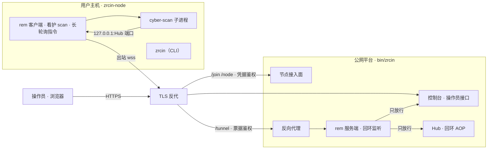

# 15 远程节点：隧道回连、一键部署与节点生命周期（设计）

状态：**1a 与 1b 已实现**（2026-11-26；落地决策见 §14），2（SSH 部署）与收尾待做。它是 [docs/14](14-nodes.md) 节点形态的第四种：节点在用户主机上，经隧道自己回连中心。[docs/04](04-templates-and-resources.md) 的 T3–T5 解决了「远程节点怎么声明能力、证据怎么传」，本文解决「怎么装上去、怎么回连、怎么看状态、怎么销毁」，并补齐异机节点真正干活所缺的文件合同。实施完成后按 §15 并入 docs/14 与 docs/01，本文退役。

## 0. 目标与边界

**目标**：公网平台当中心。在用户主机上执行一行命令，或给控制台一组 SSH 凭据，节点就装好 `cyber-scan` 并自动打隧道回连；控制台看得到每个远端节点的状态，点一下就能销毁。

**边界**：

- 节点只出不进，主机侧不开任何入站端口；平台公网只开控制台那一个端口。
- SSH 只在部署那一次使用；销毁靠平台下发指令。
- 不改模型侧的交接契约（仍是「追加 `.zrcin/facts.jsonl`」），不改账本。
- 现有形态原样可用：本机节点、`nodes.json` 配置节点、直连 `--transport web`。
- 首批主机平台是 Linux（systemd，含 WSL2）；Windows / macOS 后续。
- 不做：zrcin 自带 TLS、自签证书指纹、节点在线升级、多平台产物构建。

## 1. 已核实事实（构成约束）

| # | 事实 | 出处 | 约束 |
| --- | --- | --- | --- |
| 1 | `cyber-scan` 不监听端口，作为 web 客户端出站连 Hub；会话还要访问控制面 API（`api_base`）。 | `internal/host/host.go:698-711`、`internal/aopexec/sessionenv.go:21-67` | 隧道要同时打通 Hub 与控制面两条链路。 |
| 2 | 控制台与 Hub 默认都绑回环；对外暴露的既定做法是套 TLS 反代。 | `cmd/zrcin/main.go:66,72`、`cmd/zrcin/exposure.go:16-31` | Hub 不上公网；隧道入口挂在控制台端口上。 |
| 3 | Hub 只有一个共享 `AccessKey`；AgentService 只有 `ListAgents`。 | `pkg/web/service/auth.go:32-37`、`proto/rpc/agent.proto:10` | 没有「停节点」的 RPC；节点级隔离只能靠隧道凭据。 |
| 4 | 控制面已有到节点的直连命令通道（`Conn.Command`，浏览器功能在用）。 | `internal/aop/command.go:19`、`internal/api/browser.go:214` | 可作备用；销毁指令不走它（§5）。 |
| 5 | 远程节点的交接依赖共享文件系统：声明的事实只走 `<case>/.zrcin/facts.jsonl`，控制面从本地磁盘读（运行中按偏移读、结算时再读）；没有任何 HTTP 申报路由。 | `internal/ledger/ingest.go:58`、`internal/api/intents.go:1363` | 异机节点的事实回不到账本。 |
| 6 | 派发时要求 case 目录落在宿主上报的工作目录内。 | `internal/aopexec/executor.go:483-512` | 节点必须用平台 `--data` 的同路径作 scan 工作目录。 |
| 7 | 证据 sidecar 只解决传输：内容落 `<case>/.native/`（以路径为引用），不在原路径；结算按原路径 `os.Stat`。 | `internal/api/artifacts.go:86-102`、`internal/artifact/artifact.go:38-67`、`internal/ledger/ingest.go:353-358` | 异机节点声明的证据在结算时报「原件不可读」。docs/14 §5 的「不再依赖共享文件系统」目前只对传输成立，对结算不成立。 |
| 8 | `.zrcin` 整个目录被产物同步排除；`artifacts` observe kind 已存在，但**单独启用时不订阅任何钩子**（实测，补丁 28 修）。 | `core/artifactsync/artifactsync.go:149-156`、`exts/observe/extension.go:43,375-377` | 放行交接文件只需改排除规则。 |
| 9 | 提示词让模型优先用 `$ZRCIN_BIN` 读状态，该变量指向控制面二进制的路径。 | `internal/api/commander.go:148`、`internal/api/prompt.go:719` | 节点上要有 zrcin 可执行文件，变量要指向节点本地路径。 |
| 10 | 仓库不发发布包；scan 由 gate 按宿主平台构建。 | [docs/02](02-deploy.md) | 首批只保证与平台同 OS/arch 的节点产物。 |
| 11 | rem 作库嵌入 4zrcin 可行：编译通过、无版本冲突、现有 zrcin 二进制字节不变，不引入 gvisor / wireguard；只做了编译验证，未跑连接。 | 2026-11-26 在 HEAD 副本上的实测 | 隧道两端都内嵌 rem，节点上不单独放 rem 二进制。 |
| 12 | rem 的三个默认行为不能带上线：`Prepare()` 不传 `-i` 会访问 `myip.ipip.net`；不传 `--no-sub` 会监听 `0.0.0.0:29999` 并暴露 `/topology`；ws 隧道默认未注册。 | `runner/options.go:416`、`runner/runner_std.go:89-189`、`cmd/cmd/cmd.go:89-96` | 平台与启动器都显式传 `-i`、`--no-sub`，并显式引入 ws 隧道包。 |
| 13 | rem 服务端没有登录钩子，且完全按客户端的 Control 行事：在平台开什么监听、让平台拨哪个地址都照做。 | `runner/console.go:411-495` | 公网入口必须加服务端策略钩子（§9.1）。 |
| 14 | rem 的 `-k` 只用于生成登录令牌；流包装的密钥与 IV 随机生成，经 URL 的 `wrapper` 参数协商。 | `agent/proxy.go:24-30`、`runner/console.go:43-58`、`protocol/core/wrapper.go:99-119` | 公网这一跳必须由 TLS 保护；rem 的流包装不当作安全边界。 |
| 15 | 节点接口是项目级的（`/p/<id>/api/nodes`）；实例级路由在 `hub.ServeHTTP`，免登录白名单在 `consoleAuth.wrap`。 | `internal/api/api.go:608-611`、`cmd/zrcin/hub.go:901-964`、`cmd/zrcin/auth.go:636-663` | 接入、销毁、部署是实例级，放实例级路由并登记白名单。 |
| 16 | `golang.org/x/crypto` 已是直接依赖。 | `go.mod:22` | SSH 部署用 `x/crypto/ssh`，不引入外部 ssh 二进制。 |
| 17 | 节点页现状：手写 `ul role="list"` 行、4 秒轮询、接入面板与构建配方占半屏、底部三段说明。组件库没有 AlertDialog，确认走 `useConfirm()`；「代理」Tab 不在深链白名单里。 | `web/src/views/Nodes.tsx`、`web/src/views/GraphView.tsx:166` | 重做节点页时一并修深链缺陷。 |

未标注仓库的路径：`internal/`、`cmd/` 在 4zrcin；`core/`、`exts/`、`agent/`、`pkg/`、`proto/` 在 cyber-harness fork；`runner/`、`protocol/`、`cmd/cmd/` 在 rem fork。

## 2. 总体架构



| 部件 | 位置 | 职责 |
| --- | --- | --- |
| `zrcin-node` | 节点 · `cmd/zrcin-node` | 隧道客户端、看护 scan、接收指令、安装与卸载 |
| `cyber-scan` | 节点 | 执行会话与工具调用（现有二进制，full 或 capture 配方） |
| `zrcin` | 节点 | 只作 CLI，供模型的原生只读命令使用 |
| 节点接入面 | 平台 · `internal/enroll` | 接入记录、节点档案、凭据校验、产物清单 |
| 隧道入口 | 平台 · `internal/tunnel` | rem 服务端、票据、反向代理、会话表、策略 |
| SSH 部署 | 平台 · `internal/nodedeploy` | 部署任务与日志流 |

节点在本地回环镜像出平台同款的 Hub 地址与控制台地址，所以控制面写进提示词和 `ToolEnv` 的地址在节点上原样可用（事实 1、6）。

## 3. 平台侧

### 3.1 开关与地址

新 flag `--public-url`：节点与浏览器访问控制台的公网基址（如 `https://ops.example.com`），不带路径与查询。设置后开启三样东西：节点接入面（`/join/*`、`/node/*`）、隧道入口（`/tunnel/*`）、控制台节点页部署栏里的命令部署与 SSH 部署。

- 留空（默认）：三者全部 404，行为与现在一致。
- 主机不是回环或私网地址时必须是 `https`，否则启动失败并说明「公网接入需要 TLS：在前面套 TLS 反代，反代需透传 `/tunnel` 的 WebSocket 升级头」。回环与私网地址允许 `http`，供内网试用。
- TLS 由反代终止（事实 2）。zrcin 自带 TLS 与自签证书指纹不在本次范围。
- 首次开启时生成 `<data>/tunnel.key`（32 字节随机，0600），作 rem 登录密钥。

### 3.2 数据模型与状态

节点档案与接入记录存 `<data>/remote-nodes.json`，单文件，临时文件加 rename 原子写。凭据只存 SHA-256，文件里没有明文。

接入记录：

```
{id, token_sha256, name, recipe: full|capture, deploy: command|ssh,
 expires_at, state: pending|joined|revoked|expired, node_id, install_id, created_at}
```

接入令牌形如 `zr1_<32 字节 base64url>`，只在创建接入记录的响应里出现一次。

节点档案：

```
{id(16 字节 hex), name, enrollment_id, recipe, deploy, credential_sha256, state,
 install_id, hostname, os, arch, joined_at, last_seen_at, last_error,
 destroy_requested_at, destroyed_at}
```

节点凭据形如 `zn1_<节点id>_<32 字节 base64url>`，只在 `POST /node/join` 的响应里出现。

节点状态：

```
joining ──隧道建立且首次心跳──▶ online ⇄ offline
   │                               │
   └──────────── 销毁 ─────────────┴──▶ destroying ──回执或人工确认──▶ destroyed
```

- online 与 offline 由平台观测：隧道会话在，且 90 秒内收到过长轮询，即 online。
- 节点名称在实例内唯一，`^[a-z0-9][a-z0-9-]{1,31}$`，缺省 `node-<id 前 4 位>`。
- 凭据不可恢复：节点凭据丢失等于重新接入（发新令牌）。

### 3.3 节点接入面

公开、绕过登录，凭据在处理器内校验，做法与 `/agent/` 一致（事实 15）；按 IP 与按令牌限速，失败计数沿用 `loginLimiter` 的方式。

| 方法与路径 | 鉴权 | 作用 |
| --- | --- | --- |
| `GET /join/{token}/install.sh` | 接入令牌有效 | 引导脚本；内含各 OS/arch 启动器的 SHA-256 |
| `GET /join/{token}/dist/zrcin-node?os=&arch=` | 接入令牌有效 | 下载启动器 |
| `POST /node/join` | 接入令牌 | 换取节点凭据与接入参数 |
| `POST /node/ticket` | 节点凭据 | 换一张 60 秒一次性隧道票据 |
| `GET /tunnel/{ticket}` | 票据 | WebSocket 升级，反向代理到 rem 回环监听 |
| `GET /node/next?wait=30` | 节点凭据 | 长轮询指令；每次响应都带节点当前状态 |
| `POST /node/report` | 节点凭据 | 心跳、隧道诊断、卸载回执 |
| `GET /node/dist/{name}` | 节点凭据 | 下载 scan 与 zrcin |

状态码：401 凭据无效；409 接入令牌已绑定另一台主机；410 接入令牌已作废（已回连、过期或撤销），或节点凭据已随销毁失效。

`POST /node/join` 的规则：

- 首次调用为接入记录分配节点 id 并签发节点凭据，同时记下安装 id。
- 同一接入令牌、同一安装 id 重复调用返回同一凭据（安装重试安全）。
- 同一接入令牌、不同安装 id 返回 409「该接入令牌已绑定另一台主机」。
- 隧道首次建立后接入令牌作废。节点之后的修复安装凭已有的 `etc/node.json` 走节点凭据，不再需要令牌。

安装 id 由启动器从主机 machine-id 派生，同一台主机重复安装保持不变。

`POST /node/join` 的响应：

```json
{
  "node_id": "…", "node_credential": "zn1_…",
  "public_url": "https://ops.example.com",
  "tunnel": {"key": "<实例隧道密钥>", "path": "/tunnel"},
  "hub": {"addr": "127.0.0.1:18766", "key": "<Hub AccessKey>"},
  "console_addr": "127.0.0.1:8080",
  "data_dir": "/srv/zrcin/data",
  "dist": [{"name": "cyber-scan", "sha256": "…", "size": 0}, {"name": "zrcin", "sha256": "…", "size": 0}]
}
```

`console_addr` 取自平台自身的 `APIBase`，`data_dir` 是 `--data` 的绝对路径。

产物来源：启动器是 gate 与 zrcin 一同构建的 `bin/zrcin-node`；scan 是平台自己的 `--scan` 二进制（full）或同目录的 `cyber-scan-capture`；zrcin 是平台正在运行的可执行文件。三者都与平台同 OS/arch。请求方平台不同且 `<data>/node-dist/<os>-<arch>/` 里没有对应产物时返回 409，并说明把产物放到哪里。

### 3.4 隧道入口

- 平台进程内起 rem 服务端，只监听回环：`-s ws://127.0.0.1:<自动分配端口>/tunnel -i 127.0.0.1 -k <隧道密钥> --no-sub`（事实 12）。
- 节点先换票，再连 `wss://<公网基址>/tunnel/<票据>`。zrcin 在 `GET /tunnel/{ticket}` 校验票据（存在、未用、未过期），登记「期待节点 id = 票据所属节点」，再把连接反向代理到 rem 的回环监听，路径改写回 `/tunnel`。
- 票据放路径而不是请求头：rem 的 ws 客户端不能定制请求头，并且会丢弃查询串、保留路径（`protocol/tunnel/websocket/websocket.go:34-76`）。票据一次性、60 秒，进反代访问日志也无害。
- 节点 id 与隧道的绑定：rem 登录里的 agent 别名由客户端自报，策略钩子要求它等于期待节点 id，且该期待在 60 秒内未被消费。一张票对应一次登录。
- 节点请求的转发固定两条：`127.0.0.1:<Hub 端口>` 到平台 Hub，`127.0.0.1:<控制台端口>` 到平台控制台。平台不向节点推送任何监听。
- 会话表（内存）：节点 id 到 rem 服务端 agent、对端地址、接入时间、流量。rem 服务端 agent 在 `agent.Agents` 全局注册，按节点 id 取，状态读 `IsClosed()` 与 `TrafficStats()`。

### 3.5 操作员接口

实例级，要求操作员会话；harness 会话一律 404。

| 方法与路径 | 作用 |
| --- | --- |
| `POST /api/enrollments` | 创建接入记录：`{name?, recipe, deploy, ttl_minutes?}`，返回 `{id, token, install_command, expires_at}`。`token` 只在此响应出现。 |
| `GET /api/enrollments` | 待回连与近期的接入记录 |
| `DELETE /api/enrollments/{id}` | 撤销尚未回连的接入令牌 |
| `GET /api/remote-nodes` | 远端节点档案与隧道状态 |
| `POST /api/remote-nodes/{id}/destroy` | 销毁（§5） |
| `POST /api/remote-nodes/{id}/forget` | 长期不回连的 `destroying` 节点标记为已移除 |
| `POST /api/node-deploys` | 发起 SSH 部署任务（§7.2） |
| `GET /api/node-deploys/{id}` | 任务步骤与日志 |

### 3.6 节点注册表与派发

- scan 经隧道连上中心 Hub 后走现有自动发现（`Registry.RefreshNodes`），节点 id 为 `scan_<节点id>`。`nodeView` 增 `remote` 字段（部署方式、配方、隧道状态、主机信息、运行时长），由节点档案按 id 关联。
- 1a 里隧道节点的 `remote.dispatch` 为 `blocked`：`resolveNode` 在这一步拒绝，落点与 capture-only 的隐式派发拒绝相同（`internal/api/nodes.go:221-248`），`Router.Run` 兜底。拒绝文案说明「文件合同上线前不能承接意图」。控制台对这类节点禁用「启用到项目 / 设为默认」。终端照常可用。
- 1b 文件合同上线后 `remote.dispatch` 为 `ready`，限制解除。

## 4. 节点侧：zrcin-node

### 4.1 安装布局

```
/opt/zrcin-node/                      安装根；.owner 标记记录节点 id
  bin/zrcin-node  bin/cyber-scan  bin/zrcin
  etc/node.json                      0600：公网基址、节点凭据、隧道密钥、Hub 地址与密钥、回环镜像端口、数据目录路径
  var/                               启动器与 scan 日志、安装 id
<平台 --data 的绝对路径>/             归属标记 .zrcin-node-owner；scan 的工作目录；case 的落地处
/etc/systemd/system/zrcin-node.service
```

- 安装根可用 `--root` 改。数据目录路径不能改（事实 6）。
- 归属标记是卸载时「只删自己的东西」的依据。
- 非 root 安装时根目录在 `~/.zrcin-node`，服务单元在 `~/.config/systemd/user/`；数据目录路径建不出来就拒绝并说明。

### 4.2 install

1. `POST /node/join`，得到节点凭据与接入参数。已有 `etc/node.json` 时走修复：校验节点凭据后重新下载产物、重新注册服务，不需要接入令牌。
2. 预检，任一失败即退出并说明原因，不留半成品：
   - 回环镜像端口（Hub、控制台）未被占用。
   - 数据目录路径不存在，或带本节点的归属标记；存在但没有标记则拒绝，「该路径已存在且不属于本节点」。
   - 磁盘空间不少于产物清单 size 之和的两倍。
3. 按 `dist` 清单下载 `cyber-scan` 与 `zrcin` 到 `bin/`，逐个校验 SHA-256，权限 0755。
4. 写 `etc/node.json`。
5. 注册并启动服务。没有 systemd（例如未启用 systemd 的 WSL2）时打印明示，并以前台方式进入 `run`，退出码 0；`status` 显示 `service: none`。

### 4.3 run

1. 建隧道。rem 客户端：`-c wss://<公网基址>/tunnel/<票据> -k <隧道密钥> -i 127.0.0.1 --no-sub -a <节点id>`，本端开两条转发，监听在 Hub 与控制台的回环镜像端口上。断线按 rem 的退避重连，重连前重新换票。
2. 隧道就绪（两条回环端口可连）后拉起 scan：`agent --transport web --server-url http://<Hub 密钥>@127.0.0.1:<Hub 端口> --node-id <节点id> --node-name <名称> --observe http,artifacts --timeout 0`，工作目录是数据目录路径。scan 退出即按退避重启。
3. 指令通道（§4.4）。
4. 收到 SIGTERM：停 scan、关隧道、退出，不删文件。

落地结论：`--observe` 的 kind 可解析，但 `artifacts` 单独启用时不订阅钩子、什么都传不回；补丁 28 让它自给自足（只在确实带产物时发载体事件），说明文字也已补上。

### 4.4 指令通道

- 启动器长轮询 `GET /node/next?wait=30`，每 30 秒 `POST /node/report` 一次心跳（隧道与 scan 状态、诊断）。
- 指令带递增序号，节点持久化「已执行到的序号」，重复投递幂等。
- 1a 的指令集只有 `uninstall`；后续可加 `restart`、`upgrade`。
- 节点凭据失效（410）等同 `uninstall`：启动器进入卸载流程。这是离线销毁的兜底。
- 指令通道走公网 HTTPS 直达控制台，不经过隧道，scan 崩溃循环或隧道异常时仍然可用。

### 4.5 uninstall

1. 停 scan 与隧道。
2. 停用并删除服务单元。以服务方式运行时，卸载放进独立的瞬时单元（`systemd-run`）执行，避免停止服务时被连带杀掉。
3. 删除安装根。数据目录路径仅在带本节点归属标记时删除。
4. 尽力上报 `{event: "uninstalled"}`（3 秒超时）后退出。运行中的可执行文件在 Linux 上可以先删后退出。

### 4.6 status

打印档案摘要、隧道与 scan 状态、服务方式、归属路径，供操作员贴进工单。

## 5. 销毁

操作员点「销毁节点」，输入节点名确认，控制台调用 `POST /api/remote-nodes/{id}/destroy`：

1. 平台立即把档案置为 `destroying`，停止签发票据，关闭现有隧道会话，并解除该节点在所有项目里的绑定与默认。节点凭据从这一刻起换不到隧道票据；指令通道仍然接受它，直到收到卸载回执或操作员标记已移除，此后返回 410。
2. 平台排队一条 `uninstall` 指令。
3. 节点在线：长轮询立即返回指令，启动器执行卸载（§4.5），上报 `uninstalled`，档案置为 `destroyed`。
4. 节点离线：保持 `destroying`，界面显示「等待节点回连执行卸载」。节点下次上线时 `GET /node/next` 立即拿到指令。
5. 长期不回连的节点，操作员可点「标记已移除」，档案直接置为 `destroyed`。

卸载指令不走现成的命令通道（事实 4）：那条通道借道 scan 的会话，而销毁的正是 scan；scan 崩溃循环或未就绪时销毁就会失效。指令通道属于启动器自己，只依赖到控制台的 HTTPS。

## 6. 凭据与安全

| 凭据 | 有效期 | 存放 | 泄露的后果 |
| --- | --- | --- | --- |
| 接入令牌 | 默认 60 分钟；首次回连即作废 | 平台只存哈希；节点的安装参数 | 可下载产物并完成一次接入；已被使用则无用 |
| 节点凭据 | 直到销毁完成；`destroying` 期间只能走指令通道 | 平台只存哈希；节点 `etc/node.json` | 可冒充该节点；可单独吊销 |
| 隧道票据 | 60 秒，一次性 | 仅内存 | 无法重放 |
| 实例隧道密钥 | 实例生命周期 | `<data>/tunnel.key`、节点配置 | 仅凭它不能登录，策略钩子还要求期待节点 id；轮换等于全部节点重新接入 |
| Hub AccessKey | 实例生命周期 | 节点配置 | 可经隧道连 Hub，前提是持有有效的节点凭据 |
| SSH 凭据 | 一次部署 | 仅部署任务内存，任务结束清零 | 不落盘、不进日志 |

| 威胁 | 对策 |
| --- | --- |
| 一行命令从 shell 历史或截图泄露 | 令牌限时、一次性，用过即 410 |
| 被攻陷的节点把平台当跳板 | 策略钩子只允许节点侧回环监听，只允许拨 Hub 与控制台两个平台回环地址；拨号策略二次校验（§9.1） |
| 节点冒充别的节点 | 票据与期待节点 id 绑定，一张票一次登录 |
| 公网暴力尝试 | 强制 TLS；接入面按 IP 与按令牌限速；令牌与凭据都是 256 位随机 |
| 明文传输 | `--public-url` 非 https 且非私网时拒绝启动；rem 的流包装不当作加密（事实 14） |
| 反代日志记下票据 | 票据一次性、60 秒 |
| 平台上的其他进程连 rem 的回环监听 | 需要隧道密钥，还需要被登记的期待节点 id |
| 部署时 SSH 口令泄露 | 不进 argv、不落盘，日志脱敏 |

已知限制，不在本次解决：Hub 凭据仍是实例级；节点配置文件含 Hub AccessKey 与节点凭据，主机被攻陷即泄露。这与现状的直连节点一致。

## 7. 部署方式

### 7.1 命令部署

1. 控制台创建接入记录，得到一行命令：

   ```sh
   curl -fsSL https://ops.example.com/join/<令牌>/install.sh | sudo sh
   ```

2. 脚本只做三件事：识别 `uname -s -m`；从平台下载 `zrcin-node` 并校验 SHA-256（脚本里带各平台的摘要）；执行 `zrcin-node install --join https://ops.example.com/join/<令牌>`。其余逻辑都在 Go 里。
3. `install`（§4.2）完成后，控制台部署栏的状态行随轮询变为「已回连」。

### 7.2 SSH 部署

- 表单：主机、端口、用户、认证方式（密码，或私钥加可选口令）、非 root 时的 sudo 口令。
- 步骤实时显示：连接 → 探测（`uname -s -m`、systemd、是否已是节点）→ 引导（§7.1 的脚本经 stdin 送给远端 `sudo sh`，不落远端磁盘，令牌不进 argv）→ 等待回连（隧道会话建立且 scan hello）→ 完成。
- 主机必须能出站访问平台的公网地址，隧道本身就是出站的，所以不往主机上传大二进制，仍由主机从平台下载。
- 凭据只在任务内存里，任务结束清零，日志脱敏。同一接入记录同时只允许一个部署任务。
- 失败即停并保留日志。重试时复用未作废的令牌，或发新令牌。

### 7.3 直连

现有「生成原生接入命令」放在节点页部署栏的「直连」方式下，行为不变，适用同机或共享目录的执行机。

## 8. 文件合同（1b）

目标：隧道节点能承接意图。模型侧契约与账本不变。

| # | 改动 | 仓库 | 落点 |
| --- | --- | --- | --- |
| H1 | 回合种子：`RunTurnRequest` 新增 fork 扩展 `4zrcin.CaseSeed`（JSON：`files[{path, mode, data}]`，路径相对 `WorkDir`），在 `applyTurnWorkDir` 之后、回合开始之前落盘；拒绝越界路径与符号链接 | harness | `agent/session/session.go:1402` 之后 |
| H3 | `artifacts` 自给自足：单独启用时订阅进程完成与文件钩子，只在载体事件确实带产物时才发（`exts/observe/extension.go`）；现有 `processes,artifacts` 等组合行为不变 | harness | 补丁 28 |
| H2 | 交接文件放行：`skipsArtifact` 从「排除整个 `.zrcin`」改为只排除控制面专用文件（`auth`、`identity.json`、`aop-session.json`、`*.offset`、`cursor-repair-*.json`）；`facts.jsonl` 与 `worker-note.md` 走现有 sidecar | harness | `core/artifactsync/artifactsync.go:149-156` |
| Z1 | 派发到隧道节点时构造种子：case 目录 `.zrcin` 的快照，沿用 23c 的限额（单文件 8 MiB，每批 16 文件、64 MiB），随 `RunTurnOpts` 下发 | zrcin | `internal/aopexec/executor.go`；扩展编码照 `internal/aop/workdir.go` |
| Z2 | 交接文件落地：sidecar 路径命中交接文件名时写到中心 case 目录的对应路径，不进 `.native` 工件库。`facts.jsonl` 先校验与中心已有内容的前缀一致再追加；`worker-note.md` 原子覆盖 | zrcin | `internal/api/journal.go:627-633` 之前分流 |
| Z3 | 证据结算：原路径 `os.Stat` 失败时，按同一路径到 `.native` 工件库取。`ResultId` 就是节点侧的相对路径（`internal/api/artifacts.go:93`） | zrcin | `internal/ledger/ingest.go:353-358` |
| Z4 | `$ZRCIN_BIN`：隧道节点的 `ToolEnv` 指向节点本地的 zrcin 路径，路径登记在节点档案里 | zrcin | `internal/aopexec/sessionenv.go:60-65` |
| Z5 | 放开派发：`remote.dispatch` 置为 `ready` | zrcin | §3.6 |

`CaseSeed` 与 `WorkDir`、`ToolEnv` 一样是 JSON-in-Any 的 fork 扩展，不改 proto，不触发 AOP 生成代码同步。

约束与落地核对：

- `facts.jsonl` 的写者只有该节点。前缀校验失败（节点文件短于中心已有内容）记为 run warning，不覆盖。
- 续跑、steer、verifier 的读凭证（`internal/verifier/verifier.go:743` 写 `.zrcin` 对）是否各自需要种子，逐条核对后再放开对应入口。
- 种子只含 `.zrcin`。提示词里按绝对路径引用的其它文件（显式选定的技能文件，`skillPrompt`）是否需要随种子携带，落地前列清单核对。
- Hub 侧 agent id 是否等于 scan 的 `--node-id`，用 `ListAgents` 核对；不一致时以 hello 回报的字段为准，并相应调整 §3.6 的关联键。
- 1b 完成前 `remote.dispatch` 保持 `blocked`。

## 9. fork 补丁

### 9.1 rem fork：服务端接入策略

- `runner`：`Options` 与 `RunnerConfig` 增 `AcceptPolicy`。读完 `Login` 后调用一次，用来拒绝半信道与 ConnHub 的登录路径；读完 `Control` 后再调用一次，位置在 `runner/console.go:411` 的令牌校验之后、建 agent 之前。返回 error 时回 `Ack{StatusFailed}`、关连接并返回错误。钩子为 nil 时行为与现在一致。
- `agent`：`Config` 增 `DialPolicy`。`initProxyClient` 与 `Fork` 的复制路径把拨号器包一层受限拨号器（`agent/proxy.go:11-22`、`agent/agent.go:415`）。
- 平台侧策略：登录别名必须等于被期待的节点 id；Control 只允许「节点侧回环监听，目的地址为 Hub 或控制台回环地址」；半信道登录一律拒绝。
- 实现补齐：Control 钩子最初只覆盖 accept 路径，客户端的额外 serve 走 `Fork`、绕过 accept。已在 `agent.Config` 增 `ControlPolicy`，在 `handlerControl` 入口统一校验（Fork 也经过它），console 从 `Policy.OnControl` 装配；测试证明「两个 serve 只放行第一个，第二个数据面不通」。
- 测试：无策略时现有 e2e 全绿；带策略时越界监听、越界目的地址、错误别名、重放期待各自被拒。

### 9.2 cyber-harness fork：文件合同

H1、H2 见 §8，在 FORK.md 按既有编号登记。旧 scan 忽略 `CaseSeed` 扩展；没有启用 `--observe artifacts` 的节点不受 H2 影响。

## 10. 控制台：执行环境 · 节点

部署相关的界面全部留在本页：节点状态与销毁、隧道命令部署、SSH 部署、直连接入命令、两种 scan 配方的构建指令。不挪去别的 Tab，也不藏进对话框页签。

### 10.1 设计方向

- **产品**：授权安全测试的指挥控制台。这一页回答「意图在哪里执行」：把执行节点部署出去、看住它们、必要时收回。
- **性格**：冷静、精确、值班台。
- **世界**：指挥中心的值班台与机架，链路灯、等宽字节计数、一条条接通的线路。中性色沿用仓库现有的 ink 色阶。
- **亮点**：远程节点行上的隧道链路（状态灯加实时流量），以及接入命令（一条等宽命令静置在安静底面上）。页面上只有这两处有分量。
- **签名细节**：链路灯，即状态点、连接时长、流量计数，只出现在节点行。

现状问题（依据 `docs/screenshots/nodes.png`）：说明文字替代了布局，一页有六句解释；面板里套着带边框的配方框，配方框里再套命令块，三层容器；节点行里两个默认徽章、状态胶囊、按钮同为橙色，没有主次；六档字号同屏；很少用的部署说明占了首屏的一半。方向按 unslop（Damir Sokolovsky，CC BY 4.0）的方法得出。

### 10.2 版式

容器宽度达到 56rem（页面现在用的 `@4xl`）时左右两栏：左边节点列表占弹性宽，右边部署栏固定 `w-96`。不足时上下堆叠，顺序是列表、终端面板（打开时）、部署栏。

```
节点列表 ·（弹性宽）
  远程节点 · 2
  ● lab-wsl      隧道已连接 42m   scan 就绪   full · 命令部署   [终端] [⋯]
    ubuntu-wsl · linux/amd64 · ↑12.4 MB ↓3.1 MB
  ○ office-wsl   离线 · 3 小时前   capture · SSH 部署          [终端] [⋯]
  待回连 · 1
  ◌ edge-01      剩余 47 分钟      full · 命令部署  [复制命令] [撤销]
  直连 · 1
  ● fence        宿主就绪          capture                     [终端] [⋯]
  本机
  ● local        宿主与模型就绪    项目默认                    [终端]

部署栏 ·（w-96；宽屏在右侧，窄屏在列表与终端之后）
  接入方式   [命令部署] [SSH 部署] [直连]
  名称       [edge-01            ]
  配方       (•) scan-full    ( ) scan-capture
  有效期     [60 分钟 ▾]
  ┌ curl -fsSL https://ops.example.com/join/…/install.sh | sudo sh ┐  [复制]
  ◌ 等待节点回连
  ─────────────────────────────────────────────
  构建配方
  scan-full      全引擎                              [复制]
  go build -o cyber-scan ./cmd/cyber-scan
  scan-capture   仅流量代理与围栏                    [复制]
  go build -tags 'emptyresources captureonly' -o cyber-scan-capture ./cmd/cyber-scan
```

页面只有标题「节点」和动作「刷新状态」，没有副标题。

### 10.3 节点列表

分组按管理边界，空组不渲染。组头是组名加等宽的计数。

| 组 | 行内容 |
| --- | --- |
| 远程节点 | 隧道接入的节点，可销毁。在线的排前面 |
| 待回连 | 未回连的接入记录：名称、剩余有效期、配方、部署方式、复制命令、撤销 |
| 直连 | 直连接入的 scan：状态、配方、终端。只能绑定，不能销毁 |
| 本机 | 本机节点：状态、项目默认、终端 |

每行固定两行，所有行同高同间距：

- 第一行：链路灯、名称（等宽）、隧道与 scan 状态、配方、部署方式；右侧是「终端」和 `⋯`。
- 第二行（次要色等宽）：主机名、系统与架构、上行与下行流量、连接时长。直连与本机行显示端点。

- `⋯` 里是启用到项目、移出项目、设为默认、销毁节点（仅隧道节点）。1a 里隧道节点的前两项禁用，菜单底部一行说明「隧道节点暂不能承接意图」。
- 每行只有状态带语义色。默认标记从徽章改成次要色文字；本机行不再显示「实例默认」，组名已经说明。配方与部署方式是安静的等宽文字。
- 状态为 `destroying` 的行显示「等待卸载」，行内附「标记已移除」。
- 远程节点为空时不渲染该组，部署栏就是接入入口。

销毁确认用 `useConfirm({destructive: true})`，正文写明后果：停服务、删除节点上的可执行内容与安装目录、解除项目绑定、不可恢复。需输入节点名。

### 10.4 部署栏

- **接入方式**是分段控件：命令部署、SSH 部署、直连。
- **命令部署与 SSH 部署共用的字段**：名称（留空自动生成）、配方（scan-full 或 scan-capture）、有效期（15 分钟、60 分钟、24 小时）。平台缺该配方的产物时，选项禁用并注明。
- **命令部署**：「生成接入命令」后出现命令块（等宽，`bg-surface-2` 底，不加边框，一个复制按钮）和状态行「等待节点回连…」。节点上线后变成「已回连」，点击定位到该行。重新生成等于发一条新的接入记录。
- **SSH 部署**：共用字段加主机、端口、用户、认证方式（密码，或私钥加口令）、sudo 口令。「开始部署」后栏内显示步骤与日志（等宽，限高滚动），节点回连即成功。凭据不回显，任务结束清空。
- **直连**：「生成接入命令」沿用现有输出。命令块下一行是前提：「执行机须与控制台共享项目目录，并能访问 Hub 与控制台 API」。
- **`--public-url` 未设置**：栏顶一条警告 Callout 给出启动参数。命令部署与 SSH 部署禁用，直连与构建配方可用。
- **构建配方**：在栏底。顶部一行等宽的产物状态（启动器、scan-full、scan-capture 各自是否可分发）；两条配方各占一行名称、限定语、复制按钮，下面是去掉边框的等宽命令。

### 10.5 终端

页内终端面板保留。宽屏时右栏默认是部署栏；打开某个节点的终端后，右栏换成终端面板，关闭面板回到部署栏，部署栏的状态不丢。窄屏时面板在列表与部署栏之间。面板下方沿用现有说明：「终端运行在所选 scan 节点；关闭面板不会停止节点」。

### 10.6 状态与数据

隧道状态由纯函数推导（`lib/remote-nodes.ts`），可单测：

| 条件 | status | 文案 |
| --- | --- | --- |
| 档案为 `destroying` | pending | 等待卸载 |
| 隧道会话在 | online | 隧道已连接 |
| 隧道会话不在，90 秒内收到过长轮询 | warning | 隧道断开 · 重连中 |
| 其余 | error | 离线 · <距今> |

scan 状态沿用 `hostPresentation`（`lib/nodes.ts`）。

- 列表仍是 4 秒轮询的项目级 `/api/nodes`，每行带 `remote`。
- 部署栏可见时轮询 `GET /api/enrollments` 与 `GET /api/remote-nodes`，后者带接入面是否开启、各产物是否可分发；操作后立即刷新。

### 10.7 实现约束

- 界面做减法：删副标题、接入面板的说明段、底部三段说明、行首图标；配方提示缩成限定语。
- 间距走 4px 刻度；同列表的行同高同间距；正文不超过三档字号；图标只用 lucide 的一个尺寸。
- 不再边框套边框：列表用发丝线分隔，命令块用底色不加边框。
- 顺带修复：`GraphView.tsx` 的 runtime tab 白名单补上 `proxy`。
- 四态与无障碍：首屏 `SkeletonList`；错误 `Callout tone="destructive"` 加重试；成功用行内状态，不引入 Toast。图标按钮有 `aria-label`，回连与销毁结果经 `aria-live` 播报，接入流程可只用键盘完成。
- 这是用户要求的重设计，实现时按 unslop 的完整流程做：实现后渲染，对照 §10.1 的现状问题逐项复查。

## 11. 实施顺序

| 步 | 内容 | 仓库 | 依赖 |
| --- | --- | --- | --- |
| R1 | 服务端接入策略钩子（§9.1） | rem | 无 |
| N1 | `--public-url`；`internal/enroll`；节点接入面（§3.1–3.3） | zrcin | 无 |
| N2 | `internal/tunnel`：rem 服务端、票据、反向代理、会话表，接上 R1 的策略 | zrcin | R1、N1 |
| N3 | `cmd/zrcin-node`：install、run、uninstall、status；引导脚本 | zrcin | N2 |
| N4 | 销毁（§5）；注册表关联与派发拒绝（§3.6） | zrcin | N3 |
| N5 | 节点页重做：节点列表、部署栏（命令部署、直连、构建配方）、终端面板切换、深链修复（§10） | zrcin | N4 |
| H1 | 回合种子（§8） | harness | 无 |
| H2 | 交接文件放行（§8） | harness | 无 |
| Z1–Z5 | 种子下发、交接落地、证据结算、`$ZRCIN_BIN`、放开派发（§8） | zrcin | 1a、H1、H2 |
| S1 | SSH 部署任务与部署栏的 SSH 部署（§7.2） | zrcin | 1a |

- **1a** = R1、N1–N5：节点能回连、能看状态、能开终端、能销毁；派发明确拒绝。
- **1b** = H1、H2、Z1–Z5：放开派发。可与 1a 并行开工，合入在 1a 之后。
- **2** = S1：SSH 部署。

## 12. 验收

**1a**

- 平台以 `--public-url https://…` 启动；另一台 Linux 主机执行一行命令后，启动器服务起来，隧道会话建立，scan 出现在节点列表并显示「隧道已连接 / scan 就绪」，主机名与 OS/arch 正确。
- 该节点的终端可用；对它派发意图得到明确拒绝；「启用到项目 / 设为默认」禁用并说明原因。
- 销毁在线节点：数秒内安装目录与服务单元消失，回环镜像端口释放，档案变为 `destroyed`，项目绑定解除。
- 销毁离线节点：档案为 `destroying`；节点恢复网络后自行卸载。
- 撤销未回连的接入令牌后，一行命令返回 410。
- 错误的令牌、凭据、票据访问接入面分别得到 401 或 410，限速生效。
- 持有效节点凭据的客户端请求越界转发（非回环监听，或目的不是 Hub 与控制台）被策略钩子拒绝。
- 不带 `--public-url` 启动时 `/join`、`/node`、`/tunnel` 全部 404，现有 gate 全绿。
- 平台进程没有 `0.0.0.0:29999` 监听，启动期间没有对 `myip.ipip.net` 的访问。
- 前端：`remotePresentation` 纯函数用例、部署栏与节点行的视图测试、typecheck 通过；1280 / 1024 / 768 三档下部署栏与终端面板的位置符合 §10.2。前端测试需要 Node 24+。

**1b**

- 隧道节点完成一次端到端意图：派发后节点上有种子文件；模型追加的事实出现在账本；声明的证据可读、可复核；`$ZRCIN_BIN board` 在节点上可用。
- 本机节点与直连节点的行为不变。

**2**

- 用 SSH 部署一台新主机，从提交到「已回连」全程可见步骤与日志；失败时保留日志。
- 测试断言：部署任务结束后，进程内不再持有 SSH 凭据。

## 13. 风险与回滚

| 风险 | 缓解 |
| --- | --- |
| rem 在 4zrcin 的依赖图里用的是比它自己声明更新的共享依赖 | 目前只做了编译验证（事实 11）；1a 用端到端隧道与策略测试覆盖；版本由 go.sum 锁定 |
| 反代不透传 WebSocket 升级头，或读超时过短 | 启动器把握手失败码经 `POST /node/report` 回报，界面给出对应处置文案；验收覆盖一种反代 |
| 节点主机的回环端口被占用（用户本机也在跑 zrcin） | `install` 预检并指明端口；平台侧换端口即可 |
| 节点主机上平台数据目录的同路径已存在 | 归属标记预检；不属于本节点就拒绝，不覆盖 |
| WSL2 未启用 systemd | 退化为前台进程并明示，`status` 显示 `service: none` |
| 被攻陷的节点滥用隧道 | §9.1 的策略钩子与拨号策略；验收项覆盖 |
| 1b 的 `facts.jsonl` 前缀冲突 | 前缀校验失败只告警，不覆盖 |
| 分两步交付造成「节点在线却不能派发」的误解 | 控制台显式状态与禁用原因，不静默 |

回滚：`--public-url` 留空即整体关闭，不需要回退二进制。R1、H1、H2 都是可加的：钩子为 nil、扩展不存在时行为不变。N 系列与 S1 各自独立 revert。

## 14. 落地决策（实施记录）

1a 与 1b 实现时确定的、与本文原描述不同或需要记住的决定：

- **rem 登录键不能直接用实例密钥的十六进制**：rem 先用 PKCS7 填充再把字符串当 AES 密钥，64 字符会填成 80 字节被拒（`invalid key size`）。两端改为派生 31 字符（填充后 32 字节），入口对超长键显式拒绝；`tunnel.key` 本身仍是 32 字节熵。
- **隧道两端固定 `?wrapper=raw`**：包装参数是随机协商的，启动器拿不到服务端链接；TLS 才是公网这一跳的保护，rem 包装不作为安全边界（§1 事实 14）。服务端显式传 `-i 127.0.0.1`、`--no-sub`、`-q`。
- **启动器必须自装**：服务单元与卸载进程都 exec `<root>/bin/zrcin-node`，install 现在原子地把自身复制进去；重装是修复（复用既有凭据，不再 join）。
- **档案存储自建目录**：`<data>` 刚建时第一条记录也能落盘（原实现会因目录不存在失败）。
- **节点何时可派发**：`dispatch_ready = online && 状态不是 destroying/destroyed`；1a 的临时全量拒绝在 1b 落地后移除。
- **种子内容**：`<case>/.zrcin` 全量快照，去掉控制面自己的记账（`aop-session.json`、`*.offset`、`cursor-repair-*.json`、`media/`）；限额沿用 23c（单文件 8 MiB、16 文件、64 MiB），超限跳过不报错。
- **交接回传落点**：`facts.jsonl` 与 `worker-note.md` 由 sidecar 直接写中心 case 目录；`facts.jsonl` 只有「中心内容是节点内容前缀」时才替换，否则记 run warning、不覆盖。
- **远程证据结算**：声明路径在中心磁盘不存在时，按 `<runID>/<case 相对路径>` 去 `.native` 工件库取字节，再进内容寻址证据库（与本地保全区同一条路径）。
- **`$ZRCIN_BIN`**：启动器心跳上报节点本地 `zrcin` 路径（档案 `node_bin_path`），控制面在隧道节点的 `ToolEnv` 里指向它；本机节点仍用自身可执行文件。
- **构建标签**：`bin/zrcin` 与 `bin/zrcin-node` 都带 `remtunnel`；gate 在同级 `../rem` 检出存在时自动加标签并构建启动器；默认构建不依赖 rem 检出，开启 `--public-url` 会得到明确的「未编入隧道支持」错误。
- **验收方式**：1a 的自动化验收在进程内驱动真实启动器二进制与真实 rem 隧道（安装→回连→心跳→销毁→卸载清目录）。真实公网主机部署与四档视口浏览器实测需要操作员环境，仍未做。
- **真实服务器验收（2026-11-26，Debian 13 / systemd 257 / 公网 118.25.109.41）**：平台以 systemd 单元跑在宿主上（`--public-url http://10.200.0.1:18080`），节点跑在宿主的独立网络+挂载命名空间里（veth + tmpfs），用**真实的引导一行命令**完成安装，经隧道回连为 online，`/api/remote-nodes` 显示隧道流量与 `dispatch_ready: true`；平台触发销毁后启动器执行卸载、安装根被删除、档案变 destroyed。该环境外部只开放 22 端口（80/443 被封），所以公开 HTTPS 一行命令这条路需要在安全组放行端口或提供域名；节点侧 systemd 单元路径也没在真实主机上跑过（同机部署会与平台抢镜像端口，需另一台带 systemd 的主机）。

## 15. 实施后的文档处理

按 [CONTRIBUTING](../CONTRIBUTING.md) 的约定，架构集中维护在 [docs/01](01-architecture.md)：

- 1a 合入时，§3–§7、§10 与 §14 的落地事实并入 [docs/14](14-nodes.md)（节点形态第四行、接入与销毁）与 [docs/02](02-deploy.md)（`--public-url`、端口与反代要求），README 的分布式段同步更新。
- 1b 合入时，§8–§9 并入 docs/01 第 9 节与 docs/14 §5，更正「不再依赖共享文件系统」的适用范围。
- 实施中与本文不一致的决策先写回本文的「落地决策」段，再并入上述文档。
- 2 合入后本文删除。
