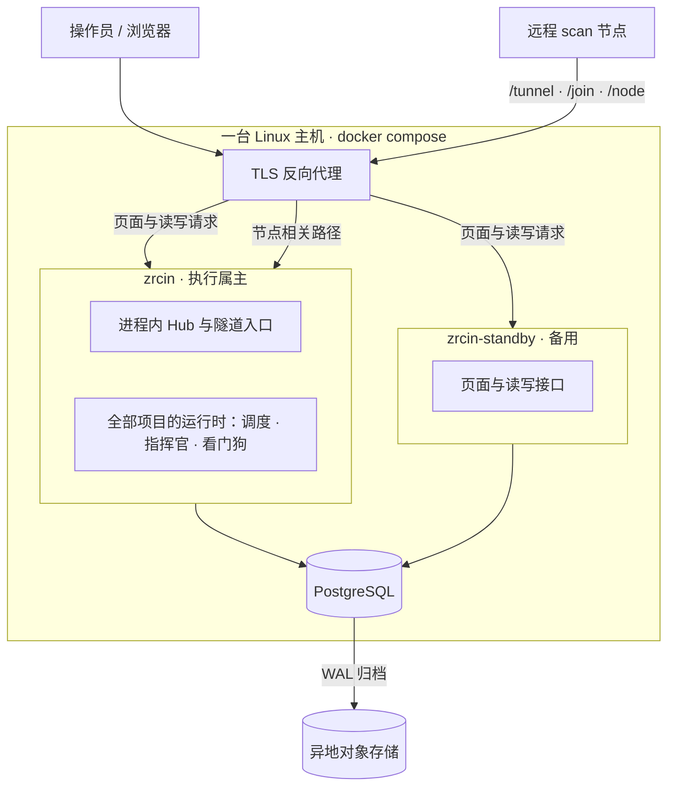

# 16 server 模式：双形态存储与故障接管（实施文档）

状态：**方案，未实施**（2026-11-26）。它给同一个二进制增加第二种部署形态：桌面形态是现状（单进程、SQLite、本地盘），server 形态以 PostgreSQL 为唯一真相，并支持实例故障后的自动接管。设计取向见 [agent.md](../agent.md)，现行架构见 [docs/01](01-architecture.md)，测试与验收见 [docs/17](17-server-mode-acceptance.md)，远程节点的接入与文件合同见 [docs/14](14-nodes.md)。文中的行号是 2026-11-26 调查时 `feat/remote-nodes` 工作树上的位置，只用于定位，不是契约。

## 0. 目标与边界

**目标**：server 形态下，执行属主实例挂掉后约一分钟内由备用实例接管，已提交的数据不丢；除执行节点上的工作树外，状态都放进 PostgreSQL。

**边界**：

- 桌面形态的行为逐项不变。
- 第一版只做「一个执行属主加若干备用实例」。按项目分片留到增强阶段。
- **当前实施范围是 §13 的 M0 最小路径**：单实例 server、无接管、文件留在卷上；P0–P4 是 M0 之后的后续路径。
- 不做：Kubernetes、PostgreSQL 自动主备切换、Hub 独立成高可用服务、多租户、旧账本迁移（现有数据均为测试数据）。

## 1. 决策记录

| 编号 | 决定 | 状态 |
| --- | --- | --- |
| Q1 | 高可用做到「自动接管」：同一时刻一个执行属主，故障后由备用实例接管；按项目分片留到增强阶段 | 已确认 |
| Q2 | 同一个产品、两种部署形态，差异全部由运行参数决定 | 已确认 |
| Q3 | 单团队多账号，不做多租户 | 已确认 |
| Q4 | docker compose 起步，不假设 Kubernetes | 已确认 |
| Q5 | 「去掉全量内存」与「换引擎」是两件事：先在 SQLite 上做前者，PostgreSQL 最后只替换持久化外壳 | 已确认 |
| Q6 | 接管后项目默认暂停；「自动继续」是按项目的开关 | 已确认 |
| Q7 | 用运行参数切换形态，不用编译标签 | 已确认 |
| Q8 | PostgreSQL 单主加 WAL 归档；有第二台主机时加流复制备机；不做自动主备切换 | 已确认 |
| Q9 | 入库范围按 §9.1 的八类划分 | 按推荐落笔，待确认 |
| Q10 | 任何实例直接写库，实例之间不转发 | 按推荐落笔，待确认 |
| Q11 | PostgreSQL 沿用通用行模型，不按对象拆表 | 按推荐落笔，待确认 |
| Q12 | 接管按「会话不保留」设计；续接远程节点上的会话分两步作为增强 | 按推荐落笔，待确认 |
| Q13 | 第一版用实例级租约 | 按推荐落笔，待确认 |
| Q14 | 快照按项目版本缓存，不把整库算法改写成查询 | 按推荐落笔，待确认 |
| Q15 | 全文检索默认用 `pg_trgm` | 按推荐落笔，待确认 |
| Q16 | 现有数据均为测试数据，不做旧账本迁移 | 已确认 |
| Q17 | 最小路径（M0）：跳过 P0，PostgreSQL 作为现有内存模型后面的持久化层，装载与提交与 SQLite 同构；文件留在卷上；不做接管。Q5（先去全量内存）推迟到 M0 之后 | 已确认 |

「按推荐落笔」的条目按调查后的推荐答案写成了完整设计。改动其中一条只影响对应小节，不影响其他决定。

## 2. 已核实事实（构成约束）

| # | 事实 | 出处 |
| --- | --- | --- |
| 1 | 账本是内存镜像加进程内互斥锁，启动时装载一次、从不重载。`Store` 没有接口，只有 `resource.Ledger` 这个六方法的只读接口 | `internal/store/store.go:65-98`、`internal/store/sqlite.go:96-108`、`internal/resource/resource.go:40-47` |
| 2 | 169 个导出方法全部「上锁、改内存切片、落盘」。没有任何条件 SQL 写，唯一性与幂等靠内存扫描。`ClaimIntent` 没有正式调用方，派发走 `StartIntentRun` | `internal/store/store.go:187-190,237-275`、`internal/store/admission.go:12-63` |
| 3 | 版本日志每次内容写入存整份行内容，无上限，打开时全量载入；至少六条热路径读它 | `internal/store/sqlite.go:158-172`、`internal/store/memory.go:248-362`、`internal/store/routing.go:417-428`、`internal/store/attention.go:108-111` |
| 4 | 每次提交把 `Memory`（去掉历史）整体序列化写回单行 `meta`，其中混有按意图、按收件人、按待办增长的状态 | `internal/store/sqlite.go:299-307`、`internal/store/memory.go:42-80` |
| 5 | 每次写入用反射逐行深比对选出改动，代价正比于该类的行数 | `internal/store/memory.go:305-336` |
| 6 | 包外约 68 个函数直接吃整个 `store.DB`，约 230 处切片读取。`GetIntent`、`GetRun` 是线性扫描，各有约 71、59 处调用 | `internal/board/board.go:455`、`internal/api/prompt.go:96`、`internal/report/validate.go:18`、`internal/store/store.go:229,742` |
| 7 | 控制台全靠轮询（看板 5 秒、运行 4 秒、fleet 3 秒、图谱变更探测不少于 3 秒）。浏览器唯一的 WebSocket 是节点终端 | `web/src/App.tsx:79`、`web/src/views/Runs.tsx:95`、`web/src/views/Fleet.tsx:490`、`internal/api/terminal.go:58` |
| 8 | 登录凭证是无状态的签名令牌（HS256，没有会话表），只由启动时读入的 `jwt.key` 验签 | `cmd/zrcin/auth.go:267-272,1240-1264`、`internal/account/jwt.go:82-100` |
| 9 | 启动即无条件接管：打开全部项目、强制暂停（`restart_pause`）、崩溃对账。恢复由操作员触发，`redispatchInterrupted` 重派被 `restart` 中断的意图，预算 3 次且不计 restart | `cmd/zrcin/hub.go:254-288,660`、`internal/api/dispatch.go:567-606`、`internal/lifecycle/lifecycle.go:717-759`、`internal/api/redispatch.go:14-101` |
| 10 | 启动时把指向其他 Hub 端点的会话标记改名为 `.stale`，扫描范围是全部项目。孤儿清理按命令行里的数据目录找进程 | `cmd/zrcin/main.go:337,385`、`internal/host/stale.go:56-104`、`internal/host/orphans.go:108-140` |
| 11 | 只有附加没有分离：停止项目运行时的唯一路径是删除项目 | `cmd/zrcin/hub.go:2816-2925` |
| 12 | 只存在于进程内存的状态：会话凭证注册表（24 小时）、通知队列（未发出的在崩溃时丢失）、run 实时脉冲、登录限流、交接重试标志 | `cmd/zrcin/main.go:482`、`internal/collab/collab.go:89-114`、`internal/notify/engine.go:16-66`、`internal/decider/runner.go:97-161` |
| 13 | 唯一的互斥是控制台端口绑定，没有 PID 或锁文件 | `cmd/zrcin/main.go:116-125` |
| 14 | 看门狗 30 秒一拍，回收本进程登记表里不存在的超过 2 分钟的 run。优雅停止的证据窗口不超过 90 秒 | `internal/api/dispatch.go:611-642`、`internal/lifecycle/lifecycle.go:796-809`、`cmd/zrcin/hub.go:2930-2947` |
| 15 | Hub 默认内嵌在控制面进程，与本机 scan 同生共死（Linux 用 Pdeathsig，Windows 用 Job Object） | `cmd/zrcin-gate/main.go:153-160`、`internal/host/host_inproc.go:41-115`、`internal/host/proc_unix.go:15-31`、`internal/host/job_windows.go:13-25` |
| 16 | 节点与 Hub 断连即中止回合、取消已接受的工具调用、不缓存任何事件。会话留在节点内存，节点以 1、2、4、8、10 秒的间隔永远重连 | cyber-harness `pkg/node/proto_connection.go:73-105,165,242-253`、`agent/session/session.go:694-727` |
| 17 | 对话内容只在 scan 节点的内存里。Hub 库存会话登记与事件流；本地这份 392 MB 中 98.6% 是事件流 | cyber-harness `agent/session/runtime.go:27-60`、`pkg/web/service/store_schema.go:40-62`；本地实测 |
| 18 | 节点丢了上下文时 Hub 发出 `session_context_reset`，控制面没有处理它的代码 | cyber-harness `pkg/web/service/events.go:120-130`；4zrcin 内检索无匹配 |
| 19 | Hub 地址、接入密钥、数据目录路径都写进了会话：地址变则会话标记全部作废，密钥变则节点永远 401，端口被占则 Hub 退到临时端口 | `internal/aopexec/executor.go:239`、`internal/api/agent.go:125-138`、`internal/host/host.go:1190-1205`、[docs/02](02-deploy.md) |
| 20 | Hub 接入密钥由控制台密钥对数据目录路径做 HMAC 派生。IOA 观察器 ID 是绝对目录的哈希，项目 ID 就是目录名，`Run.LogPath` 是绝对路径 | `cmd/zrcin/auth.go:371-377`、`internal/ioa/observer.go:86`、`internal/project/project.go:581`、`internal/model/model.go:1097` |
| 21 | `api_base` 由 `--addr` 推出（通配映射成 `127.0.0.1`），写进 `identity.json`、指挥官提示词、会话环境、通知链接和节点接入地址 | `cmd/zrcin/main.go:697-716`、`internal/api/commander.go:117-150`、`internal/aopexec/sessionenv.go:43-50` |
| 22 | 没有文件系统抽象：运行代码约 450 处直接读写文件，约 312 处在项目目录内。证据、工件、抓包三个内容寻址库各自收口在一个包里，构造时只收根路径。抓包列表没有索引 | `internal/evidence`、`internal/artifact`、`internal/traffic`、`internal/api/http_flows.go:18-43` |
| 23 | 实例级状态分散在 `account.db`、`jwt.key`、`settings.json`（含模型 key）、数据目录之外的 `~/.cyber/cyber.yaml`、`notify.json`、`nodes.json` | `cmd/zrcin/main.go:177-187,271,296,305`、`internal/settings/settings.go:50-58` |
| 24 | 本地实测（最大的项目）：账本 6.5 MB（1,887 条对象、2,054 行版本日志），run 日志 126.5 MB 共 130 个，`cases/` 约 33 万个文件 414 MB | 2026-11-26 测量 `data/` |
| 25 | 存储包有 254 个测试，统一经 `open(t)` 打开临时 SQLite 账本。宿主集成测试由 `ZRCIN_HARNESS_BIN`、`ZRCIN_SCAN_BIN` 显式启用，未设置时跳过 | `internal/store/store_test.go:12-18`、[验收说明](../scripts/acceptance/README.md) |
| 26 | docs/14 的文件合同（回合种子、交接文件经 sidecar 回传、证据从工件库结算）已随 1b 落地，它是异机节点不再依赖共享文件系统的前提 | [docs/14](14-nodes.md) §8 |
| 27 | gate 只有一份实现，Windows 与 Linux 检查项相同。文档链接检查只查已跟踪的文档 | [贡献指南](../CONTRIBUTING.md#开发环境与检查)、`scripts/check-docs.mjs` |

未核实：Hub 的存储层有没有可换后端的接缝；Hub 能否给一个只靠节点重新登记的会话派回合；`VACUUM INTO` 是否重排 `objects.rowid`；IOA 原始观察的目录结构与体积。

## 3. 用户故事

形态与配置：

1. 作为操作员，我希望桌面版保持单二进制、零外部依赖，以便在离线现场直接使用。
2. 作为操作员，我希望同一个可执行文件既能当桌面版又能当服务端，以便不用维护两套产物，也不会拿错版本。
3. 作为操作员，我希望只给一个数据库连接串和一个公网地址就进入服务端形态，以便部署时不必理解内部细节。
4. 作为操作员，我希望配置不完整或库的版本对不上时，启动就报清楚问题在哪，以便不会带着半套配置上线。
5. 作为操作员，我希望服务端形态下页面和接口的行为与桌面版一致，以便不用重新学习。
6. 作为维护者，我希望服务端形态在一台 Linux 主机上用一份 compose 就能起来，以便没有 Kubernetes 也能高可用。

数据与文件：

7. 作为操作员，我希望账本、日志、证据、报告都在同一个数据库里，以便只备份一处。
8. 作为操作员，我希望证据和它所属的事实要么都写入成功，要么都没写，以便不会出现事实在而原件丢。
9. 作为操作员，我希望抓包列表、运行事件、审计记录在接管之后仍然完整可查，以便一次故障不丢历史。
10. 作为操作员，我希望从桌面版导出的项目能导入服务端、反之亦然，以便在两种形态之间搬项目。
11. 作为复核者与报告器，我希望接管后读到的账本与故障前已提交的内容一致，以便结论不建立在丢过的数据上。
12. 作为操作员，我希望实例挂掉不丢任何已提交的写入，最坏只丢没落库的实时脉冲，以便对数据有确定的预期。
13. 作为维护者，我希望本地磁盘上只有可重建的草稿，以便换一台实例不需要搬文件。

写入与协调：

14. 作为操作员，我希望在任意一个实例上操作都生效，以便不用关心反代把请求发给了谁。
15. 作为操作员，我希望我的操作和属主的调度撞车时不会互相覆盖，以便不会出现谁后写谁赢。
16. 作为指挥官，我希望别的实例上产生的变化能及时让我知道，以便不会对着过期状态决策。
17. 作为执行者，我希望我的会话凭证在任何实例上都被接受，以便不需要知道自己连的是哪一台。
18. 作为执行者，我希望实例切换后旧凭证被明确拒绝并说明原因，以便不会把失败误当成自己的问题。

接管：

19. 作为操作员，我希望执行属主挂掉后一分钟内由备用实例接管，以便不用手动重启。
20. 作为操作员，我希望接管后项目默认暂停并写明「实例切换」，以便先看清现场再继续。
21. 作为操作员，我希望可以按项目打开「自动继续」，以便无人值守时工作不中断。
22. 作为操作员，我希望接管只处理故障前在跑的项目，已暂停的项目不被打扰。
23. 作为操作员，我希望接管在控制台上有记录（谁、何时、中断了哪些 run），以便事后能审计。
24. 作为操作员，我希望属主失联、等待接管期间页面仍可读，并明确提示正在接管，以便知道发生了什么。
25. 作为操作员，我希望计划内重启也走同一条接管路径并在十几秒内完成，以便升级不比故障更麻烦。
26. 作为维护者，我希望旧属主一旦确认丢失租约就退出，以便不会有两个属主同时发号施令。
27. 作为维护者，我希望旧属主的迟到写入被数据库拒绝，以便隔离不依赖进程一定按时死掉。
28. 作为维护者，我希望备用实例启动时不去碰正在运行的项目，以便扩容或重启备用机不会打断业务。
29. 作为维护者，我希望同一时刻只可能有一个执行属主，以便同时启动两台也不会脑裂。

会话与节点：

30. 作为执行者，我希望 Hub 断连时当前回合被干净地中止而不是半途继续，以便不会留下做了一半的外部动作。
31. 作为操作员，我希望被中断的意图在我点继续后自动重新派发，以便不用手工重建。
32. 作为操作员，我希望接管后节点自动回连而不需要重新接入，以便远程主机不用人工干预。
33. 作为指挥官，我希望会话历史丢失时拿到完整任务书重建，以便不会在空会话里被误以为记得历史。
34. 作为维护者，我希望节点相关的连接和终端始终落到执行属主那个实例，以便不会出现连得上却派不出回合。

运维：

35. 作为维护者，我希望数据库自身有异地归档，以便主机损毁后能恢复到几分钟内。
36. 作为维护者，我希望有一份恢复演练步骤并量出 RPO 与 RTO，以便备份不是纸面的。
37. 作为维护者，我希望签名密钥、数据库口令、隧道密钥统一从环境注入，以便不落在镜像或仓库里。
38. 作为维护者，我希望构建清单记录 PostgreSQL 契约测试是否跑过及其版本，以便知道这个产物验证过什么。
39. 作为维护者，我希望回滚只是改回配置，以便出问题能快速退回桌面形态或上一版。

开发体验：

40. 作为开发者，我希望同一套存储测试在 SQLite 和 PostgreSQL 上各跑一遍，以便两个后端行为一致不靠人盯。
41. 作为开发者，我希望没有数据库时日常 `go test` 照常能跑，PostgreSQL 测试显式跳过并出声，以便桌面功能的开发循环不变慢。
42. 作为开发者，我希望接管逻辑能在测试里用可注入的时钟验证，以便不用真的等 30 秒。
43. 作为开发者，我希望 Windows 和 Linux 上跑同一套检查，以便不因为平台差异漏测。
44. 作为编码代理，我希望接缝只有一处、文档写明哪些事实已核实，以便改动时知道边界在哪里。

规模与性能：

45. 作为维护者，我希望实例的内存和打开项目的时间不随历史长度增长，以便数据积累后不必靠重启或扩容解决。

检索：

46. 作为指挥官，我希望按中英混合的关键词仍能查到相关事实，以便换库之后检索能力不退化。

## 4. 总体设计

### 4.1 形态判定

给了 PostgreSQL 连接串（参数 `--postgres` 或环境变量 `ZRCIN_POSTGRES_DSN`）就是 server 形态，否则是桌面形态。server 形态必须同时给出 `--public-url`（[docs/14](14-nodes.md) §3.1），缺了启动失败并说明原因：会话、提示词与节点接入地址都要用它，不能是回环地址。最小路径下 server 形态只有单实例；`/healthz/lease`、备用实例与按实例的路由属于 P2。

### 4.2 三条不变量

1. **同一时刻只有一个执行属主。** 第一版它是实例级的：持有者拥有全部项目，只有它调度、派发、唤醒指挥官、承接节点的连接。
2. **PostgreSQL 是唯一真相。** 任何实例都能读、都能写。机器写者（属主的后台流程、带会话凭证的请求）的写入必须带当前纪元，旧纪元一律拒绝；操作员的写不受纪元限制。
3. **本地盘只是草稿区。** 服务一个请求所需的一切都来自 PostgreSQL。执行节点上的工作树留在节点磁盘，只有声明出来的产物进库。

### 4.3 部署形态

两个 zrcin 服务用同一个镜像，各有自己的草稿目录，在自己的网络名字空间里绑定相同的端口。Hub 地址从节点的角度因此是稳定的：隧道节点经平台的 `/tunnel` 到达属主，不依赖某一台实例的地址。

### 4.4 三个只增计数

| 计数 | 存放 | 谁递增 | 用途 |
| --- | --- | --- | --- |
| 提交序号 `commit_no` | 项目状态行 | 每个提交事务 | 快照缓存的键。消息这类不唤醒指挥官的提交也递增它 |
| 唤醒序号 `rev` | 项目状态行 | 与今天进程内 `rev` 相同的那些写 | 唤醒指挥官的信号 |
| 版本水位 `seq` | 版本日志 | 写版本日志的提交 | 读版本与历史重放的水位 |

三者分工固定：缓存是否有效只看 `commit_no`，是否唤醒只看 `rev`，读到哪个版本只看 `seq`。

### 4.5 三种使用体验

- **操作员**：部署只多一个连接串和一个公网地址；页面与桌面版一致；接管在页面上看得见（§7.7）。
- **开发者**：一个二进制、一套检查、两个平台不变；新增的依赖只有一个可跳过的 PostgreSQL。
- **模型与编码代理**：会话凭证在任何实例上都有效，实例切换时得到专属的错误码而不是含糊的失败；文档把已核实的事实与接缝写在明处。

## 5. 存储

### 5.1 接缝

`Store` 对调用方的 169 个方法不变。每个方法拆成三步：**取**（按主键或查询取出规则用到的行）、**算**（不碰存储的规则）、**存**（一个事务提交改动）。取与存收在一个后端接口后面，SQLite 与 PostgreSQL 各一份实现，现有只读接口 `resource.Ledger` 并入其中。后端接口提供：

- 按主键取、写、删，并管理版本、序号与版本日志；
- 按键读写元数据；
- 按类列出与筛选；
- 关系与全文索引的维护；
- 头版本、某水位之后的变更、某版本的行。

行的解码已经集中在一处（`appendRow`），两个后端共用。

今天的规则里只有少数已经是纯函数，其余直接读内存切片，另有一组 `*Locked` 辅助函数直接读整库状态。切接缝时把这些「读切片」改成「接收行作为参数」，规则本身不变。

### 5.2 六类方法，六种对待

| 类别 | 数量 | 今天的做法 | server 形态的做法 |
| --- | --- | --- | --- |
| 按主键读写 | 100 | 扫切片，上锁改内存 | 主键查询；带版本号的条件写；唯一约束接替内存去重 |
| 整类列表 | 18 | 拷贝整个切片 | 按类查询，常用筛选建索引 |
| 跨类遍历与聚合 | 17 | 扫全表，临时建索引 | 图遍历走关系表的递归查询；按游标的走版本日志的范围查询 |
| 快照与分页 | 19 | 克隆整个内存状态；旧版本靠重放全部历史 | 按提交序号缓存快照；旧版本按需重放 |
| 搜索 | 6 | FTS5 与向量表 | `pg_trgm` 与向量列，排序会变 |
| 维护 | 9 | 快照、重建索引等 | 逻辑导出与导入 |

失效传播与依赖环校验是 17 个跨类方法里最重的两个：今天都要先给全部意图和事实建索引，改后走 `relations` 表（它已经存了前提、产出、证据等边，邻域读取今天就在查它）。

### 5.3 PostgreSQL 的数据形状

| 表 | 对应今天 | 键与索引 |
| --- | --- | --- |
| `objects` | `objects` | 主键（项目、类型、ID）；按（项目、类型、位置、ID）排序；按规则用到的字段建表达式索引 |
| `changes` | `versions` | 主键（项目、序号）；记录版本日志的规则不变 |
| `relations` | `relations` | 主键同今天；来源、目标各一个索引；图遍历用递归查询 |
| `project_state` | `meta` 的标量部分 | 每个项目一行：属主纪元、三个计数、消息游标、内容哈希 |
| 元数据行 | `meta` 里按实体增长的部分 | 复核游标（按意图）、投递（按名称）、待路由变更、原生邮箱游标、检查点，各按实体键存放 |
| 全文与向量 | `fact_search`、`vectors` | 事实行上的 `pg_trgm` GIN 索引；向量按（模型、哈希） |

payload 用 JSONB。不按对象拆表（Q11）的理由有三：按主键的 100 个方法、关系表、版本日志表与通用行模型一一对应；包外 68 个整库函数要的是 Go 结构体，拆表帮不上它们；模型字段变化不产生数据库迁移。代价是没有数据库级的字段约束，由领域规则承担，今天也是如此。个别要扫全表的规则需要补几列或补索引时，单独提出。

全文检索默认用 `pg_trgm`（Q15）：它与现在的三字符切分最接近，官方镜像自带。排序与 FTS5 的 bm25 不同，检索测试要重新校准。全文检索在这里只是候选生成，还有一条完整的词法路径兜底。

### 5.4 三处结构性改动

1. **版本日志不再在打开时载入。** 它成为按序号存的 `changes` 表。热路径只读「某个水位之后」的范围；重建旧快照时才按需重放，沿用现在那个最多 4 份的小缓存。
2. **`meta` 拆开。** 标量部分留在项目状态行，每次提交更新它。按意图、按收件人、按待办变化分开的状态各成按键访问的行，一次提交只动到相关的那几行。第一版可以按桶分行，桶大了再按实体拆。
3. **快照按提交序号缓存。** 包外 68 个整库函数不改。第一次用到时从行里建出快照，之后按项目的 `commit_no` 缓存；每个请求先用一次很小的查询核对，变了才重建，闲置就淘汰。

### 5.5 快照缓存

读请求固定在一个 `commit_no` 的快照上，整个请求看到同一个版本；写事务在自己的事务里按键重读。缓存以已提交的序号为键，不会读到与库里不一致的数据。

内存从「正比于全部历史加所有项目」变成「正比于这个实例上被访问到的项目的当前行」。它不是零内存：被访问的项目，当前行仍在该实例的内存里，现在约 2 MB 一个。

提交序号变化后，第一版直接重建快照。按现在的规模，一次重建是读出约两千行，而每个项目每分钟的提交通常不到十次，重建不会成为热点。当单个项目的当前行超过约十万行、或一次重建超过 100 ms 时，再改成按提交增量维护；这两个数是初始的触发条件，首轮测量后修订。

### 5.6 SQLite 后端

第一步在 SQLite 上落到同一形状（Q5）：打开时不载入版本日志，读走同一个快照缓存。桌面形态只有一个写者，核对提交序号是一次内存比较，不发查询；串行化仍由进程内互斥锁负责。

### 5.7 不做的

- 不把整库算法改写成查询（Q14）。
- 不按对象拆表（Q11）。
- 不引入向量检索扩展：向量只是按哈希取的缓存，今天没有近邻查询。
- 第一版不做快照的提交增量维护（触发条件见 §5.5），也不改掉反射比对（留到 P4）。

## 6. 写入与协调

**任何实例都能写**（Q10）。实例之间没有调用通道，反代可以把请求发给任何一个健康实例。

一个写事务的形状：

1. 更新该项目的状态行：提交序号加一，机器写者同时校验属主纪元。行锁在这里把同一项目的写入串行化，取代今天的进程内互斥锁。
2. 按主键取出规则要用的行。
3. 跑规则。
4. 写入改动：带版本号的条件写、版本日志、受影响的元数据键、关系与全文索引。
5. 提交后发出变更通知。

**决定与动作分开。** 属主根据读到的状态决定派发，派发本身是一次条件写（状态与版本都匹配才改成已认领），没有写进去就重读再来。

**变更传播。** 属主用一个专用连接监听 PostgreSQL 的通知，通知只带项目标识；另有一个 1 到 2 秒的轮询兜底。两者都只是提示，属主总是回库读唤醒序号与真实状态。

**纪元的范围。** 机器写者是属主的后台流程和带会话凭证的请求，它们的写入带纪元。操作员经控制台登录后的写不带纪元，只受正常的版本检查约束。

**会话凭证。** server 形态下从进程内注册表改为库里的一张表：凭证哈希、项目、意图、run、纪元、过期时间。任何实例用一次主键查询就能验证；撤销就是删行，纪元变化则整批失效。桌面形态仍是进程内注册表。

**属主缺位期间。** 属主死亡到接管完成之间，不触发调度的写（编辑目标、发消息、改指令）照收；会触发调度的写（继续项目等）被拒，返回「等待接管」。

**唯一性与幂等**由数据库约束表达：主键保证记录身份唯一，幂等键上建唯一索引。

**实例级限额**（辅助模型并发、按实例统计的执行者上限）随执行属主走。第一版只有一个执行属主，实际效果与今天相同。

## 7. 属主与接管

### 7.1 租约

PostgreSQL 里有一行执行租约，记持有者、纪元和最近续租时间。

| 项 | 取值 | 说明 |
| --- | --- | --- |
| 续租 | 每 5 秒 | 带纪元的条件更新；更新到 0 行即视为丢失 |
| 有效期 | 30 秒 | 最近续租早于 30 秒前，即可被抢占 |
| 丢失判定 | 连续 15 秒续不上 | 进入自我隔离 |
| 抢占 | 条件更新，纪元加一 | 多个备用实例同时尝试时恰有一个成功，失败者随机退避后重试 |
| 隔离收尾预算 | 5 秒 | 超时直接退出 |

时间都是初始值，首轮故障注入后按实测修订。

### 7.2 server 形态的启动

启动只做三件事：连库并校验 schema 版本；加载实例级配置；提供页面与读写接口。它不附加项目、不强制暂停、不做崩溃对账、不改会话标记；孤儿清理只认自己私有的草稿目录。没有持有租约的实例是备用实例。

今天启动时的那三样动作（事实 9、事实 10）在单实例下是对的，在多实例下会让一个新启动的实例打断正在工作的属主，所以它们全部改为持有租约后才做。

### 7.3 接管流程

持有者在取得租约（纪元从 e 变为 e+1）后，对每个项目执行：

1. 把项目状态行的属主纪元改为 e+1。此后旧属主的机器写入全部被拒。
2. 故障前在跑的项目走今天的启动接管路径，暂停原因记为 `failover`，界面显示「实例切换」：发送中的消息重排队；中断的交接记为失败并挂起；每个在跑的 run 记为取消，原因 `failover`；它的意图回到待派或等待，受托的记为失败。故障前已暂停的项目不动。
3. 写一条接管记录：纪元、上一个持有者、时间、被中断的 run。
4. 等节点回连，重连退避最长 10 秒。回连前不派发，否则回合得到的是 `UNAVAILABLE`。
5. 按项目的开关决定到此为止（默认，等人点继续），还是调用与「继续项目」相同的路径（自动继续，P3）。

`failover` 与 `restart` 在重派预算上同等对待，都不计入 3 次预算。

### 7.4 自我隔离

隔离的做法是退出进程。只有进程退出才会带走进程内的 Hub 与隧道入口，节点随即中止回合（事实 16）；活着但冻结的实例仍然握着节点的连接。流程：把 `/healthz/lease` 置为失败，在 5 秒预算内尽力把在跑的 run 记为 `failover` 取消并释放租约，然后退出。数据库不可达时跳过中间一步。进程被挂起后恢复时，续租定时器早已过期，恢复后的第一次调度就会触发隔离。

### 7.5 计划内交接

升级或重启走同一条路径：持有者停止接新回合，等待证据窗口（不超过 90 秒），以 `restart` 原因取消在跑的 run，分离全部项目，释放租约，退出。备用实例立即取得租约，不必等 30 秒有效期。

### 7.6 反向代理

每个实例暴露 `/healthz/lease`：持有租约且数据库可达时返回 200，否则 503。反代规则只有两条：

- 节点相关路径（docs/14 的 `/tunnel`、`/join`、`/node`，以及节点终端的 WebSocket）只发给 `/healthz/lease` 为 200 的实例。
- 其余请求在健康实例之间分发。

反代需要支持按路径路由、主动健康检查和 WebSocket 透传，选型见 §15。

### 7.7 控制台

实例状态条显示执行属主、最近续租时间和本实例的角色；属主失联时显示「等待接管」。项目的暂停原因「实例切换」与接管记录在项目页可查。接管记录不是新的账本对象，是审计事件里的一种。

## 8. Hub 与会话

**基线，必须成立：会话不保留。** 新属主的 Hub 是一个空库，预期续跑时找不到会话，走现有的 `resume_fallback` 路径，带完整任务书开新会话。中断的回合本来就不可能跨实例存活（事实 16）。

**必须补的一处：处理 `session_context_reset`。** Hub 地址不变而节点丢了上下文时，回合会落到空会话上，提示词却以为历史还在（事实 18）。收到该事件按「历史已丢」处理，带完整任务书重建。这是单实例下也存在的缺陷，在 P0 修复。

**三个前提。** Hub 地址跨实例稳定，server 形态不允许退到临时端口；接入密钥各实例相同（§10）；接管后等节点回连再派发。

**增强一（可选）。** Hub 的会话登记放进 PostgreSQL，远程节点上活着的会话可以被新属主续接。要搬的是几十行登记，不是事件流（事实 17）。

**增强二（可选）。** Hub 的事件流也放进 PostgreSQL，接管后运行审计不断档。

**不做。** Hub 独立成高可用服务。

**本机 scan。** 它随实例一起死，节点身份又由数据目录路径派生，接管后续不上。server 形态的执行面应当是远程节点；本机 scan 是否默认关闭见 §15。

新属主的 Hub 对旧会话究竟返回「找不到」还是接受节点的重新登记，尚未核实。两种结果都必须落在同一个行为上：回合要么落在上下文完整的会话，要么落在带完整任务书的新会话，绝不落在被误认为有历史的空会话。这一点由宿主集成测试钉住（[docs/17](17-server-mode-acceptance.md) 的 H3、H4）。

## 9. 文件入库

### 9.1 八类，各归其位

| 类别 | 成员 | 去向 | PostgreSQL 里的落点 |
| --- | --- | --- | --- |
| 只追加的事件流 | run 日志、决策日志、范围决定记录、阶段指标、操作员审计记录、IOA 原始观察 | 进库 | 按流分区的事件表，键是（流、序号） |
| 写完不改的二进制 | 证据原件、工件、抓包正文与元数据 | 进库 | 二进制表，键是内容哈希或稳定身份 |
| 必须留存的产出 | 报告、每轮下发的任务书存档 | 进库 | 产出行加二进制表 |
| 访问材料 | `.access/` 的条目与租约，含密钥 | 进库 | 与会话凭证同一保护级别 |
| 结构化的用户内容 | 知识库条目与候选、漏洞库 | 进库 | 各自的表 |
| 每轮重新生成的输入 | `.zrcin` 里的任务书、焦点、前提分页、技能与知识库副本 | 不进库 | 属主的草稿目录，随回合种子下发（docs/14 §8） |
| 活的工作树 | case 工作文件、指挥官工作区、复核草稿 | 不进库 | 执行节点与属主的草稿目录 |
| 工具与模板目录 | POC 库、arsenal、内置技能 | 不进库 | 扫描引擎按目录读 |

好处是全系统只有一份要备份的东西，WAL 归档同时覆盖账本、日志、证据和实例状态；证据与它所属的事实可以在同一个事务里提交，不再有「事实在、原件丢」的半个状态。代价是「项目即目录」变成「项目即库里的一组行」，离线工具与迁移包都要改成经库读写。库会变大，按现在的规模仍在 PostgreSQL 的舒适区内（事实 24）。

证据、工件、抓包三个库已经各自收口在一个包里（事实 22），换库只动包的内脏。run 日志按事件行存，不做大对象。

### 9.2 四类身份改用稳定键

| 身份 | 今天 | 改为 |
| --- | --- | --- |
| 项目 ID | 目录名 | 库里的主键；桌面形态下仍取目录名 |
| run 日志路径 | `Run.LogPath` 存绝对路径 | 按 run ID 寻址 |
| Hub 接入密钥 | 控制台密钥对数据目录路径做 HMAC | 控制台密钥按固定域派生 |
| IOA 观察器 ID | 绝对目录的哈希 | 按实例编号派生 |

不换的后果各有一条：路径或密钥随实例不同，接管后节点回连会被拒，旧会话全部作废（事实 19、事实 20）。

### 9.3 迁移包

`.twproj` 仍是桌面与 server 之间唯一的搬运方式，包内账本的规范格式仍是 SQLite 快照。server 导入时把快照里的行写进库，导出时把行渲染成快照。包的格式与校验规则不变（[docs/01](01-architecture.md) 第 3 节）。

## 10. 实例级状态、配置与密钥

| 状态 | 今天 | server 形态 |
| --- | --- | --- |
| 账号 | `account.db` | 库 |
| 设置与模型连接 | `settings.json`、`~/.cyber/cyber.yaml` | 库；各实例据此在草稿目录渲染自己的宿主运行配置 |
| 通知配置与队列 | `notify.json`、进程内存 | 库；未发出的通知不再因崩溃丢失 |
| 节点登记、接入记录、节点档案、部署任务 | `nodes.json`、docs/14 的 JSON 文件、进程内存 | 库 |
| 会话凭证注册表 | 进程内存 | 库（§6） |
| 执行租约 | 无 | 库（§7.1） |
| 知识库条目、漏洞库 | `<data>/kb`、`<data>/vulns` | 库 |
| 控制台签名密钥 | `<data>/jwt.key` | 环境变量 `ZRCIN_JWT_KEY`，各实例相同 |
| Hub 接入密钥、隧道密钥 | 由控制台密钥与数据目录路径派生；`<data>/tunnel.key` | 由控制台密钥按固定域派生，不再依赖路径，各实例相同 |
| PostgreSQL 连接串 | 无 | 参数 `--postgres` 或环境变量 `ZRCIN_POSTGRES_DSN` |
| 宿主运行配置、会话环境脚本、本机标记 | `<data>/host`、`<data>/harness` | 实例私有的草稿目录，可重建 |
| 工具与模板 | `<data>/.cyber`、`pocs/`、`arsenal/` | 镜像或卷里的只读目录 |

密钥一律从环境注入，不进镜像、仓库和日志；连接串带口令，建议只走环境变量。docs/14 目前把隧道密钥做成每实例一份文件，server 形态下要改为派生，落地时写回 docs/14 的对应段落。

## 11. 部署形态

| 参数或环境变量 | 作用 |
| --- | --- |
| `--postgres`、`ZRCIN_POSTGRES_DSN` | 给出即进入 server 形态 |
| `--public-url` | 控制台的公网基址，server 形态必填（docs/14 §7） |
| `ZRCIN_JWT_KEY` | 控制台签名密钥，各实例相同 |
| `ZRCIN_TEST_PG_DSN` | 只供测试使用（docs/17 第 3 节） |

- **compose 的服务**：`zrcin`、`zrcin-standby`、`postgres`、反向代理。实验环境可以再加一个对象存储供归档。
- **PostgreSQL**：16 或更高，启用 `pg_trgm`，驱动用 pgx。
- **schema 版本**：库里有一张版本表。启动时版本不一致就拒绝并说明，与账本 schema 的现行规则一致；自动迁移不在第一版。
- **备份**：单主，WAL 归档到异地对象存储，每天一份基线。恢复手册在 P1 交付。有第二台主机时加流复制备机，手工或脚本切换（Q8）。

## 12. 兼容性与失败模式

### 12.1 协议与数据

- HTTP 接口不变，新增 `/healthz/lease`。
- 旧纪元的会话凭证被拒时返回一个专属的错误码，不与普通的凭证失效混淆。
- `.twproj` 的格式与校验规则不变。
- P0 若改动了 SQLite 布局，递增账本的 schema 版本号，旧账本不支持（测试数据）。
- PostgreSQL 的 schema 由版本表管理，不匹配时拒绝启动。

### 12.2 授权

- 控制台登录凭证由共享密钥验签，任何实例都接受，不需要粘性会话。
- Hub 接入密钥与隧道密钥各实例相同，节点回连不需要重新接入。
- 会话凭证入库，带纪元；纪元是属主隔离的边界，不是操作员权限的边界。

### 12.3 失败模式

| 情形 | 行为 | 恢复 |
| --- | --- | --- |
| PostgreSQL 不可达 | 读写接口返回 503；持有者续租失败后自我隔离；备用实例也拿不到租约 | 数据库恢复后租约过期，备用实例接管 |
| PostgreSQL 重启 | 进行中的事务失败，写路径按今天提交失败的处理返回错误，不吞错 | 连接带退避重连；持有者在丢失阈值内续上则不触发隔离 |
| 多个备用实例同时抢占 | 恰一个成功 | 失败者随机退避后重试 |
| 通知丢失 | 唤醒延迟不超过轮询间隔 | 轮询兜底 |
| 节点尚未回连 | 不派发 | 回连后由待办与心跳唤醒 |
| 旧属主没有按时退出 | 它的机器写入被纪元拒绝；它的回合随 Hub 消亡而中止 | 由编排器把它重启为备用实例 |
| 快照缓存过期 | 每个请求先核对提交序号，不一致就重建 | 无需处理 |
| 属主缺位期间操作员操作 | 不触发调度的写照收；触发调度的写被拒并说明「等待接管」 | 接管完成后重试 |
| 数据库主机损毁 | 全停 | 从基线加 WAL 归档恢复；RPO 为归档间隔，RTO 以恢复演练实测为准 |

## 13. 实施顺序

| 阶段 | 做什么 | 跑在哪 | 依赖 | 完成条件（见 docs/17） |
| --- | --- | --- | --- | --- |
| M0 | 最小路径：PostgreSQL 作为现有内存模型的持久化层，实例状态入库，compose 与备份；文件留卷，无接管 | server，单实例 | 无（docs/14 的节点接入已落地） | C2–C4、C6、C8、C10–C13、A1、A2、L0、H4、E10、E11、B1–B5、N1–N5 |
| P0 | 切接缝：规则与持久化分离，去掉打开时的全量载入 | 桌面 | 无 | C1、C3、C5、C6、A1、H4；现有验收脚本、gate、race 全绿 |
| P1 | 单实例 server：PostgreSQL 后端、文件入库、实例状态入库、compose 与备份 | server，单实例 | P0 | L0、C2–C8、C10–C13、A2、N1–N5、E10、B1–B5 |
| P2 | 接管，默认暂停：租约、附加与分离、纪元、凭证入库、变更传播、反代路由 | server，双实例 | P1；docs/14 的节点接入与文件合同 | C9、A3–A6、L1–L5、L7–L9、H1–H3、H5、E1–E9、E11 |
| P3 | 自动继续 | server，双实例 | P2 | L6、H4、E12；E1–E9 复跑 |
| P4 | 增强，各项独立：按项目分片、Hub 会话登记入库、Hub 事件流入库、提交增量维护快照、写入显式声明改动 | server | 按项 | 按项另定 |

M0 是当前实施范围（Q17）；P0–P4 在 M0 之后按需启动：数据量大到内存模型吃紧、或需要去掉全量内存时做 P0，需要高可用时做 P2、P3。各行完成条件不变。

每一步的内容：

**M0（单实例 server，现有内存模型不动，当前实施范围）**

1. PostgreSQL 后端：与 SQLite 同构的装载与提交路径；`objects`/`changes`/`relations`/`vectors`/`project_state` 的 schema 与版本表；`fact_search` 的 rowid 绑定改为显式列；全文检索用 `pg_trgm`；备份导出为 SQLite 快照。
2. 测试基建：存储测试的 `open(t)` 按后端参数化，`ZRCIN_TEST_PG_DSN` 提供库；gate 增加 PostgreSQL 契约步骤并记入清单。
3. 实例级状态入库：账号、设置与模型连接、通知、节点登记与接入记录；知识库、漏洞库与工具目录留卷，随卷备份。
4. 形态判定与启动校验；`api_base` 取 `--public-url`。
5. 迁移包：导入写 PostgreSQL，导出渲染 SQLite 快照，格式与校验规则不变。
6. `zrcin-metrics` 与 `zrcin-repair` 增加 `--pg-dsn`。
7. compose、反向代理、WAL 归档、卷快照与恢复手册。
8. 处理 `session_context_reset`（§8），配复现测试。

**P0（桌面形态，对外行为不变）**

1. 后端接口与 SQLite 实现：取、算、存三步，169 个方法对外不变。
2. 版本日志不在打开时载入，热路径改为按水位读。
3. `meta` 拆分：标量进项目状态行，按实体增长的状态按键存放。
4. 快照按提交序号缓存。
5. 条件写与唯一约束在后端接口里显式表达。
6. 证据、工件、抓包三个库与 run 日志各自收口到一个接口后面，实现仍是文件；`Run.LogPath` 改为按 run ID 寻址。
7. Hub 接入密钥与 IOA 观察器 ID 改为不依赖本地路径派生。
8. 处理 `session_context_reset`，配复现测试。

**P1（单实例 server，无租约）**

1. PostgreSQL 后端，通过存储契约套件。
2. 文件入库：事件表、二进制表、产出行、访问材料。
3. 实例级状态入库（§10）。
4. 形态判定与启动校验；`api_base` 取公网地址。
5. 迁移包：导入写库，导出渲染快照。
6. `zrcin-metrics` 与 `zrcin-repair` 经库读写。
7. compose、反向代理、WAL 归档与恢复手册。
8. gate 新增 PostgreSQL 契约测试，构建清单记录。

**P2（接管，默认暂停）**

1. 实例级租约、续租、自我隔离。
2. server 形态启动不附加项目；附加与分离成对。
3. 接管流程、`failover` 暂停原因与取消原因、接管记录。
4. 纪元：项目状态行的属主纪元与机器写者校验。
5. 会话凭证入库；变更传播。
6. 属主缺位期间的写规则。
7. `/healthz/lease` 与反代路由。
8. 控制台的实例状态条、暂停原因、接管记录。

**P3（自动继续）**

1. 按项目的「自动继续」开关。
2. 节点回连后才派发。
3. 故障注入全组复跑。

## 14. 风险与回滚

| 风险 | 缓解 |
| --- | --- |
| 68 个整库函数依赖内存里的 `store.DB`，改成按需建出后出现行为差异 | P0 不改这些函数；现有 254 个存储测试与接口测试全部保留；迁移包往返校验内容哈希 |
| 旧属主没有按时退出，出现两个属主 | 纪元拒绝其写入，Hub 随进程消亡使回合中止；专门的挂起恢复场景验证 |
| 反代切换慢于应用层接管 | 节点相关路径以 `/healthz/lease` 为准；量出切换时间 |
| 库体积与 WAL 量增长 | 只记录不设门槛；保留策略见 §15 |
| 文件入库存取大对象的成本 | 证据单文件上限 8 MiB（docs/01 第 1 节）；run 日志按事件行存 |
| 与 docs/14 的节点接入并行开发互相踩踏 | 两份工作改动的包不同。server 形态下接入记录与节点档案要进库，其实现已把文件读写收在 `internal/enroll` 后面 |
| 测试用的库成为开发负担 | 没有库时日常 `go test` 显式跳过；gate 用显式开关并记入清单 |
| M0 保留全量内存模型，打开时间随版本日志增长 | 记录规模基线；C5 推迟到 P0，作为那时改动的验收条件 |

每个阶段自成一块，可单独回退。server 形态由配置开启：去掉连接串即回到桌面形态，不需要回退二进制。P0 若改了 SQLite 布局，回退时换回旧数据目录（测试数据）。

## 15. 未决事项

1. Q9–Q15 的确认（§1）。
2. Hub 的存储层能否换成 PostgreSQL；新属主的 Hub 对旧会话的实际行为（§8）。两项都未核实。
3. 测试用的 PostgreSQL 从哪来：建议有 Docker 时由脚本起用完即删的容器，没有就用本机安装的（docs/17 第 3 节）。
4. server 形态下本机 scan 是否默认关闭：建议关闭，由操作员显式开启，并在控制台标明「不随接管恢复」。
5. 操作员导入的 POC 目录如何到达远程节点：docs/14 只分发二进制，未覆盖。
6. 保留期限：建议第一版不设新的保留策略，归档保留 30 天。
7. 反向代理的选型：需要按路径路由、主动健康检查、WebSocket 透传。
8. IOA 原始观察的结构与体积未核实，§9.1 把它归入事件流是按性质判断。
9. PostgreSQL 的 schema 版本：M0 即实现版本表加拒绝不匹配；前向迁移仍不做，有真实数据后再加。
10. docs/14 的节点接入落地进度，以及它与本文两个阶段的合并顺序。

## 16. 实施后的文档处理

按 [贡献指南](../CONTRIBUTING.md) 的约定，架构集中维护在 [docs/01](01-architecture.md)：

- P1 合入时，server 形态的存储与部署写入 docs/01 第 3 节与 [docs/02](02-deploy.md)，README 的部署段同步。
- P2、P3 合入时，租约与接管写入 docs/01 第 4 节，节点形态写入 [docs/14](14-nodes.md)。
- 实施中与本文不一致的决策先写回 §1 与 §15，再并入上述文档。
- 全部合入后本文删除。
